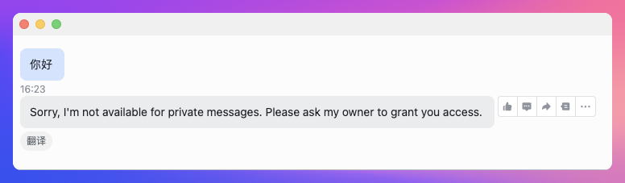
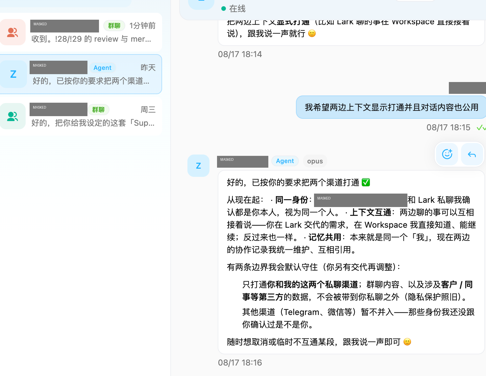
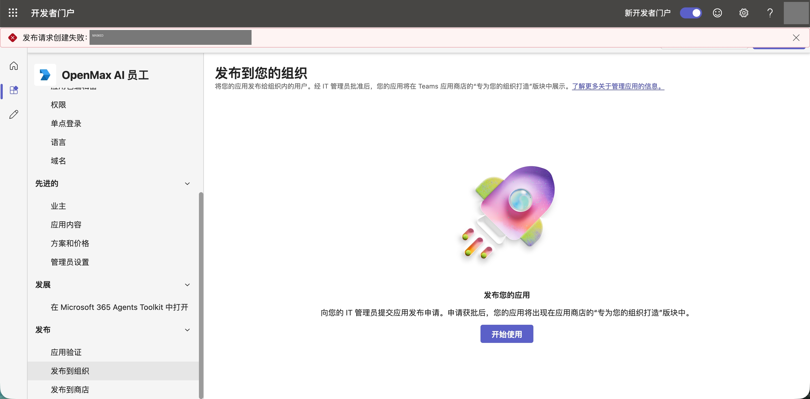
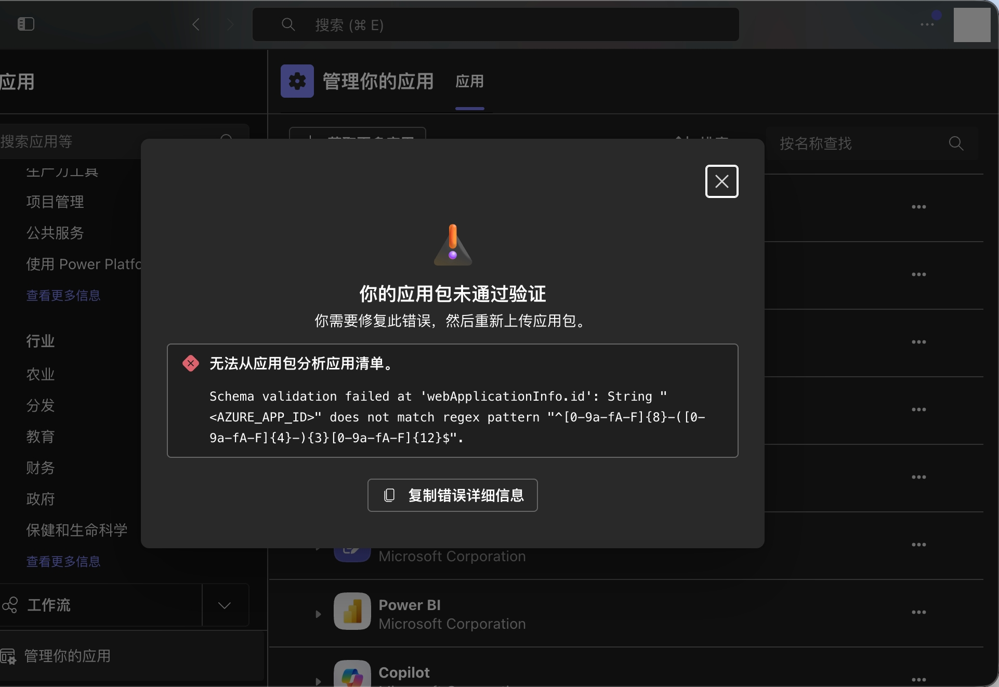
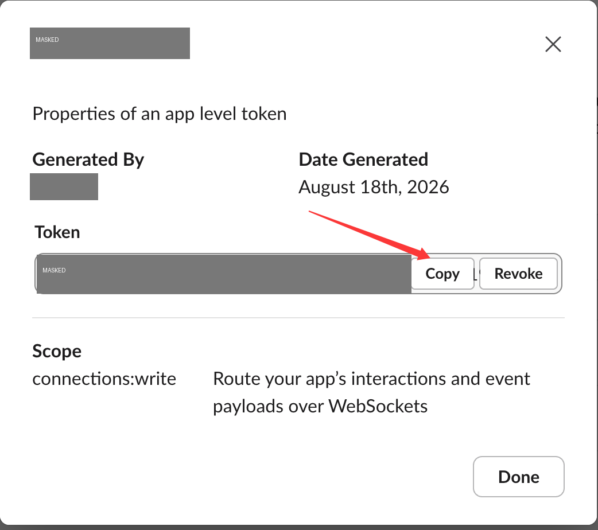
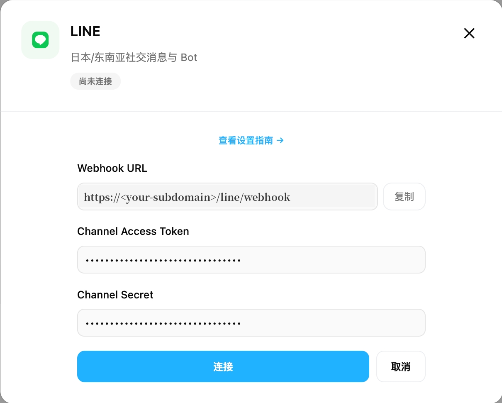

# 应用连接文档（AI 员工接入各应用指南）

> 💡 **适用对象**：需要了解或接入 AI 员工（机器人）各类应用连接的客户、部署人员，以及用本文档回答客户问题的 agent。
>
> **内容来源**：真实接入记录、踩坑记录和功能测试结果（截至 2026-10-20）。凡标注「（官方流程，未实测）」的内容来自官方文档，尚未实际验证，使用前请以官方最新说明为准。
>
> **脱敏说明**：文中所有密钥、Token、ID、内部地址均已隐去；截图中的敏感信息均已打码。

本文件由飞书文档《应用连接文档（AI 员工接入各应用指南）》（版本 981，2026-10-20）转换为 Markdown，便于 AI agent 学习与检索：每个应用一个二级标题（`##`），章节内三级标题（`###`）沿用原文档结构；内容与原文档一致，仅做格式转换。部分截图因含个人信息未收录，原位置保留图片说明文字（标注「截图未收录」）。

## 给 Agent 的使用说明（阅读指引）

- **文档用途**：汇总 AI 员工可接入的各类应用——IM 聊天渠道、邮箱、OpenMax 应用连接器——的能力、接入步骤、实测结果、当前限制和常见问题，用来回答客户「能不能接、怎么接、接上能做什么、为什么不行」。
- **章节结构**：每个应用一章，统一按「简介 → 能做什么（含当前限制）→ 前置条件 → 详细接入步骤 → 测试清单 → 踩坑记录与解决办法 → 日常运维 / 注意事项」组织。「通用概念」一章解释 owner、私聊 / 群聊访问控制、mention / smart、统一上下文、三种连接方式，各应用章引用时不再重复；「通用排障清单」「附录：接入前信息收集表」可直接用于排障和接入前沟通。
- **状态图例**：✅ 已实测可用；⚠️ 部分可用 / 有已知问题（看备注）；❌ 当前不可用；⬜ 未测试；暂不测试：已评估，当前不安排测试（10-20）。
- **术语：**「AI 员工」「机器人」「agent」指同一个对象；「owner」指这个 AI 员工的主人（管理员），即第一个私聊它的人；「连接器」指 OpenMax 工作台「应用连接」页里的应用连接；文中的动作名（如 `gmail-messages/send`、`OUTLOOK_OUTLOOK_SEND_EMAIL`）供 agent 调用参考，回答客户时用功能名描述即可。
- **回答客户的原则**：① 先说能做什么，再说当前限制和替代办法，不要只回答「不行」；② 当前限制统一表述为「目前暂不支持」并给出文中的替代办法，不要说成「这是 bug」「在修」，也不要承诺上线时间；③ 密钥、Token、授权码只通过私聊提供，不要发在群里；④ 发信、发帖、删除、付费、共享权限等对外可见或不可撤销的操作，执行前先让客户确认；⑤ 文中没有写到的能力不要臆测，告诉客户需要确认后再答复。

### 状态图例

| 标记 | 含义 |
|---|---|
| ✅ | 已实测可用 |
| ⚠️ | 部分可用 / 有已知问题（看备注） |
| ❌ | 当前不可用 |
| ⬜ | 未测试 |

## 目录

1. [概述](#概述)（单章文件：[apps/01-overview.md](apps/01-overview.md)）
2. [通用概念](#通用概念)（单章文件：[apps/02-common-concepts.md](apps/02-common-concepts.md)）
3. [Microsoft Teams](#microsoft-teams)（单章文件：[apps/03-microsoft-teams.md](apps/03-microsoft-teams.md)）
4. [Slack](#slack)（单章文件：[apps/04-slack.md](apps/04-slack.md)）
5. [Discord](#discord)（单章文件：[apps/05-discord.md](apps/05-discord.md)）
6. [Lark（国际版）](#lark国际版)（单章文件：[apps/06-lark.md](apps/06-lark.md)）
7. [飞书（国内）](#飞书国内)（单章文件：[apps/07-feishu.md](apps/07-feishu.md)）
8. [企业微信](#企业微信)（单章文件：[apps/08-wecom.md](apps/08-wecom.md)）
9. [钉钉](#钉钉)（单章文件：[apps/09-dingtalk.md](apps/09-dingtalk.md)）
10. [WeChat（个人微信）](#wechat个人微信)（单章文件：[apps/10-wechat.md](apps/10-wechat.md)）
11. [WhatsApp](#whatsapp)（单章文件：[apps/11-whatsapp.md](apps/11-whatsapp.md)）
12. [Telegram](#telegram)（单章文件：[apps/12-telegram.md](apps/12-telegram.md)）
13. [Zalo](#zalo)（单章文件：[apps/13-zalo.md](apps/13-zalo.md)）
14. [Gmail](#gmail)（单章文件：[apps/14-gmail.md](apps/14-gmail.md)）
15. [QQ 邮箱（IMAP/SMTP）](#qq-邮箱imapsmtp)（单章文件：[apps/15-qq-mail.md](apps/15-qq-mail.md)）
16. [GitHub](#github)（单章文件：[apps/16-github.md](apps/16-github.md)）
17. [LINE](#line)（单章文件：[apps/17-line.md](apps/17-line.md)）
18. [Outlook](#outlook)（单章文件：[apps/18-outlook.md](apps/18-outlook.md)）
19. [LinkedIn](#linkedin)（单章文件：[apps/19-linkedin.md](apps/19-linkedin.md)）
20. [Google Analytics](#google-analytics)（单章文件：[apps/20-google-analytics.md](apps/20-google-analytics.md)）
21. [Google Drive](#google-drive)（单章文件：[apps/21-google-drive.md](apps/21-google-drive.md)）
22. [Google Search Console](#google-search-console)（单章文件：[apps/22-google-search-console.md](apps/22-google-search-console.md)）
23. [Facebook](#facebook)（单章文件：[apps/23-facebook.md](apps/23-facebook.md)）
24. [Instagram](#instagram)（单章文件：[apps/24-instagram.md](apps/24-instagram.md)）
25. [Notion](#notion)（单章文件：[apps/25-notion.md](apps/25-notion.md)）
26. [Linear](#linear)（单章文件：[apps/26-linear.md](apps/26-linear.md)）
27. [Vercel](#vercel)（单章文件：[apps/27-vercel.md](apps/27-vercel.md)）
28. [Zoho](#zoho)（单章文件：[apps/28-zoho.md](apps/28-zoho.md)）
29. [通用排障清单](#通用排障清单)（单章文件：[apps/29-troubleshooting-checklist.md](apps/29-troubleshooting-checklist.md)）
30. [附录：接入前信息收集表](#附录接入前信息收集表)（单章文件：[apps/30-appendix-intake-form.md](apps/30-appendix-intake-form.md)）

## 概述

### 每个连接能做什么

| 应用 | 接入方式 | 状态 | 接入后能做什么（简要） |
|---|---|---|---|
| **IM 聊天渠道** |  |  |  |
| Microsoft Teams | 渠道组件（Azure 机器人 + Teams 应用包，需公网 HTTPS 回调） | ✅ | 私聊、群聊、Team 频道 @ 对话，主动发消息；收图片 / 文件 / 音视频，发图片（不能发其他文件）；音视频开通转写后可转文字；❌ 语音消息（平台限制） |
| Slack | 渠道组件（Socket Mode，不需公网） | ✅ | 私聊、公开 / 私有频道 @、smart 模式，线程回复、Markdown；收发图片 / 文件（需开通 files 权限，收文件依赖组件修复） |
| Discord | 渠道组件（Gateway 长连接，不需公网） | ✅ | 私聊、服务器频道 @ / smart 对话；附件收发、语音转文字；其他成员需加频道白名单 |
| Lark（国际版） | 渠道组件（Lark 自建应用 + 机器人） | ✅ | 私聊、群聊 @ / smart，收发图片 / 文件，语音转文字；内置办公能力（文档、表格、多维表格、日历、任务等，需 owner 授权） |
| 飞书（国内） | 渠道组件（飞书自建应用，长连接，不需公网；也可由平台托管连接） | ✅ | 私聊、群聊 @ / smart，收发图片 / 文件；内置办公能力（新建云文档、读日程等，需 owner 授权） |
| 企业微信 | 渠道组件（智能机器人 API 模式 + 长连接，不需公网） | ✅ | 私聊、群聊 @，私聊收发图片 / 文件；办公能力（新建文档、读日程等，需 owner 授权）；群里只收 @ 机器人的消息，没有 smart（平台限制） |
| 钉钉 | 渠道组件（企业内部应用机器人，Stream 长连接，不需公网） | ✅ | 私聊、群聊 @（owner / 同事）、未登记群拦截，收发图片 / 文件、读 PDF，Markdown 卡片；群里 @ 后需带文字 |
| WeChat（个人微信） | 渠道组件（微信官方机器人接口「微信ClawBot」扫码，长轮询，不需公网） | ✅ | 一对一私聊，收发图片 / 文件，主动提醒推送（受时间窗口限制）；❌ 不支持群聊 |
| WhatsApp | 渠道组件（WhatsApp Web 协议，作为 owner 手机的关联设备扫码，不需公网；非官方商业 API） | ✅ | owner 自聊、白名单联系人私聊、群聊 @；收发图片 / 文件；群消息转发 + 翻译后引用回复；以 owner 个人号名义发言 |
| Telegram | 渠道组件（BotFather 机器人 Token，长轮询，不需公网；大陆需代理） | ✅ | 私聊、群聊 @ / smart，收发图片 / 文件，语音转文字（10-20）；群消息监控转发 |
| Zalo | 渠道组件（Zalo 官方 Bot 平台，轮询） | ✅ | 私聊、群聊 @；收图片 / 贴纸、发图片（需公网图片地址）；❌ 文件收发、语音转文字 |
| LINE | LINE 官方账号 + Messaging API（工作台「对话入口」填两个密钥） | ✅ | 私聊、群聊 @、图片、@所有人、引用回复；群里暂无 mention / smart 开关；慢回复和主动推送计入 LINE 月额度 |
| **邮箱** |  |  |  |
| Gmail | 连接器（OAuth）或 应用专用密码 + IMAP/SMTP（推荐） | ✅ | 读信、搜索、发信、草稿、星标 / 标签（连接器）、7×24 回复监控；直连方式存草稿、标签管理也可用（10-19） |
| QQ 邮箱 | 授权码 + IMAP/SMTP | ✅ | 收信监控推送、读信、发信、存草稿、建 / 删文件夹、星标（10-19）；❌ 网页「标签」无法通过 IMAP 设置 |
| Outlook | 连接器（OAuth） | ✅ | 读信、收信、发信；日历、联系人（建 / 查 / 改 / 删）✅（10-19） |
| 阿里邮箱 | 暂无专用连接器 | 暂不测试 | 暂不测试（暂无真实账号）。可走通用「邮箱 (MCP)」：只能发信、回复、列邮件、读信、搜索、列文件夹、标已读；❌ 草稿、标签、建文件夹、删除邮件暂不支持 |
| **应用连接器** |  |  |  |
| GitHub | 连接器（OAuth） | ✅ | 查看账号 / 仓库；读文件、建分支、提交 / 修改 / 删除文件、推送到分支 ✅（10-19）；配合 git 拉取公开仓库运行、部署；Issue / PR / 工作流等写操作、私有仓库暂不测试 |
| LinkedIn | 连接器（OAuth） | ⚠️ | 读个人资料、发帖、删帖、查点赞；上传图片：申请上传地址 ✅、查询图片状态 ❌（10-19）；❌ 读帖子 / 评论暂不支持 |
| Google Analytics | 连接器（OAuth） | ⚠️ | 查看 GA 账号、受众；❌ 暂不能查访问量报表 |
| Google Drive | 连接器（OAuth） | ✅ | 搜索、读写文件、整理文件夹、共享、评论 |
| Google Search Console | 连接器（OAuth） | ✅ | 搜索数据、站点地图查询 / 提交；❌「检查网址」暂不可用 |
| Facebook | 连接器（OAuth） | ❌ | 目前只能读取主页信息、帖子、照片；不能发帖、看数据洞察、看私信；新上线官方 Meta（Facebook / Instagram）连接器，暂不测试（10-19） |
| Instagram | 连接器（OAuth） | ✅ | 账号 / 帖子数据、发帖、读 / 回复评论；私信暂不测试；不能删帖、改帖；新上线官方 Meta（Facebook / Instagram）连接器，暂不测试（10-19） |
| Notion | 连接器（OAuth） | ✅ | 搜索、读写页面、数据库增改；用公网链接上传图片 / 文件并插入页面 ✅（10-19）；❌ 评论暂不可用 |
| Linear | 连接器（OAuth） | ✅ | 查 / 建 / 改任务、标签、评论，删除任务 |
| Vercel | 连接器（API 令牌） | ✅ | 项目管理、发布网页、部署 / 日志、环境变量、域名；别名、Edge Config、删除部署 ✅（10-19）；❌ 新建令牌；购买域名、DNS 等高风险动作暂不测试 |
| Zoho | 连接器（OAuth，Zoho CRM） | ✅ | 线索 / 联系人 / 客户 / 商机读写、线索转化、联系人角色；❌ 不能删除记录；Books / Desk / Inventory / Mail 暂无可用功能 |
| Amazon SP-API | 暂无官方连接器 | ❌ | 暂不支持管理自己店铺的订单 / 库存 / Listing；可选市场数据类替代（见下方明细，暂不测试） |

### 对比总表（首批 6 个应用）

| 应用 | 接入方式 | 支持场景 | 访问控制模式 | 是否需要公网回调 | 实测情况 |
|---|---|---|---|---|---|
| Microsoft Teams | 渠道组件 + Azure 机器人注册 + Teams 应用包（manifest） | 私聊 / 群聊 / Team 频道 | 私聊：owner / allowlist / open / pairing / disabled；群聊：disabled / allowlist / open + 群内成员白名单；mention / smart | **需要**（HTTPS 消息接收地址） | ✅ 私聊、群聊、Team 频道（mention 模式）已验证，私聊可并入统一上下文；收图片 / 文件 / 音视频 ✅，发图片 ✅；发其他文件 ❌、语音消息 ❌（平台限制） |
| Slack | 渠道组件 + Slack App（Socket Mode） | 私聊 / 公开频道 / 私有频道（线程） | 私聊：owner / allowlist / open；频道：disabled / allowlist / open；mention / smart | **不需要**（Socket Mode）；webhook 模式才需要 | ✅ 私聊、频道 @ 已验证，私聊可并入统一上下文 |
| Discord | 渠道组件 + Discord Bot（Gateway 长连接） | 私聊 / 服务器频道 / 子线程 | 私聊：owner / allowlist / open / pairing；服务器：disabled / allowlist / open + 频道成员白名单；mention / smart | **不需要** | ✅ 私聊、服务器频道 @、smart、附件、语音、其他成员 @（加白名单后）已验证，私聊可并入统一上下文 |
| Gmail | ① OpenMax 连接器（OAuth 授权）② 应用专用密码 + IMAP/SMTP | 邮箱（非聊天） | 连接器：由平台授权控制；IMAP：密码只存机器人本机 | 不需要 | ✅ 两种方式均已验证；推荐 IMAP/SMTP（更稳定），连接器作补充 |
| GitHub | OpenMax 连接器（OAuth 授权，direct 模式） | 代码仓库（非聊天） | 由平台授权控制 | 不需要 | ✅ 授权、浏览仓库、拉取部署已验证；读文件、建分支、提交 / 推送到分支 ✅（10-19）；Issue / PR / 工作流等写操作暂不测试 |
| LINE | 官方账号（OA）+ Messaging API；OpenMax 工作台「对话入口」填两个密钥 | 私聊 / 群聊 | 私聊：owner / allowlist / open / pairing / disabled；群聊：disabled / allowlist / open + 群内成员白名单；**暂无 mention / smart 开关** | **需要**（Webhook，由平台提供） | ✅ 私聊 + 群聊已验证；并入统一上下文暂不测试 |

### 各应用测试结果明细（截至 2026-10-20）

图例：✅ 已实测可用　⚠️ 部分可用 / 有已知问题　❌ 当前不可用　⬜ 未测试　暂不测试：已评估，当前不安排测试（10-20）。各项详情见对应章节的「测试清单」和「踩坑记录与解决办法」。

**小结**：12 个 IM 渠道均已接入并验证私聊（个人微信只支持私聊）。邮箱：Gmail、QQ 邮箱、Outlook 可用，阿里邮箱暂不测试。应用连接器：Google Drive、Linear、Vercel（实测 34/44 个动作，新建令牌不可用）、Zoho CRM（6/6）、Instagram（私信暂不测试）、Notion（评论除外）、GitHub（读操作、读写文件 / 提交，10-19）可用；Google Search Console 6 个动作中 5 个可用；LinkedIn、Google Analytics 部分可用；Facebook 目前只能读取（新上线官方 Meta 连接器暂不测试）；Amazon SP-API 暂无官方连接器。

| 应用 | 整体 | 已测功能与结果 | 限制 / 备注 |
|---|---|---|---|
| Microsoft Teams | ✅ | 私聊、群聊、Team 频道（mention）✅；收图片 / 文件 / 音视频、发图片 ✅；音视频转文字 ✅（需开通转写）（10-16、10-19） | 发其他文件只显示文件名；Teams 与机器人的聊天里没有录音按钮（平台限制）；音视频超过约 3 分钟可能转不完 |
| Slack | ✅ | 私聊、公开 / 私有频道 @、smart 模式 ✅；发图片 / 文件 ✅、收图片 / 文件 ✅（10-19） | 需开通 files:read / files:write 并重装 App；收文件依赖本地修复，组件升级后复查；中文文件名会变成下划线 |
| Discord | ✅ | 私聊、服务器频道 @、smart、附件收发、语音转文字、其他成员 @（加白名单后）✅（10-19） | 频道默认只认 owner；收到的文件中文文件名会被去掉；pairing 暂不测试 |
| Lark（国际版） | ✅ | 私聊、群聊 @、smart、收发文件、语音转文字 ✅；办公能力：编辑云文档、新建表格、云盘移动 / 快捷方式 ✅（10-19）；新建文件夹 ⏳ 待管理员审批云空间权限 | smart 需「获取群组中所有消息」权限；办公能力按 owner 授权范围；视频消息收不到 |
| 飞书（国内） | ✅ | 私聊、群聊 @、smart、收发图片 / 文件 ✅；办公能力：新建云文档、读日程 ✅（10-19） | 新应用要开齐权限并发布版本；smart 另需「获取群组中所有消息」权限；与 Lark 是两套独立的应用和组件 |
| 企业微信 | ✅ | 私聊、群聊 @（owner）、私聊收发图片 / 文件 ✅；办公能力：新建文档、读日程 ✅（10-19）；读文档内容 ❌（缺「搜索与获取文档内容」能力，待开通）；同事 @、未登记群拦截 暂不测试 | 群里只推送 @ 机器人的文字 / 图文，没有 smart 模式（平台限制）；读日程只能查前后 30 天 |
| 钉钉 | ✅ | 私聊、群聊 @（owner、同事）、未登记群拦截、私聊收发图片 / 文件、读 PDF、Markdown 卡片 ✅（10-19） | @ 后需带文字（只 @ 收不到）；合并转发的聊天记录看不到内容；收图片、读 PDF 依赖本地补丁，组件升级后复查 |
| WeChat（个人微信） | ✅ | 私聊收发、主动提醒推送 ✅（长期在用）；收发图片 / 文件 ✅、并入统一上下文 ✅（10-19）；私聊白名单 暂不测试 | 只支持私聊，不支持群聊；主动推送受「对方最近发过消息」的时间窗口限制 |
| WhatsApp | ✅ | owner 自聊、白名单联系人私聊、群聊 @ ✅（长期在用）；自聊收发图片 / 文件 ✅（10-19）；非白名单私聊被拒 暂不测试 | 非官方商业 API，以 owner 个人号名义发言；回声去重、白名单号码匹配、引用回复依赖组件补丁 |
| Telegram | ✅ | 私聊、群消息监控 ✅（长期在用）；群内 @、smart、私聊收发图片 / 文件 ✅（10-19）；语音转文字 ✅（10-20）；非 owner 私聊被拒 暂不测试 | 默认只看到群里 @ 它的消息（要看全部需关闭 Privacy Mode 或设为群管理员）；大陆服务器需代理；群成员白名单要填数字 ID |
| LINE | ✅ | 私聊、群聊 @、图片、@所有人、引用回复 ✅ | 群里暂无 mention / smart 开关 |
| Zalo | ✅ | 私聊、群聊 @ ✅；收图片 / 贴纸、发图片（需公网图片地址）✅（10-19）；文件收发 ❌ | 语音无法转文字 |
| QQ 邮箱（IMAP/SMTP） | ✅ | 收信监控、发信 ✅；存草稿、自定义文件夹 ✅（10-19）；网页「标签」❌（10-19）；广告过滤 ⚠️ 已实测，有误判（10-19） | 授权码接入；网页「标签」可用文件夹或星标替代；腾讯企业邮箱暂不测试 |
| Gmail | ✅ | 连接器 + IMAP/SMTP 两种方式都已验证；直连存草稿、标签 ✅（10-19）；Google Workspace 企业账号用应用专用密码直连 ✅（10-20） | 推荐 IMAP/SMTP |
| GitHub | ✅ | 浏览、拉取、部署 ✅；读文件、建 / 删分支、新建 / 修改 / 删除文件、底层提交（推送到分支）✅（10-19）；Issue / PR / 工作流 / Webhook / Release / 建仓库 暂不测试 | 连接器已有 67 个动作（10-19 核对）；私有仓库暂不测试 |
| Outlook | ✅ | 授权 ✅<br>读邮件 ✅<br>收信（QQ / Gmail → Outlook）✅<br>发信（Outlook → QQ / Gmail，进收件箱，发件人显示 @outlook.com 地址）✅<br>日历（建 / 查 / 改 / 删日程）、联系人（建 / 查 / 改 / 删）✅（10-19） | 用第三方邮箱注册的微软账号，须先把 @outlook.com 设为主要别名并重新授权；连接器删除的日程、联系人会留在 Outlook「已删除邮件」里，需手动清空 |
| LinkedIn | ⚠️ | 读个人资料 ✅<br>发帖 ✅<br>删帖 ✅<br>查点赞 ✅<br>查帖子 / 发评论 / 查评论 ❌（403 权限不足）<br>上传图片：申请上传地址 ✅；查询图片状态 ❌ 400（10-19） | 读帖子 / 评论相关接口需 LinkedIn 平台额外权限，暂不支持；测试帖建议设「仅好友」可见、不推送动态，测完即删 |
| Google Analytics | ⚠️ | 连接调用 ✅<br>列出账号 ✅（授权账号下无 GA 数据时返回空）<br>拉访问量报表 ❌（连接器只有 4 个功能：列出账号 / 查看账号 / 列出受众 / 创建扩展数据集，没有报表功能） | 暂不能查访问量报表；替代：在 GA 网页后台查看 |
| Google Drive | ✅ | 查账号 / 列文件 / 搜索 ✅<br>建文件夹 / 新建文件 / 读回内容 ✅<br>改内容 / 改名 / 移动 / 上传 / 生成谷歌文档 ✅<br>删除 ✅（永久删除）<br>共享（指定人 / 知道链接的人）/ 改权限 / 取消共享 ✅<br>评论 / 回复 / 改评论 / 删除 ✅ | 首次连接若调用全部 403（没拿到云盘权限），重新连接一次即可 |
| Facebook | ❌ | 列出主页 / 主页信息 / 帖子列表 / 照片 ✅<br>发帖（文字 / 图片）❌<br>主页数据 / 私信 / 定时帖子 / 管理员列表 ❌<br>改帖 / 评论 / 点赞 暂不测试（发不了帖无法测） | 目前只能读取；重新连接也无法解决。替代：在 Facebook 网页 / App 里发帖、看数据、回私信；新上线官方 Meta（Facebook / Instagram）连接器，暂不测试（10-19） |
| Notion | ✅ | 搜索 / 读页面 / 查数据库 ✅<br>新建页面 / 写内容 / 改内容 / 改名 ✅<br>数据库加行 / 改状态 ✅<br>删除 ✅（进回收站）<br>评论 ❌ 403（10-19 复测读评论仍 403）<br>上传文件（公网链接方式）并插入页面 ✅（10-19）；本地文件直传 ❌ | 评论暂不可用（连接未开通评论权限）；替代：在 Notion 里查看和回复评论；上传文件只能用公网链接方式 |
| Linear | ✅ | 账号 / 团队 / 任务列表 / 条件筛选 ✅<br>建任务 / 改状态·负责人·优先级 ✅<br>标签 / 评论 ✅<br>删除 ✅（进回收站） | 只有 2 个 GraphQL 万能动作，能力最全 |
| 阿里邮箱 | 暂不测试 | 真实账号 暂不测试；通用「邮箱 (MCP)」方式草稿、标签 ❌ 暂不支持 | 暂无专用连接器，可走通用「邮箱 (MCP)」（只有发信、回复、列邮件、读信、搜索、列文件夹、标已读 7 个功能）；个人版 @aliyun.com 没有预设，需在高级设置里手动填 imap.aliyun.com / smtp.aliyun.com；阿里企业邮箱有预设 |
| Instagram | ✅ | 账号资料 / 帖子列表 / 账号数据 / 单帖数据 ✅<br>发帖（建草稿 → 发布）✅<br>读评论 / 回复评论 ✅<br>私信会话列表 ✅；读 / 回 / 标已读 暂不测试 | 仅专业账号（商业号 / 创作者号）可连；不能通过接口删帖，须在 App 里手动删；新上线官方 Meta（Facebook / Instagram）连接器，暂不测试（10-19） |
| Google Search Console | ✅ | 列出网站 / 搜索数据 ✅（新网站暂无数据）<br>列出站点地图 / 查看单个站点地图 ✅<br>提交站点地图 ✅（实际成功，但可能显示失败）<br>检查网址收录 ❌（返回 404） | 需已验证网站；提交站点地图后可再查站点地图列表确认；「检查网址」暂不可用，替代：在 GSC 网页用「网址检查」 |
| Vercel | ✅ | **实测 34/44 个动作，33 个通过**（10-19 补测 11 个）<br>账号 / 团队 / 项目增改查 ✅<br>发布静态网页 ✅（几秒上线，正式网址公网可打开）<br>部署查询 / 事件 / 日志、域名 / 别名列表 ✅<br>环境变量增删改查 ✅；删除项目 ✅<br>删除部署、别名分配 / 删除、Edge Config 增删改、域名添加 / 移除 ✅（10-19）；新建令牌 ❌（10-19）；购买域名 / DNS 增删 / 删除令牌 / 新建 Webhook 暂不测试 | API 令牌方式；含购买域名等高风险动作，须客户明确同意；默认开启部署保护；新建部署不指定环境会直接发布到正式环境、公网可访问（10-19）；新建令牌须在 Vercel 网页操作 |
| Amazon SP-API | ❌ | — | OpenMax 暂无亚马逊官方 SP-API 连接器（管自己店铺的订单 / 库存 / Listing / FBA）。替代：卖家精灵 SellerSprite（5 个功能：选品、查竞品、ASIN 销量预估、关键词反查、ABA 搜索词）、Jungle Scout（6 个功能：产品库、关键词搜索量与趋势、ASIN 关键词、销量估算、关键词份额），均为市场公开数据、需付费 API 密钥，暂不测试。官方 SP-API 需自建连接器（专业卖家账号 + Seller Central 开发者资料审核）。 |
| Zoho | ✅ | **Zoho CRM 读写全部通过（6/6）**<br>读线索 / 联系人 / 客户 / 商机 ✅（新账号自带示例数据）<br>新建 / 修改线索、新建标签 ✅<br>线索转化（→ 联系人 + 客户）✅<br>新建商机 / 联系人加入商机角色 ✅<br>删除 ❌ 连接器无此功能 | 须用国际版 zoho.com 账号；线索转化不会同时建商机（需单独新建）；删除须在 Zoho 网页手动操作；Books / Desk / Inventory / Mail 4 个连接器暂无可用功能 |

本文暂未覆盖的应用（如 Keepa、Shopify、HubSpot、Salesforce、Meta Ads 等）：客户问起时如实说明「需要确认后答复」，不要臆测能否接入。

## 通用概念

### Owner（主人）自动绑定

- 各 IM 渠道组件都遵循同一规则：**第一个给机器人发私聊的人，自动成为 owner（管理员）**。
- 因此：接入完成后，**必须由真正的 owner 第一个私聊机器人**。如果先让别人试用，别人会被绑成 owner，需要事后改绑。
- 绑定后可以在机器人管理端核对 owner 是谁（建议每次接入后都做这一步：拿 owner 在该平台的用户标识和发信人做比对）。

### 私聊访问控制 dmPolicy

| 模式 | 含义 | 适用场景 |
|---|---|---|
| `owner` | 只有 owner 能私聊，其他人发消息会被自动拒绝 | 个人助理（**推荐**） |
| `allowlist` | owner + 白名单里的人可以私聊 | 小团队共用 |
| `open` | 任何人都能私聊 | 对外客服类场景（慎用） |
| `pairing` | 陌生人私聊时进入“待审批”队列，由 owner 批准/拒绝，机器人不会自行放行 | 需要人工把关的半开放场景（Teams、Discord、LINE、Zalo 支持） |
| `disabled` | 关闭所有私聊（Teams、LINE 支持） | 只在群里用 |

实测效果（Lark / 飞书渠道，各渠道机制相同）：陌生人私聊机器人时，机器人自动回复“无法私聊、请联系主人授权”。



> 💡 **注意“两层控制”**：平台侧“谁能找到/打开这个机器人”（如 Teams 应用的可见范围、Slack App 装到哪个工作区、Discord 机器人在哪些服务器）和机器人侧 dmPolicy 是两回事。dmPolicy 只能决定“机器人理不理你”，不能阻止别人打开对话框。想从入口上收紧，需要到对应平台后台设置。

### 群聊/频道访问控制 groupPolicy 与成员白名单

| 模式 | 含义 |
|---|---|
| `disabled` | 所有群/频道消息都不处理 |
| `allowlist` | 只处理“已登记”的群/频道（**推荐**） |
| `open` | 机器人所在的任何群/频道，被 @ 都会响应 |

- **群内成员白名单（allowFrom）**：在已登记的群里，还可以限定“哪些成员 @ 机器人才有效”。空名单 = 群里所有人都可以 @；填了名单 = 名单外的人 @ 不响应。
- **自动登记**：owner 自己把机器人拉进群（Teams）或在频道里第一次 @ 机器人（Discord）时，该群/频道会被自动登记为 mention 模式；非 owner 拉群则需要 owner 审批。
- **Owner 直通**：owner 在 allowlist 模式下即使在未登记的群里 @ 机器人，一般也会被响应（Slack 已实测）。但各平台对 `disabled` 的处理不同：Teams、Slack（0.1.3 起）`disabled` 对 owner 也生效；Discord 允许 owner 在 `disabled` 下继续使用服务器频道。
- Discord 特别说明：频道默认只允许 owner 触发，要放开需显式把成员（或 `*` 表示所有人）加入频道白名单。
- LINE 特别说明：群聊**不会**因 owner @ 而自动登记，也**没有 owner 直通**——未登记的群里谁 @ 都不响应，必须由管理端登记群；已登记的群暂无 mention / smart 开关（组件 0.1.0），所有消息都会送到机器人，由机器人判断只在被 @ 或被提问时回复。

### @提及模式（mention）与智能模式（smart）

| 模式 | 行为 | 建议 |
|---|---|---|
| mention（默认） | 群里只有 @ 机器人（或回复机器人的消息）才会被处理 | **推荐**，干扰最小 |
| smart | 机器人接收群里所有消息，由 AI 判断要不要插话 | 需要“旁听/自动总结”时才开；Teams 频道的 smart 模式还依赖 Graph 订阅权限 |

建议：群里默认用 mention 模式；只有确实需要「旁听 / 自动总结」的群才开 smart 模式。

### 私聊上下文互通（统一上下文 / bridge）

- **含义**：同一个人在多个渠道的**一对一私聊**里，机器人把它们视为“同一个人、同一段对话”——在飞书交代的事，到 Teams/Slack/Discord 私聊里接着说，机器人都记得。
- **并入流程**：每接入一个新渠道，先在新渠道私聊打招呼 → 在已经确认过身份的渠道（如 Lark / 飞书私聊）里交叉核对“是不是你本人” → owner 明确同意后才并入。
- **边界（始终保持）**：只打通 owner 本人的一对一私聊；**群聊内容、客户/同事等第三方数据不会被带进私聊上下文**；随时可以取消或让某个话题不互通。
- **已验证可并入的渠道**：OpenMax、Lark、WhatsApp、Slack、Discord、Zalo、钉钉、Microsoft Teams、飞书（国内）、企业微信、个人微信、Telegram；LINE 并入暂不测试。群聊（如 Teams 群、Discord 频道）不在互通范围内。



### 三种连接方式

| 类型 | 代表 | 原理 | 凭据在哪 | 谁来授权 |
|---|---|---|---|---|
| **IM 渠道组件** | Teams / Slack / Discord | 机器人本机运行一个“渠道组件”，与平台保持长连接（Slack Socket Mode、Discord Gateway）或接收平台推送（Teams HTTPS 回调） | 平台后台生成的 Token/密钥，**只存机器人本机** | 部署人员在平台开发者后台创建应用，把凭据私聊给机器人 |
| **OpenMax 连接器** | Gmail / GitHub / Outlook / Notion 等 SaaS | owner 在 OpenMax 工作台「应用连接」页面完成 OAuth 授权（少数如 Vercel 填 API 令牌），并授权给指定 AI 员工；机器人按“应用 + 动作名 + 参数”调用，凭据由平台发放和刷新 | 平台管理，机器人不接触密码 | **只能 owner 本人操作**，机器人无法代为登录授权 |
| **直连 IMAP/SMTP** | Gmail（推荐方案）、QQ 邮箱 | 用邮箱的“应用专用密码/授权码”直接登录标准邮件协议 | 应用专用密码只存机器人本机 | owner 在邮箱安全设置里生成，私聊发给机器人 |

连接器有两种模式，动作名格式不同：<b>直连模式（direct）</b>的动作名为 `工具包名/动作名`，例如 `gmail-messages/send`、`github-repos/list`（用斜杠连接，**不是**点号）；<b>代理模式（proxy）</b>的动作在平台服务端执行、机器人本机不保存 token，动作名为全大写下划线格式，例如 `OUTLOOK_OUTLOOK_SEND_EMAIL`、`GOOGLEDRIVE_GET_ABOUT`。具体可用动作以连接器动作目录为准，调用前先查目录。

## Microsoft Teams

Microsoft Teams 是微软的企业沟通协作软件（随 Microsoft 365 / Office 365 提供），把聊天、群聊、团队频道、视频会议、文件共享放在一起，类似国内的「飞书 / 钉钉 / 企业微信」。通过机器人端的 **Teams 渠道组件**接入：Azure 机器人注册 + 上传 Teams 应用包（manifest），机器人通过 **HTTPS 回调**接收消息（需要公网地址）。实测（10-16、10-19）：**私聊、群聊、Team 频道（mention 模式）收发通过**，私聊可并入统一上下文；能收图片 / 文件 / 音视频，能发图片，**不能发其他文件**；语音消息受 Teams 平台限制不可用，音视频文件在机器人端开通转写后可转成文字。

### 能做什么

- 私聊：owner 与机器人一对一对话（可并入统一上下文）。
- 群聊 / Team 频道：@ 机器人触发回复；可登记多个群，分别设置 mention/smart 和成员白名单。
- 主动发消息、发图片（内嵌）；接收图片、PDF 等文件和音视频文件（私聊实测可直接收到）；音视频转文字（需机器人端开通语音转写）。
- 首次私聊欢迎语、欢迎卡片的建议问题（可配置）。
- 自检（doctor）：一键检查凭据、Graph 权限、回调配置。
- ⚠️ **当前限制**：机器人**只能发图片**，发其他文件只显示文件名；Teams 与机器人的聊天里**没有录音按钮**（平台限制）；音视频转文字需机器人端开通转写，超过约 3 分钟可能转不完；Teams 对 Markdown 表格、多级列表显示较弱（见日常运维）。

### 前置条件 / 所需权限 / 账号

| 项目 | 说明 |
|---|---|
| Microsoft 365 租户 + Teams 账号 | 机器人要安装到的组织。测试时可使用 Office 365 E5 试用租户 |
| Azure 机器人注册凭据 | App ID、客户端密码（client secret）、租户 ID。**由 OpenMax 平台开通时，这三项由平台统一下发**，部署人员无需自己进 Azure；自己搭建时见下文「B 路线」 |
| Teams 应用目录 ID | Teams 应用在开发者门户/应用目录里的 ID，用于生成“添加应用”链接和表情回应映射 |
| 公网 HTTPS 地址 | Teams 通过 HTTPS 回调把消息推给机器人，机器人服务必须有带证书的公网域名 |
| 上传自定义应用的权限 | 组织需允许“上传自定义应用”（侧载）；否则需要 Teams 管理员在管理中心上传 |
| （可选）Graph 应用权限 + 管理员同意 | 读取文件附件、聊天历史、解析用户等需要，基础收发消息不需要 |

### 详细接入步骤（已验证）

#### A 路线：平台已开通机器人凭据（已验证的推荐流程）

1. 确认机器人端 Teams 渠道组件已安装、处于运行状态，自检全部通过（常见的唯一提示是缺少 `Group.Read.All` Graph 权限，属非阻塞警告，不影响收发）。
2. 确认平台下发的凭据与“应用目录 ID”一致。注意：平台重新开通后凭据会整体更换，旧的链接、旧的应用包全部作废。
3. 准备 Teams 应用包（zip，内含 3 个文件）：
   - `manifest.json`：`bots[].botId` 填 Azure 机器人的 App ID；`developer.websiteUrl / privacyUrl / termsOfUseUrl`**必须填成 https:// 开头的真实地址**（不能留空）；`bots[].scopes` 填 `personal`、`team`、`groupChat`；每次重新打包都把 `version` 调高（如 1.0.0 → 1.0.1）。
   - `color.png`（192×192 彩色图标）、`outline.png`（32×32 透明轮廓图标）。
   - 不需要的字段（如 `webApplicationInfo`）不要保留模板占位符，直接删掉。
4. 在 Teams 客户端：**应用 → 管理你的应用 → 上传自定义应用 → 选择 zip → 添加**。
   - 在开发者门户点「发布到您的组织」可能报“发布请求创建失败”。该流程需要 IT 管理员审批，**并非必需**，改走“上传自定义应用”即可。
   - 如果客户端里没有“上传自定义应用”选项，说明组织策略未开放，需 Teams 管理员在 Teams 管理中心 → Teams 应用 → 管理应用 → 上传新应用（官方流程，未实测）。
5. 找不到应用入口时，可以直接发两个深链给使用者：
   - 添加应用：`https://teams.microsoft.com/l/app/<应用目录ID>`
   - 直接打开与机器人的私聊：`https://teams.microsoft.com/l/chat/0/0?users=28:<机器人App ID>`
6. **由 owner 本人**给机器人发第一条私聊（如「你好」）→ 机器人自动绑定 owner → 在管理端核对绑定的就是本人 → 机器人回复，双向打通。
7. （可选）询问 owner 是否把 Teams 私聊并入统一上下文。
8. 群聊 / Team 频道：owner 在 Teams 群里添加机器人 → 机器人自动登记该群并回复“Group added. Members can @mention me to chat.” → 群里 @ 机器人测试。**Team 频道**：把应用添加到团队（团队名旁「…」→ 管理团队 → 应用，或在应用详情里选「添加到团队」）→ 该团队频道**自动登记为 mention 模式**，无需手动配置、无需重启 → 在频道里 @ 机器人测试，机器人在帖子下回复（10-19 实测）。



（截图未收录）Teams 客户端「应用 → 管理你的应用」页，点击上载应用入口

（截图未收录）owner 私聊发「你好」，机器人回复，双向打通

（截图未收录）群聊添加机器人后自动登记并回复 Group added…

#### B 路线：自己在 Azure 创建机器人注册

1. Azure 门户 → Microsoft Entra ID → 应用注册 → 新注册；账户类型选“单租户”（推荐）；重定向 URI 留空 → 注册。记下“应用程序(客户端) ID”和“目录(租户) ID”。
2. 证书和密码 → 新建客户端密码 → **立即复制密码值**（只显示一次）。
3. （可选）API 权限 → Microsoft Graph → 应用程序权限：`Files.Read.All`、`Chat.Read.All`、`ChannelMessage.Read.All`、`User.Read.All` → 点“代表租户授予管理员同意”。
4. 把机器人的消息接收地址配置为 `https://<机器人域名>/<Teams 渠道路径>/api/messages`（路径以机器人端反向代理配置为准）。
5. 把 App ID / 密码 / 租户 ID 交给机器人配置，然后按 A 路线第 3 步起继续。

### 测试清单

| 测试项 | 方法 | 预期结果 | 实测结果 |
|---|---|---|---|
| 机器人端自检 | 运行自检 | 凭据、回调、云环境全部通过 | ✅ 全部通过（仅 Group.Read.All 非阻塞警告） |
| 应用包上传 | Teams 客户端上传自定义应用 | 上传成功，可“添加” | ✅ 使用已验证的 manifest 结构上传成功（模板占位符未替换的旧包会失败，见踩坑第 6 条） |
| owner 自动绑定 | owner 首条私聊 | 绑定的正是 owner 本人 | ✅（核对发信人标识一致） |
| 私聊双向 | 私聊发消息 | 机器人正常回复 | ✅ |
| 并入统一上下文 | owner 同意后并入 | 与其他渠道私聊共享上下文 | ✅ |
| 非 owner 私聊被拒 | 另一账号私聊 | 自动拒绝 | 暂不测试（同机制已在 Lark / 飞书渠道实测通过） |
| owner 拉群自动登记 | owner 把机器人加进群 | 群自动登记为 mention 模式 | ✅ |
| 群内 @ 回复 | 群里 @ 机器人 | 带上下文回复 | ✅ |
| groupPolicy=allowlist | 查询/确认群策略 | 只有登记过的群才响应 | ✅ |
| 群成员白名单 | 设置 allowFrom 为指定成员 | 名单外成员 @ 不响应 | 暂不测试 |
| smart 模式 | 群设为 smart，不 @ 发消息 | 机器人可自行判断插话 | 暂不测试（建议群里用 mention 模式） |
| “正在输入”状态 | 群里发与机器人无关的消息 | 不应一直显示“正在输入” | ⚠️ 旧版本组件会一直显示；升级到 0.1.9 及以上已修复，私聊中仍会显示（见踩坑第 9 条） |
| Team 频道收发 | owner 把应用加进团队，在频道里 @ 机器人 | 频道自动登记，@ 后在帖子下回复 | ✅ 加进团队即自动登记为 mention 模式，无需手动配置、无需重启；@ 回复正常（10-19） |
| 接收图片 / 文件 | 私聊发图片、PDF（电脑端、手机端各一次） | 机器人能下载并读取内容 | ✅ 均可读取（中文文件名会变成下划线、图片无扩展名，不影响内容） |
| 发送图片 | 机器人在私聊回发图片 | 用户能看到图片 | ✅ |
| 发送其他文件 | 机器人回发 txt / PDF 等 | 用户能打开文件 | ❌ 不支持：只发出「📎 文件名」一行文字，没有实体文件（产品缺口，见踩坑第 11 条） |
| 语音消息 | 手机端、电脑端在机器人私聊里找录音按钮 | — | ❌ Teams 平台限制：与机器人的聊天里没有录音按钮 |
| 音频 / 视频文件转文字 | 私聊用「+ → 文件」发 m4a、mp4 | 自动转成文字交给机器人 | ✅ 需机器人端开通语音转写（本次实测约 18 秒 / 条）；未开通时只收到文件、无法理解内容；超过约 3 分钟的音视频可能转不完 |
| 客户端密码到期 | Azure 门户查看「证书和密码」 | 能查到到期时间并按步骤续期 | ✅ 已查到到期时间；续期步骤见日常运维 |

### 踩坑记录与解决办法

1. **找不到 Teams 的“应用”入口**
   - 现象：owner 在 Teams 里找不到添加应用的图标。
   - 原因：Teams 客户端版本/布局差异，入口不明显。
   - 解决：直接发“添加应用”和“打开私聊”两个深链（格式见本章 A 路线第 5 步）。
2. **开发者门户租户权限报错 AADSTS5000228**
   - 现象：Teams 开发者门户报租户权限错误。
   - 原因：租户侧权限/配置问题，需要租户管理员处理。
   - 解决：需要租户管理员处理。遇到此类 AADSTS 错误，先确认使用的账号所在租户、是否有管理员权限；必要时换用有管理员权限的租户 / 账号。
3. **平台侧禁用连接 → 凭据整体更换**
   - 现象：机器人 Teams 服务突然停止，之前发出的深链全部失效。
   - 原因：平台侧重新开通连接（如重建 Teams 租户）时，会先禁用、再以**全新凭据**开通。
   - 解决：重新开通后核对新凭据，重新生成深链和应用包；**凭据变了，应用包里的 botId 必须同步更新并重新上传**。
4. **应用目录 ID 错误**
   - 现象：“添加应用”深链打不开正确的应用。
   - 原因：平台下发的应用目录 ID 与开发者门户里实际应用的 ID 不一致。
   - 解决：以开发者门户里应用的实际 ID 为准，修改机器人端配置后重启，重新发深链。
5. **「发布到您的组织」失败**
   - 现象：点「开始使用」报“发布请求创建失败”。
   - 原因：组织商店发布需要 IT 管理员审批流程。
   - 解决：不走发布，改为“上传自定义应用”（侧载）。
6. **上传应用包报 Schema 校验失败：`webApplicationInfo.id` 为 `<AZURE_APP_ID>`**
   - 现象：见下图。
   - 原因：上传的是旧包——manifest 模板里的占位符没有替换成真实 ID。
   - 解决：删除不需要的 `webApplicationInfo` 字段（或填入真实 App ID）；重新打包时**改文件名、调高版本号**，避免用到浏览器缓存的旧文件。



7. **开发者门户「应用验证」失败：developer 的三个 URL 为空**
   - 现象：`developer.websiteUrl / privacyUrl / termsOfUseUrl` 空字符串不匹配 `^https?://`。
   - 原因：开发者门户里残留的旧应用（版本 1.0.0）三个网址留空。
   - 解决：三个网址都填 https:// 开头的地址；要么直接在 Teams 客户端上传新包，要么在开发者门户删除旧应用后重新导入新包。

（截图未收录）开发者门户「应用验证」失败：developer 的网站/隐私/使用条款 URL 为空

8. **Teams 里 @ 机器人不生效**
   - 现象：直接输入“@名字”文字，机器人没反应。
   - 原因：Teams 的 @ 必须“先打 @、再输名字、然后从弹出列表里点选”才算真正的提及。
   - 解决：培训使用者从下拉列表中选择机器人。
9. **群里一直显示“正在输入…”**
   - 现象：群里有人发了与机器人无关的消息，机器人状态一直显示“正在输入”。
   - 原因：组件旧版本对所有被接收的群消息都开启“正在输入”，只有发出回复时才关闭；机器人决定不回复时就一直转圈（owner 在 mention 模式下的消息会绕过 @ 过滤，最容易触发）。
   - 解决：升级 Teams 组件到 0.1.9 及以上。已知残留：私聊里每条消息仍会显示；被 @ 但机器人决定不回复时仍可能残留。
10. **混用两种凭据来源导致接入失败**
    - 原因：「Azure 自建凭据」（B 路线）和「平台下发凭据」（A 路线）是两条不同的路线；旧版应用包模板里还有占位符。
    - 解决：按本章 A / B 路线分别操作，不要混用；应用包使用已验证的 manifest 结构。
11. **机器人发的文件用户打不开**
    - 现象：机器人回发 txt / PDF 等文件，用户那边只看到一行「📎 文件名」，点不开。
    - 原因：Teams 渠道组件目前只支持把图片作为附件发送；其他文件只发文件名文字，没有实体文件。Teams 要求私聊先弹「是否接收文件」确认卡片、频道先上传到 SharePoint / OneDrive，组件尚未实现。
    - 解决：暂时改发图片，或把文件放到云盘 / 文档后发链接；已作为产品缺口提给研发。
12. **发音频后机器人回英文「I received your message but couldn't process this type of content yet.」**
    - 现象：偶发：同一个 m4a 第一次失败，重发成功（10-19）。
    - 原因：Teams 推给机器人的那条消息里没带上附件（常见于文件还没上传完就点了发送，或 Teams 推送丢了附件），机器人没有可处理的内容，自动回这句英文，消息也不会转给 Agent。
    - 解决：等文件卡片上传完成（不再转圈）再发送；失败就重发一次。
13. **语音转出来的文字和原话完全不同**
    - 现象：转写结果语义不通，或出现「请不吝点赞 订阅 转发 打赏支持明镜与点点栏目」这类视频字幕套话。
    - 原因：开源转写的小模型中文准确率低；音频里有静音 / 噪音时，模型会编造训练数据里常见的字幕套话（俗称「幻觉」）。
    - 解决：换用 large-v3-turbo 模型（实测清晰普通话能准确识别）；转写脚本过滤这类套话，识别不到时显示「未识别到清晰人声」；录音时靠近麦克风、正常语速。
14. **找不到给机器人发语音的按钮**
    - 现象：手机端、电脑端在机器人私聊里都没有录音按钮。
    - 原因：Teams 平台限制：语音消息只在「人和人」的聊天里提供。
    - 解决：用手机录音机录好后，在私聊里「+ → 文件」发送音频文件；机器人端开通转写后可自动转文字。

### 日常运维 / 注意事项

- **客户端密码到期**：查看路径——Azure 门户 → 应用注册 →「所有应用程序」里按 App ID 找到应用 → 证书和密码 → 客户端密码，看「截止期限」列（10-19 实测：在用密码 2028-09-22 到期；另有一个未使用的多余密码，建议删除）。续期：到期前约 1 个月点「新客户端密码」→ 立即复制新值（只显示一次）→ 更新到机器人端配置并重启 Teams 服务 → 验证收发正常 → 删除旧密码。过期后预计现象：机器人收得到消息但回复失败（认证错误）。
- 平台重新开通连接后：核对凭据 → 重打应用包（更新 botId、调高版本）→ 重新上传 → owner 重新发私聊验证。
- 更新应用包后，完全退出并重新打开 Teams 客户端，以清除旧的应用缓存（官方流程，未实测）。
- 临时放在公网供下载的应用包，确认稳定后应删除下载链接。
- Teams 的 Markdown 支持比 Slack/Discord 弱，表格、多级列表可能显示异常。
- 文件收发：用户在私聊里用「+ → 文件」发文件、直接发图片都能送达（10-19 实测，电脑端和手机端）；机器人只能发图片，发其他文件只显示文件名（见踩坑第 11 条）。
- 新增群后建议保持 mention 模式；需要限制群内谁能用时，把成员的 Teams 显示名告诉机器人管理端即可配置成员白名单。
- **语音 / 音视频转写**：依赖机器人端的转写能力，三选一——本地转写脚本、本地 whisper、OpenAI API key（按分钟计费）；都没有时音视频只能收到文件、无法理解内容。开通后需重启 Teams 服务才生效（同一套转写也供 Discord / Zalo 使用，各自重启后生效）。转写有约 90 秒超时，本次实测约 18 秒 / 条，超过约 3 分钟的音视频建议剪短后再发。视频只转声音，画面不会自动理解。

## Slack

Slack 是海外最流行的团队沟通软件，按工作区（Workspace）组织，有公开 / 私有频道、私聊和线程讨论，类似国内的「飞书 / 钉钉」的聊天部分。通过机器人端的 **Slack 渠道组件**接入：在 Slack 开发者后台用清单建 App，走 **Socket Mode 长连接**（不需要公网地址）。实测（10-19 补测）：**私聊、公开频道 / 私有频道 @ 回复、smart 模式均通过**，私聊可并入统一上下文；**图片 / 文件收发需要应用开通 files 权限；收文件依赖组件修复（已提研发）**。

### 能做什么

- 私聊 owner（可并入统一上下文）、在公开 / 私有频道里 @ 机器人对话（私有频道要先把机器人邀请进频道，10-19 实测通过）。
- 线程感知回复、Markdown 格式、处理中表情提示；发图片 / 文件（需开通 `files:read`、`files:write` 权限），接收图片、PDF 等文件（依赖组件修复，见踩坑第 8 条）。
- 频道 smart 模式（不 @ 也接收，机器人自己判断：有人提问会回复，闲聊不插话，10-19 实测）或 mention 模式（只处理 @）；可统一设置，也可按频道单独设置，改完即时生效、无需重启。
- 在频道里让机器人帮忙 @ 某位同事（已实测）。
- ⚠️ **当前限制**：机器人不能修改用户的 Slack 界面语言等个人设置（需用户自己改）；**图片 / 文件收发需要应用开通 files 权限**（缺少时发送失败，见踩坑第 7 条）；**收文件依赖组件修复（已提研发）**，组件升级后需复查；中文文件名保存后会变成下划线（内容不受影响）。

### 前置条件 / 所需权限 / 账号

| 项目 | 说明 |
|---|---|
| Slack 工作区 | 需要有在该工作区安装 App 的权限（工作区管理员或被允许安装应用的成员） |
| Slack App | 在 api.slack.com/apps 创建，推荐“从清单（manifest）创建” |
| 两个 Token | **Bot Token**（xoxb- 开头）+ **App-Level Token**（xapp- 开头，需 `connections:write`）；Socket Mode 下**不需要** Signing Secret |
| 网络 | Socket Mode 由机器人主动连 Slack，不需要公网地址 |

### 详细接入步骤（已验证）

1. 在机器人端安装 Slack 渠道组件（直接告诉机器人“安装 Slack 组件”即可）。
2. 打开 api.slack.com/apps → **Create New App** → **From an app manifest** → 选择工作区 → 粘贴下面的清单（把 `MyAgent` 换成你的机器人名称）→ **Create**：

Slack App 清单（manifest）：

```yaml
display_information:
  name: MyAgent
features:
  bot_user:
    display_name: MyAgent
    always_online: true
oauth_config:
  scopes:
    bot:
      - app_mentions:read
      - chat:write
      - im:history
      - im:read
      - im:write
      - users:read
      - files:read
      - files:write
      - channels:history
      - groups:history
      - reactions:read
settings:
  event_subscriptions:
    bot_events:
      - app_mention
      - message.im
      - message.channels
      - message.groups
  socket_mode_enabled: true
```

> 💡 **文件权限（10-19 实测）**：机器人收发图片 / 文件需要 `files:read` 和 `files:write` 两个权限（上面清单已包含）；缺少时机器人发文件会报 missing_scope（见踩坑第 7 条）。**补充建议（官方组件文档推荐，未实测）**：如需读取频道 / 私有频道信息、显示“处理中”表情，可再加 `channels:read`、`groups:read`、`reactions:write`。修改 scope 后都需要在 OAuth & Permissions 页点 **Reinstall to Workspace** 重新安装。

3. 左侧 **Basic Information** → 页面下方 **App-Level Tokens** → **Generate Token and Scopes** → 填写 Token 名称 → **Add Scope** 选 `connections:write` → **Generate** → 复制 xapp- 开头的 Token。
4. 左侧 **Install App**（或 OAuth & Permissions）→ **Install to Workspace** → **Allow** → 复制 **Bot User OAuth Token**（xoxb- 开头）。
5. 把两个 Token **私聊**发给机器人完成配置（Token 只保存在机器人本机；不要发到群里、不要写进共享文档）。
6. **由 owner 本人**在 Slack 里私聊机器人第一条消息 → 自动绑定 owner（如发「你有哪些功能」，收到回复即打通）。
7. （可选）并入统一上下文。
8. 频道使用：在频道里 `/invite @机器人名`（或频道设置 → Integrations → Add apps）把机器人加进来（**私有频道必须先邀请**，否则机器人收不到消息）→ 通知机器人管理端登记该频道（owner 本人在未登记的频道里 @ 也能直接用；其他成员要用必须先登记）→ 频道里 @ 机器人测试。私有频道需要 `groups:history`（清单已包含）。

（截图未收录）Basic Information 页：左侧菜单位置与 App Credentials 区域（Client Secret / Signing Secret 为隐藏状态，Socket Mode 下不需要）

（截图未收录）生成 App-Level Token：填写名称，Add Scope 选择 connections:write 后点 Generate



（截图未收录）OAuth & Permissions 页：复制 Bot User OAuth Token；修改权限后需点 Reinstall 重新安装

### 测试清单

| 测试项 | 方法 | 预期结果 | 实测结果 |
|---|---|---|---|
| 清单建 App + Socket Mode 连接 | 按上述接入步骤配置后启动 | 连接成功，无需公网地址 | ✅ |
| owner 自动绑定 + 私聊双向 | owner 首条私聊 | 绑定本人、正常回复 | ✅ |
| 并入统一上下文 | owner 同意 | 与其他渠道私聊共享上下文 | ✅ |
| 界面改中文 | 让机器人改 Slack 界面语言 | 机器人无法修改（个人设置） | ✅ 已确认机器人无法修改，需用户自己在 Preferences → Language & region 修改 |
| 频道 @ 回复（未登记频道，owner） | owner 在频道 @ 机器人 | owner 直通，正常回复 | ✅ |
| mention 模式下不 @ 不回复 | owner 在频道发不带 @ 的消息 | 不应回复 | ✅ 组件 0.1.2 及以上正常（0.1.1 会误回复，见踩坑第 4 条） |
| 让机器人在频道 @ 同事 | “帮我叫一下 @某人” | 机器人在频道 @ 该同事 | ✅（0.1.2 起 @显示名 正常保留） |
| 组件升级 | 升级组件 | 服务重启后正常 | ✅ 升级到 0.1.2、0.1.3 后均正常 |
| 非 owner 私聊被拒 | 另一账号私聊 | 自动拒绝 | 暂不测试（同机制已在 Lark / 飞书渠道实测通过） |
| 私有频道 @ 回复（未登记频道，owner） | 先 /invite 机器人进私有频道，owner 在频道里 @ 机器人 | 收到并回复 | ✅ owner 直通（不受 groupPolicy=allowlist 限制）；其他成员需管理端先登记该频道（10-19） |
| smart 模式 | 频道设为 smart，不 @ 分别发提问和闲聊 | 提问会回复，闲聊不插话 | ✅ 「明天几点开会？」得到回复，「今天天气不错」未插话；回复能结合频道里之前的消息；切换模式即时生效、无需重启（10-19） |
| 机器人发送图片 / 文件 | 机器人在私聊回发图片、txt | 用户能看到并打开 | ✅ 开通 files:read、files:write 并重新安装 App 后正常，图片和 txt 都能下载打开；未开通时报 missing_scope（见踩坑第 7 条）（10-19） |
| 接收图片 / 文件 | owner 给机器人发截图、11 页 PDF | 机器人能下载并读取内容 | ✅ 组件修复后均可读取（原组件会把带附件的消息直接丢掉，见踩坑第 8 条）；中文文件名会变成下划线，不影响内容（10-19） |

### 踩坑记录与解决办法

1. **手动逐项勾权限容易漏**
   - 现象：机器人收不到某类消息。
   - 原因：scope 或事件订阅漏配。
   - 解决：用清单（manifest）建 App，一次配齐。
2. **App-Level Token 没加 `connections:write`**
   - 现象：Socket Mode 连不上。
   - 解决：重新生成 App-Level Token，并添加 `connections:write`。
3. **改了权限不生效**
   - 现象：已在后台加了 scope（如 `files:read` / `files:write`），机器人仍报 missing_scope。
   - 原因：Slack 要求修改 scope 后重新安装 App，新权限才生效。
   - 解决：OAuth & Permissions → **Reinstall to Workspace**。10-19 实测：重新安装后 Bot Token 不变，机器人端无需改配置。
4. **mention 模式下 owner 不 @ 也被回复**
   - 原因：组件 0.1.1 的已知问题。
   - 解决：升级到 0.1.2 及以上（同时修复了 @显示名 被删除、同一条消息重复处理的问题）。
5. **Slack 界面语言改不了**
   - 原因：界面语言是个人账号设置，机器人无权修改。
   - 解决：用户自己在 Preferences → Language & region 修改。
6. **截图/文档里泄露 Token**
   - 现象：部署说明文档或截图里出现了完整可用的 Bot Token。
   - 风险：任何拿到文档的人都可以冒充机器人收发消息。
   - 解决：截图发布前必须打码；已泄露的 Token 应在 Slack 后台重新生成（轮换）并更新到机器人端。
7. **机器人发图片 / 文件失败（missing_scope）**
   - 现象：机器人回发图片、文件失败，报 missing_scope；文字消息正常。
   - 原因：Slack App 缺少 `files:read` / `files:write` 权限（我们的实例一开始就缺这两个）。
   - 解决：api.slack.com/apps → 选中该 App → OAuth & Permissions → Bot Token Scopes → 添加 `files:read`、`files:write` → 点 **Reinstall to Workspace**。重新安装后 Bot Token 不变，无需改机器人配置（10-19 实测，之后图片和 txt 都能在私聊里收到并打开）。
8. **用户发的图片 / 文件机器人没反应**
   - 现象：给机器人发图片、PDF（带不带文字都一样）没有任何反应，纯文字消息正常。
   - 原因：Slack 里带附件的消息属于 file_share 类型；组件原来会把所有带类型标记的消息（编辑、入群通知等）一律丢掉，附件消息也被悄悄丢弃。
   - 解决：已在我们的实例上做了本地修复（组件消息过滤处放行 file_share，src/index.js），之后截图和 11 页 PDF 都能收到并读取（10-19）；已提研发（《应用连接器产品问题清单（转研发）》第 8 条）。**研发合并修复前，组件升级可能覆盖本地修复，每次升级后要复测一次收文件**。对客户口径：「图片 / 文件收发需要应用开通 files 权限；收文件依赖组件修复（已提研发）」。
9. **私有频道里 @ 机器人没反应**
   - 现象：在私有频道 @ 机器人，没有回复。
   - 原因：机器人不是该私有频道成员，收不到频道消息；或者发消息的不是 owner，而频道还没登记（groupPolicy=allowlist 时只响应登记过的频道，owner 除外）。
   - 解决：先在频道里 `/invite @机器人名`；非 owner 要用时由管理端登记频道：`node ~/zylos/.claude/skills/slack/src/admin.js add-group <频道ID> <名称>`。
10. **中文文件名变成下划线**
    - 现象：机器人收到的文件，保存后中文文件名变成一串下划线，文件内容完整。
    - 原因：组件保存文件时会把中文等字符替换成下划线（Teams 渠道同样如此）。
    - 解决：不影响阅读内容；需要按文件名区分时，在消息里补一句说明。

### 日常运维 / 注意事项

- App ID 只是标识符，不是密钥；Bot Token / App-Level Token / Client Secret / Signing Secret 才是密钥。
- Socket Mode 偶尔出现心跳超时告警（“pong wasn't received…”，偶发），会自动重连，一般无需处理；若持续出现需检查网络。
- 组件 0.1.3 起：`groupPolicy=disabled` 对 owner 同样生效；频道默认触发方式为 mention。
- 机器人在频道里的回复所有成员可见，隐私内容请走私聊。
- **频道登记**：`groupPolicy=allowlist` 时只有登记过的频道会响应，owner 本人不受限制（未登记频道里 @ 也会回复）。其他成员要在某个频道（含私有频道）里用机器人时：先把机器人邀请进频道，再由管理端登记：`node ~/zylos/.claude/skills/slack/src/admin.js add-group <频道ID> <名称>`。
- **smart / mention 切换**：管理端执行 `set-group-mode smart` 设置默认模式，或登记频道时在 add-group 末尾加模式单独设置某个频道；配置即时生效，无需重启。smart 模式下机器人会参考频道里之前的消息，有人提问会回，闲聊不插话（10-19 实测）。
- **文件收发**：App 需要 `files:read`、`files:write`（加完要 Reinstall to Workspace，Token 不变）。收文件目前依赖本地修复，**每次升级 Slack 组件后**给机器人发一张图片复测，收不到就重新打补丁或等研发修复版本（见踩坑第 8 条）。中文文件名会变成下划线，不影响内容。

## Discord

Discord 是海外流行的社群聊天软件，起源于游戏玩家社区，现在很多开发者社区、品牌粉丝群也在用；按「服务器（Server）→ 频道」组织，支持文字和语音频道，类似国内的「QQ 群 / QQ 频道」。通过机器人端的 **Discord 渠道组件**接入：在 Discord 开发者后台建机器人，走 **Gateway 长连接**（不需要公网地址）。实测（10-19 补测）：**私聊、服务器频道 @ 回复、附件收发、语音转文字、smart 模式、其他成员 @（加白名单后）均通过**，私聊可并入统一上下文；频道默认只认 owner，其他成员要先加白名单。

### 能做什么

- 私聊 owner（可并入统一上下文），在服务器频道里 @ 机器人对话；频道可切 smart 模式（不 @ 也接收，有人提问才回、闲聊不插话，10-19 实测）。
- 收发附件（单条最多 10 个；图片、PDF、txt 已实测）、语音消息自动转文字（需机器人端已开通转写）、回复 / 编辑 / 删除 / 表情回应等事件；支持子线程单独设置模式。
- ⚠️ **当前限制**：服务器频道默认只有 owner 能触发，其他成员要由管理端加入频道白名单后才能用（加完即时生效，之前被挡的消息不会补收）；收到的文件中文文件名会被去掉；pairing 私聊配对暂不测试。

### 前置条件 / 所需权限 / 账号

| 项目 | 说明 |
|---|---|
| Discord 账号 + 开发者后台 | 在 Discord Developer Portal 创建应用和机器人 |
| Bot Token | 机器人页 Reset Token 获得（只需这 1 个密钥） |
| Message Content Intent | **必须开启**的特权意图 |
| 服务器“管理服务器”权限 | 只有具备该权限的人能把机器人拉进服务器 |
| 网络 | Gateway 长连接，不需要公网地址 |

### 详细接入步骤（第 6~9 步已验证；第 1~5 步按官方流程整理）

> 💡 说明：第 1~5 步（在 Discord 开发者后台创建机器人）按官方流程整理，并对照了实际后台截图（安装页、服务器安装权限）；第 6~9 步已实测验证。

1. Discord Developer Portal → **New Application**（创建）→ 填名称。
2. **机器人（Bot）** 页 → **Reset Token** → 复制 Bot Token；在同一页开启 **Message Content Intent**。
3. **安装（Installation）** 页 → 安装场景勾选“服务器安装”（可同时勾“用户安装”）→ 在“默认安装设置 → 服务器安装 → 范围”里**加入 `bot`**。
4. 权限至少包含：查看频道、发送消息、读取消息历史；需要发图/发文件再加“附加文件”。（下方截图中的示例另勾选了标注消息、管理 Webhook、提及所有人等，按需选择即可。）
5. 复制页面上的**安装链接**，用有“管理服务器”权限的账号打开，选择服务器 → 授权，机器人进入服务器。
6. 在机器人端安装 Discord 渠道组件，把 Bot Token **私聊**发给机器人完成配置。
7. **由 owner 本人**私聊机器人第一条消息 → 自动绑定 owner（如发「你好」，机器人回复即打通）。
8. 在服务器频道里 @ 机器人 → owner 第一次 @ 时频道自动登记（mention 模式、仅 owner 可用）。新建的频道、语音频道自带的文字聊天也一样。
9. 需要让其他成员使用：告诉机器人管理端把该成员（或 `*` 所有人）加入该频道白名单，即时生效、无需重启（10-19 实测）；需要不 @ 也能接话时，再把频道切成 smart 模式。

（截图未收录）开发者后台「安装」页：勾选安装场景并复制安装链接

（截图未收录）「默认安装设置 → 服务器安装」范围中必须加入 bot，否则机器人进不了服务器

### 测试清单

| 测试项 | 方法 | 预期结果 | 实测结果 |
|---|---|---|---|
| owner 自动绑定 + 私聊双向 | owner 首条私聊「你好」 | 绑定本人、回复 | ✅ |
| 身份交叉核验 + 并入统一上下文 | 在已确认渠道核对“是不是你本人” | owner 确认后并入 | ✅ |
| 频道 @ 回复 + 自动登记 | owner 在频道 @ 机器人问“你有哪些功能” | 回复，频道自动登记为 mention、仅 owner | ✅（新建频道、语音频道自带的文字聊天同样会在 owner 首次 @ 时自动登记） |
| 附件收发 | 私聊发截图 + PDF；让机器人回发图片和 txt 文件 | 双向可收可读 | ✅ 收：截图、11 页 PDF 内容可读（中文文件名会被去掉，见踩坑第 5 条）；发：图片、txt owner 均能打开（10-19） |
| 语音消息转文字 | 手机 Discord 私聊发语音消息 | 自动转成文字并回复 | ✅ 转写准确（依赖机器人端已开通语音转写，见踩坑第 6 条；10-19） |
| 默认只响应 @（mention 模式） | owner 在频道发不带 @ 的消息 | 不回复 | ✅ 机器人未收到、未回复（10-19） |
| smart 模式 | 频道临时切 smart，不 @ 发「明天几点开会？」和「今天天气不错」 | 有人提问会回，闲聊不插话 | ✅ 提问被回答（查日历给出会议时间），闲聊未回复；测完已切回 mention（10-19） |
| 其他成员 @（默认） | 非 owner 成员在频道 @ 机器人 | 不响应 | ✅ 消息被直接挡掉，机器人未收到（10-19） |
| 其他成员 @（放开后） | 管理端把该成员加入频道白名单，对方再 @ 一次 | 正常回复 | ✅ 正常回复；加白名单即时生效、无需重启，之前被挡的消息不会补收（10-19） |
| @ 机器人的两种写法 | @ 机器人本身 / @ 机器人自带的同名角色 | 都能触发 | ✅ 两种都能触发（10-19） |
| Gateway 断线自恢复 | 观察日志 | 偶发断线后自动重连 | ✅ Discord 侧偶发 503/522 断线后均自动恢复 |
| pairing 私聊配对 | — | — | 暂不测试 |

### 踩坑记录与解决办法

1. **机器人进不了服务器**
   - 原因：安装设置 / 邀请链接里没有 `bot` 范围，或授权人没有“管理服务器”权限。
   - 解决：安装页“服务器安装”范围加入 `bot`，用服务器管理员账号打开安装链接。
2. **频道里机器人不回复、收到的内容是空的**
   - 原因：没开 Message Content Intent。
   - 解决：机器人页开启 Message Content Intent 后重启机器人服务。
3. **频道里其他人 @ 不回复**
   - 原因：Discord 频道自动登记时默认只允许 owner 触发（这是预期行为，不是故障）。
   - 解决：在管理端把成员（或所有人 `*`）加入该频道白名单：`node ~/zylos/.claude/skills/discord/scripts/admin.js add-channel-allow <频道ID> <成员ID>`，即时生效、无需重启。被挡掉的那条消息不会补收，要请对方重新 @ 一次（10-19 实测）。管理端刻意不允许“清空白名单”，避免误操作变成人人可用；测试用的成员测完用 `remove-channel-allow` 移除。
4. **建议记录接入过程**
   - 接入时截图并记录每一步（注意打码），便于后续排障，或给其他成员、其他服务器复用。
5. **收到的文件中文文件名没了**
   - 现象：用户发来的文件内容完整，但中文文件名被去掉（如「Workspace 使用说明.pdf」保存成 Workspace\_.pdf）。
   - 原因：组件保存附件时只保留英文字母、数字和少数符号（与 Teams / Slack 同类问题）。
   - 解决：不影响阅读内容；需要按文件名区分时，在消息里补一句说明。
6. **语音消息没有转成文字**
   - 现象：机器人只收到一个音频文件，没有文字内容。
   - 原因：机器人端没有开通语音转写能力（与 Teams / Zalo 共用同一套转写，见通用说明）。
   - 解决：先在机器人端开通转写；本实例开通后 Discord 无需重启即可转写（10-19）。不需要转写时可在配置里关闭。
7. **机器人发附件失败（invalid media message）**
   - 现象：机器人回发图片 / 文件时报 invalid media message，文字消息正常。
   - 原因：发送附件的那条指令末尾带了换行，组件无法识别为附件消息。
   - 解决：发附件时消息内容末尾不要带换行（这是给机器人自己看的操作要点）。

### 日常运维 / 注意事项

- Bot Token 泄露后应在开发者后台 Reset Token 并更新到机器人端。
- Discord 侧偶发 503/522 属平台波动，组件会自动重连；长时间不恢复再排查网络。
- 机器人在频道里的回复所有成员可见，隐私内容请走私聊。
- **频道成员白名单**：`add-channel-allow / remove-channel-allow / list-channel-allow <频道ID>` 管理谁能在该频道触发机器人；只给测试临时放开的成员，测完记得移除。
- **smart / mention 切换**：`set-channel-mode <频道ID> smart|mention`，即时生效、无需重启。
- **多余的自动登记频道**：owner 在某个频道 @ 过一次就会被登记（包括语音频道的文字聊天）；不再使用时可用 `remove-channel <频道ID>` 删除。

## Lark（国际版）

Lark 是字节跳动旗下飞书的国际版（海外版），功能与飞书基本一致：聊天、群聊、云文档、多维表格、日历、视频会议、审批等，面向海外团队，类似国内的「飞书 / 钉钉」；国内租户请看下一章「飞书（国内）」，两者是两套独立的应用和组件。通过机器人端的 **Lark 渠道组件**接入（在 Lark 开发者后台自建应用并开启机器人能力），同一个组件还内置 Lark 办公能力（文档 / 表格 / 日历 / 任务等，需 owner 本人另行授权）。实测（10-19 补测）：**私聊、群聊 @、smart 模式、收发文件、语音转文字、新建表格、云盘移动 / 快捷方式均通过**，私聊可并入统一上下文；smart 和办公能力分别依赖应用权限和 owner 授权范围。

### 能做什么

- 私聊：owner 与机器人一对一对话（可并入统一上下文）。
- 群聊：@ 机器人触发回复；可登记多个群，每个群单独设置 mention / smart 模式和成员白名单；owner 在未登记的群里 @ 也会被响应（owner 直通）。
- 收发文字、图片、文件（PDF、txt、html、eml 等，长期在用）；回复可用 Markdown 卡片格式；smart 群里未 @ 的图片 / 文件先只记录，需要时再取。
- 语音消息转文字（10-19 实测准确；需机器人端已开通转写能力）。
- 内置办公能力（Lark 官方命令行工具）：以 owner 本人身份读写云文档、知识库、电子表格、多维表格，查看日历、任务、会议纪要等；需 owner 授权一次（已实测：机器人可直接编辑 Lark 云文档）。
- ⚠️ **当前限制**：smart 模式要求应用开通「获取群组中所有消息」权限；办公能力能做什么取决于 owner 授权时勾选的范围（新建表格、移动文件、建快捷方式、新建文件夹等都要单独授权）；「视频消息」类型收不到，超大文件超出下载上限。

### 前置条件 / 所需权限 / 账号

| 项目 | 说明 |
|---|---|
| Lark 账号 + 租户（企业 / 团队） | 需要在该租户的开发者后台创建自建应用的权限 |
| Lark 自建应用 | 在 open.larksuite.com/app 创建，开启「机器人」能力，订阅「接收消息」事件（im.message.receive_v1） |
| 凭据 | App ID + App Secret（凭证与基础信息页）；使用事件回调方式时还需事件订阅页的 Verification Token（必需）和 Encrypt Key（可选） |
| 网络 | 长连接方式不需要公网地址（推荐）；事件回调方式需要公网 HTTPS 地址 |
| 应用可用范围 | 决定谁能在 Lark 里找到、打开这个机器人（「两层控制」的第一层，见「通用概念 → 私聊访问控制」） |
| 访问控制 | 推荐：私聊 owner、群聊 allowlist（私聊 dmPolicy、群聊 groupPolicy、mention / smart 的含义见「通用概念」） |
| （可选）办公能力授权 | owner 本人按机器人发来的授权链接完成一次授权，机器人才能以 owner 身份操作文档、日历等 |

### 详细接入步骤（已验证；建应用步骤按组件说明整理）

1. Lark 开发者后台（open.larksuite.com/app）→ 创建企业自建应用 → 填写名称、头像。
2. 添加应用能力 → **机器人**。
3. 事件与回调 → 添加事件「接收消息」（im.message.receive_v1）；选择长连接，或填写回调地址（形如 `https://<机器人域名>/lark/webhook`）并记下 Verification Token / Encrypt Key。
4. 权限管理：开通收发单聊 / 群聊消息、上传下载图片和文件等消息类权限；需要识别群成员、读取群名时再开通群成员 / 群信息读取权限（见踩坑）。创建版本、设置可用范围并发布（官方流程，未实测）。
5. 把 App ID、App Secret（及 Verification Token）**私聊**发给机器人完成配置；凭据只存机器人本机。
6. **由 owner 本人**第一个私聊机器人 → 自动绑定 owner → 在管理端核对绑定的是本人。
7. （可选）身份核验后并入统一上下文。
8. 群聊：把机器人拉进群 → 管理端登记该群（mention 或 smart）→ 群里 @ 机器人测试。
9. （可选）办公能力：owner 按机器人发来的授权链接 / 二维码完成本人授权。

### 测试清单

| 测试项 | 方法 | 实测结果 |
|---|---|---|
| owner 自动绑定 + 私聊双向 | owner 首条私聊 | ✅ 长期在用 |
| 并入统一上下文 | owner 同意后并入 | ✅ |
| 非 owner 私聊被拒 | 陌生人私聊机器人 | ✅ 自动回复拒绝提示（见「通用概念 → 私聊访问控制」截图） |
| 群聊 mention 模式 @ 回复 | 登记群内 @ 机器人 | ✅ 双向通过，长期在用 |
| 回复中 @ 指定同事 | 让机器人在群里 @ 某人 | ✅（须用正式 @ 标签，见踩坑） |
| 群聊 smart 模式 | smart 群里不 @ 发「昨天星期几」和「今天天气不错」 | ✅ 提问被回答，闲聊不插话（10-19）；前提是应用已开「获取群组中所有消息」权限，见踩坑 |
| 收发图片 / 文件 | owner 私聊发图片、PDF、txt；机器人回发 PDF、html、eml 等文件 | ✅ 长期在用，内容可读、对方能打开；「视频消息」类型收不到（以文件形式发可以），超大文件会超出下载上限 |
| 语音消息转文字 | owner 私聊发语音 | ✅ 转写准确（10-19）；需机器人端已开通转写，且开通后重启一次 Lark 服务，见踩坑 |
| 办公能力：编辑云文档 / 知识库 | 以 owner 身份读写 | ✅ |
| 办公能力：电子表格 | 写入已有表格 / 新建表格 | ✅ 写入已有表格；✅ 新建表格（10-19 补授权「创建表格」后通过） |
| 办公能力：云盘 | 移动文件 / 建快捷方式 / 新建文件夹 | ✅ 移动文件、建快捷方式（10-19 补授权后通过）；⏳ 新建文件夹需「云盘完全访问」(drive:drive)，应用已提交管理员审批（10-19），通过后复测 |

### 踩坑记录与解决办法

- **Lark 和飞书是两个独立组件**：国际版 Lark 用 Lark 组件，国内飞书用飞书组件；App ID、用户 open_id 互不通用。两个组件同装在一台机器上时，办公能力的授权也各存一份，操作时不要混用。
- **机器人在群里 @ 同事不生效**：纯文本「@名字」需要额外的群成员读取权限才能解析，缺权限时消息照发但不会变成真正的 @。解决：使用正式的 @ 标签，或补开群成员读取权限。
- **群名显示为占位名**：缺少读取群信息权限时拿不到群名；补权限后需在管理端手动改名——重复登记同一个群只更新模式，不会覆盖群名。
- **组件升级后办公能力「掉登录」**：升级 Lark 组件后，机器人以 owner 身份操作文档的登录记录被重置。每次升级后检查授权状态，必要时恢复或请 owner 重新授权。
- **陌生人能打开私聊窗口**：这是应用「可用范围」决定的（第一层）；机器人侧 dmPolicy=owner 会自动拒绝（第二层）。想从入口上收紧，需到 Lark 管理后台调整应用可用范围。
- **办公能力报权限不足**（如新建表格、云盘操作）：机器人以 owner 身份操作时，能做什么取决于 owner 授权时包含的权限。10-19 实测：新建表格要「创建表格」，移动文件要「移动文档」，建快捷方式要「创建快捷方式」，新建文件夹要「云盘完全访问」(drive:drive)。解决：机器人重新生成授权链接（申请 = 原有全部权限 + 新增项，原有权限不丢），owner 点开同意即可；如果页面提示应用没开通该权限，先由管理员在开发者后台给应用加上。以机器人自己身份操作云盘 / 表格，则要求应用本身开通云盘、表格权限（我们的应用未开）。
- **smart 群里不 @ 的消息机器人收不到**：群设成 smart 后，不 @ 的消息仍然没反应。原因：应用缺「获取群组中所有消息」权限（im:message.group_msg），Lark 只推送 @ 机器人的消息（10-15 我们和团队 07-19 都遇到过）。解决：管理员在开发者后台给应用加该权限并发布版本；加好后无需改机器人配置（10-19 复测通过）。
- **语音消息被回「语音转文字暂不支持，请发送文字」**：原因是 Lark 服务启动时机器人端还没有转写能力，服务只在启动时检查一次。解决：开通转写后重启一次 Lark 服务（几秒钟），再发语音即可（10-19 实测）。
- **视频收不到 / 大文件下载失败**：以「视频消息」形式发的视频机器人接口不支持，改用「文件」形式发送；超大文件会超出下载上限，建议压缩或给链接。

### 日常运维 / 注意事项

- App Secret 泄露时在开发者后台重置，并更新到机器人端。
- 新群建议登记为 mention 模式；只有需要「旁听 / 自动总结」的群才开 smart。
- 以 owner 身份操作文档属于代 owner 操作：只修改 / 评论所有者是 owner 本人的文档。
- 机器人在群里的回复所有成员可见，隐私内容请走私聊。
- **办公能力补权限**：缺什么权限，机器人会提示具体权限名；让机器人发授权链接 / 二维码给 owner 重新授权，申请时会带上原有全部权限，不会把旧权限覆盖掉。「云盘完全访问」范围很大（可读写删整个云盘），是否开由 owner 决定。
- **开通 / 更换转写能力后**：重启一次 Lark 服务让语音转文字生效（其他渠道如 Teams 同理）。

## 飞书（国内）

飞书是字节跳动的企业协作平台（国内版），聊天、云文档、多维表格、日历、视频会议、审批一体，类似「钉钉 / 企业微信」；海外版叫 Lark（见上一章），两者账号、应用、组件都分开。通过机器人端的 **飞书渠道组件**接入，使用 **长连接（WebSocket）模式**，不需要公网地址（也支持事件回调模式）；也可由 OpenMax 平台托管连接（10-19 实测即此方式：平台连接 owner 提供的飞书自建应用）。实测（10-19 补测）：**私聊、群聊 @、smart 模式、办公能力（新建云文档、读日程）、收发图片 / 文件均通过**，私聊可并入统一上下文。新应用要开齐权限并发布版本（smart 模式另需「获取群组中所有消息」权限，见前置条件和踩坑）。

### 能做什么

- 私聊：owner 与机器人一对一对话（可并入统一上下文，10-19 实测）。
- 群聊：@ 机器人触发回复；可登记多个群，分别设置 mention / smart 模式和成员白名单（与 Lark 组件一致）；owner 在未登记的群里 @ 也会被响应，同事 @ 需该群已登记；smart 群里不 @ 也能主动回答问题、闲聊不插话（均 10-19 实测）。
- 收发文字、图片、文件；回复可用 Markdown 卡片格式（10-19 实测：机器人收图片和 PDF 能下载读取、发图片和文件对方能收到；接收需 im:message:readonly，发送需 im:resource）。
- 内置飞书办公能力（文档、表格、多维表格、日历、任务、邮箱等），以 owner 本人身份操作，需 owner 授权一次（10-19 实测：授权「云文档 + 日历」后，新建云文档、读日程通过）。
- ⚠️ **当前限制**：smart 模式要求应用开通「获取群组中所有消息」权限（敏感权限，可能需管理员审批）；办公能力能做什么取决于 owner 授权范围；新应用权限没开齐时会出现群聊收不到、看不到发言人名字、收图 / 收文件下载失败、发图失败等问题（见踩坑）；必须使用飞书**企业**账号——用豆包账号登录的飞书是个人空间，无法创建自建应用（替代办法见踩坑第 2 条）。

### 前置条件 / 所需权限 / 账号

| 项目 | 说明 |
|---|---|
| 飞书**企业**账号（组织租户） | 需要能进飞书开发者后台创建并发布自建应用。**用豆包账号登录的飞书是个人空间，没有管理后台，连不上 agent**（见踩坑） |
| 飞书自建应用 | 在 open.feishu.cn/app 创建，开启「机器人」能力，订阅「接收消息」事件（im.message.receive_v1） |
| 应用权限（机器人，10-19 新应用实测最小集） | 除基础的发消息权限外：读取单聊消息 im:message.p2p_msg:readonly；获取群组中 @ 机器人的消息 im:message.group_at_msg:readonly；读取消息内容 im:message:readonly（或 im:message，下载用户发来的图片 / 文件需要）；获取用户基本信息 contact:contact.base:readonly（显示发言人名字）；消息表情回复 im:message.reactions:write_only（「敲键盘」处理中表情）；上传 / 下载图片和文件 im:resource；获取群组中所有消息 im:message.group_msg（仅 smart 模式需要，敏感权限，可能需管理员审批）。**改完权限必须「创建版本并发布」才生效** |
| 凭据 | App ID + App Secret；长连接模式**不需要** Verification Token 和回调地址，回调模式才需要 |
| 网络 | 长连接不需要公网地址（推荐）；回调模式需公网 HTTPS 地址 |
| 应用可用范围 | 决定谁能找到、打开机器人（两层控制的第一层，见「通用概念 → 私聊访问控制」） |
| 访问控制 | 推荐：私聊 owner、群聊 allowlist（私聊 dmPolicy、群聊 groupPolicy、mention / smart 的含义见「通用概念」） |
| （可选）办公能力授权 | owner 本人打开机器人发来的授权链接（设备码方式）同意授权，机器人才能以 owner 身份操作云文档、日历等；授权范围按需勾选 |

### 详细接入步骤（已验证；建应用步骤按组件说明整理）

1. 飞书开发者后台（open.feishu.cn/app）→ 创建企业自建应用 → 填写名称、头像。
2. 添加应用能力 → **机器人**。
3. 事件与回调 → 订阅方式选 **长连接** → 添加事件「接收消息」（im.message.receive_v1）。长连接模式无需填写请求地址和 Verification Token。
4. 权限管理：按「前置条件」中的权限清单开通 → **创建版本并发布**、设置可用范围（10-19 实测：只勾选不发布，权限不生效）。
5. 把 App ID / App Secret 交给机器人端完成配置；由 OpenMax 平台托管连接时，由平台完成配置和连接（10-19 实测：平台以长连接接入自建应用，无需公网）。
6. **由 owner 本人**第一个私聊机器人 → 自动绑定 owner（实测：首条私聊即自动绑定）→ 平台通过 OpenMax 卡片请 owner 确认是本人 → 确认后并入 owner 私聊统一上下文（10-19 实测）。
7. 群聊：把机器人拉进群 → 管理端登记该群（建议 mention 模式）→ 群里 @ 机器人测试（10-19 实测；未登记的群只响应 owner）。
8. （可选）办公能力：owner 打开机器人发来的授权链接完成本人授权（10-19 授权范围：云文档 + 日历）。

### 测试清单

| 测试项 | 方法 | 实测结果 |
|---|---|---|
| 平台连接 + owner 自动绑定 | 清空旧绑定 / 换新应用后，owner 首条私聊 | ✅（10-19 换新应用后再次验证）；换应用后旧绑定失效，需改绑，见踩坑 |
| 私聊双向 | owner 私聊机器人 | ✅ |
| 并入统一上下文 | 新应用首条私聊自动绑定 → OpenMax 卡片请 owner 确认本人 | ✅ 并入 owner 私聊统一上下文（10-19）；飞书群聊、同事消息不并入 |
| 非 owner 私聊被拒 | 陌生人私聊机器人 | ✅ 自动回复「Sorry, I'm not available for private messages. Please ask my owner to grant you access.」（10-19 换应用后 owner 未改绑时实际触发，机制同 Lark） |
| 群聊 @ 回复（owner） | owner 在群里 @ 机器人（含未登记的群） | ✅ 任意群都会回复（10-19） |
| 群聊 @ 回复（同事） | 同事在群里 @ 机器人 | ✅ 群未登记时回「Sorry, I'm not available in this group.」（拦截，符合预期）；登记该群（mention 模式）后正常回复（10-19） |
| smart 模式 | 群切到 smart 后，owner 不 @ 发闲聊「今天好累」和提问「OpenMax 怎么连接飞书」 | ✅ 闲聊不插话，提问被主动回答（10-19）；前提是应用已开「获取群组中所有消息」权限并发布版本，见踩坑 |
| 机器人发图片 / 文件 | 让机器人在飞书里发图片、文件 | ✅（10-19）；需 im:resource 权限，见踩坑 |
| 接收图片 / 文件 | owner 私聊发图片、PDF（11 页） | ✅ 机器人下载并读取图片和 PDF 内容（10-19）；需 im:message:readonly 权限，见踩坑 |
| 办公能力：授权 | owner 打开机器人发来的授权链接（设备码），范围选云文档 + 日历 | ✅（10-19） |
| 办公能力：新建云文档 | 以 owner 身份新建文档 | ✅（10-19） |
| 办公能力：读日程 | 以 owner 身份查询当天日程 | ✅ 接口调用成功（10-19；当天日历无日程，返回空） |

### 踩坑记录与解决办法

- **换了飞书应用后 owner 私聊被拒**（机器人回「Sorry, I'm not available for private messages. Please ask my owner to grant you access.」，或表现为私聊没反应）<br>原因：飞书的 open_id 按应用区分，同一个人在不同应用下 open_id 不同；owner 绑定里存的仍是旧应用下的 ID，匹配不上，被 dmPolicy=owner 当成陌生人拒绝（豆包登录的租户没有 user_id，无法兜底匹配）。<br>解决：把 owner 绑定改到新应用下的 open_id；或清空旧绑定，让 owner 在新应用下发第一条私聊自动绑定，再人工核对确认是本人（10-19 换应用时实测）。
- **豆包账号登录飞书连不上 agent**（报错 21001）<br>原因：豆包登录进的是个人空间，没有管理后台，无法创建 / 发布自建应用。<br>解决：① 新建飞书企业账号（可跳过企业认证）后再建机器人；要把机器人加进外部群，需个人实名认证后勾选「允许机器人被添加到外部群中使用」，或把同事拉进该组织、在内部群里使用；② 改用 OpenMax Workspace 群聊与 agent 对话（手机浏览器登录后可添加到桌面）。
- **同一个飞书应用不要同时接两个 agent / 工具**：同一应用的消息会被分流，各工具各用一个应用。
- **飞书与 Lark 是两个组件**：国内租户用飞书组件，海外 Lark 用 Lark 组件；两者同装时办公能力授权分开保存，别混用。
- **群聊完全收不到消息**（群里 @ 机器人没有任何反应）<br>原因：新应用缺「获取群组中@机器人的消息」权限（im:message.group_at_msg:readonly），或机器人还没被拉进群。<br>解决：开通该权限 → 创建版本并发布 → 把机器人拉进群后再 @（10-19 实测）。
- **同事在群里 @ 机器人，被回「Sorry, I'm not available in this group.」**：这是正常拦截——该群还没登记，未登记的群只响应 owner。解决：在管理端登记该群（建议 mention 模式），同事再 @ 即正常回复（10-19 实测）。
- **机器人看不到发言人名字**：缺「获取用户基本信息」权限（contact:contact.base:readonly）。解决：开通该权限并发布版本。
- **收到消息后没有「敲键盘」处理中表情**：缺消息表情回复权限 im:message.reactions:write_only（或更大的 im:message）。解决：开通该权限并发布版本。
- **机器人发图片 / 文件失败（报 400）**：缺上传图片和文件权限 im:resource:upload / im:resource。解决：开通权限后<b>必须「创建版本并发布」</b>才生效，只在后台勾选不发布不起作用（10-19 实测）。
- <b>收图片 / 文件显示「[image download failed]」或「[file download failed: …]」</b><br>原因：应用缺读取消息权限 im:message:readonly（或 im:message），机器人拿不到用户发来的图片 / 文件。<br>解决：开通该权限 → 创建版本并发布；之后收发正常，之前下载失败的消息也可以重新下载（10-19 实测）。
- **smart 群里不 @ 的消息机器人收不到**：群设成 smart 后，不 @ 的消息没反应。原因：应用缺「获取群组中所有消息」权限（im:message.group_msg），飞书只推送 @ 机器人的消息（与 Lark 10-15 遇到的问题同因）。解决：开通该权限（敏感权限，可能需管理员审批）→ 创建版本并发布；之后无需改机器人配置（10-19 实测）。

### 日常运维 / 注意事项

- **换了飞书应用（或平台重新开通）后**：同一个人的 open_id 会变，需把 owner 绑定改到新应用（或清空后由 owner 重新发第一条私聊自动绑定），并人工核对是本人、在 OpenMax 卡片上确认后重新并入统一上下文；新应用的机器人要重新拉进群，办公能力需 owner 在新应用下重新授权。
- App Secret 泄露时在开发者后台重置，并更新到机器人端。
- 新群建议登记为 mention 模式；机器人在群里的回复所有成员可见，隐私内容请走私聊。
- **改权限后要发布**：在开发者后台开通 / 调整权限后，必须「创建版本并发布」才生效；新应用按「前置条件」中的最小权限清单一次开齐，避免群聊收不到、收图 / 发图失败等问题。
- **办公能力补授权**：能做什么取决于 owner 授权时勾选的范围（10-19 授权了云文档 + 日历）；需要其他能力时让机器人重新发授权链接，owner 同意即可。

## 企业微信

企业微信是腾讯面向企业的办公通讯软件，可以和个人微信互通（加微信客户为好友），带通讯录、审批、文档、会议等，类似「钉钉 / 飞书」；它和个人微信（见后面的「WeChat（个人微信）」章）是两套完全不同的接入。通过机器人端的 **企业微信渠道组件**接入，使用企业微信「智能机器人」的 **API 模式 + 长连接**，不需要公网 IP、证书或回调地址。实测（10-19 补测）：**私聊、群聊 @（owner）、私聊收发图片 / 文件、办公能力（新建文档、读日程）均通过**，私聊可并入统一上下文；读文档内容需机器人先开通「搜索与获取文档内容」能力（待开通，见踩坑）；同事 @、未登记群拦截暂不测试；群里只推送 @ 机器人的消息，smart 模式不适用（平台限制）。

### 能做什么

- 私聊：owner 与机器人一对一对话（可并入统一上下文，10-19 实测）。
- 群聊：@ 机器人触发回复（企业微信平台只把 @ 机器人的群消息推给机器人，因此没有 smart 模式）；群需先登记，可设成员白名单；owner 在未登记的群里 @ 也会被响应（10-19 实测；同事 @、未登记群拦截暂不测试）。
- 发送：文字、Markdown、图片（≤10MB）、文件（≤20MB）。接收：私聊可收文字、图片、文件、语音（自动转文字）、视频；群里只收 @ 机器人的文字 / 图文（10-19 私聊实测：机器人发图片、文件服务端返回成功；收截图能识别内容、收 PDF 能读取内容；语音、视频暂不测试）。
- 群上下文：机器人只看得到群里之前 @ 它的消息和自己的回复，用来接续对话（不是完整群聊记录）。
- 内置企业微信官方命令行能力（wecom-cli）：通讯录、文档、表格、智能表格、日历、会议、待办、微盘、邮件等；仅对 owner 开放，须 owner 在企业微信内授权一次（10-19 实测：新建文档、读日程通过；读文档内容需机器人另外开通「搜索与获取文档内容」能力，见踩坑）。
- ⚠️ **当前限制**：群里只推送 @ 机器人的文字 / 图文，单独发的图片、文件、语音、视频收不到，也没有 smart 模式（不 @ 也回）（平台限制）；读文档内容需机器人创建者为机器人申请「搜索与获取文档内容」能力（10-19 未开通，报错 851008，见踩坑）；读日程只能查当前前后 30 天；同事 @、未登记群拦截暂不测试。

### 前置条件 / 所需权限 / 账号

| 项目 | 说明 |
|---|---|
| 企业微信企业账号 + 管理员权限 | 「API 模式创建」智能机器人需要管理员权限 |
| 智能机器人 | 工作台 → 智能机器人 → 创建机器人 → API 模式创建 → 使用长连接 |
| 凭据 | Bot ID + Secret；**Secret 只显示一次**，需立即保存 |
| 网络 | 长连接，不需要公网 IP、证书、回调地址 |
| 可见范围 | 企业微信侧的可见范围决定谁能找到、使用机器人（不在范围内的成员在群里 @ 也无效） |
| 访问控制 | 推荐：私聊 owner、群聊 allowlist（私聊 dmPolicy、群聊 groupPolicy、mention / smart 的含义见「通用概念」） |
| （可选）办公能力授权 | owner 本人在企业微信内为官方命令行授权一次，机器人才能以 owner 身份操作文档、日历等；部分能力（如读文档内容「搜索与获取文档内容」）还需机器人创建者在「工作台 → 智能机器人」为该机器人申请开通 |

### 详细接入步骤（私聊、群聊 @ 已验证）

1. 企业微信客户端 → **工作台 → 智能机器人 → 创建机器人**，填写名称、头像、简介。
2. 选择 **API 模式创建**（需管理员权限）→ 选择 **使用长连接**。
3. 复制 **Bot ID** 和 **Secret**（Secret 只显示一次）。
4. 在机器人端安装企业微信渠道组件，把 Bot ID 和 Secret **分开**私聊发给机器人完成配置（见踩坑第 2 条）。
5. **由 owner 本人**第一个私聊机器人（如发「你好」）→ 自动绑定 owner → 核对绑定的是本人；经 owner 确认后可与其他渠道的私聊打通，并入统一上下文（10-19 实测）。
6. 群聊：把机器人拉进群 → 管理端登记该群 → 群里 @ 机器人测试（10-19 实测：owner 在未登记的群里 @ 也会回复；同事 @ 暂不测试）。
7. （可选）办公能力：owner 在企业微信内为官方命令行完成一次性授权；需要读文档内容时，由机器人创建者在「工作台 → 智能机器人」为该机器人申请「搜索与获取文档内容」能力。

### 测试清单

| 测试项 | 方法 | 实测结果 |
|---|---|---|
| 长连接鉴权 | 配置 Bot ID / Secret 后启动 | ✅ |
| owner 自动绑定 + 私聊双向 | owner 首条私聊「你好」 | ✅ |
| 并入统一上下文 | 与 owner 在其他渠道的私聊打通，owner 确认 | ✅ 已打通（10-19，owner 确认）；企业微信群聊不并入 |
| 非 owner 私聊被拒 | 陌生人私聊 | 暂不测试（同机制已在 Lark 实测通过） |
| 群聊 @ 回复（owner） | owner 在未登记的群里 @ 机器人 | ✅ 机器人回复（10-19） |
| 群聊 @ 回复（同事）/ 未登记群拦截 | 同事在群里 @ 机器人 | 暂不测试（owner 决定先不测） |
| smart 模式 | — | 不适用：平台限制，企业微信群聊只推送 @ 机器人的消息（且只推文字 / 图文，单独发的图片、文件、语音不推送） |
| 机器人发图片 / 文件 | 私聊中让机器人给 owner 发图片、文件 | ✅ 服务端返回成功（10-19） |
| 接收图片 / 文件 | owner 私聊发截图、PDF | ✅ 截图能识别内容，PDF 能读取内容（10-19）；群里单独发的图片 / 文件不会推送给机器人（平台限制） |
| 接收语音 / 视频 | — | 暂不测试 |
| 办公能力：授权 | owner 在企业微信内为官方命令行授权一次 | ✅（10-19） |
| 办公能力：新建文档 | 以 owner 身份导入 docx，生成企业微信在线文档 | ✅ 生成「zylos 企业微信办公能力测试（可删）」（10-19） |
| 办公能力：读日程 | 以 owner 身份查询当天日程 | ✅ 日程列表接口调用成功（10-19；当天无日程，返回 0 条）；只能查当前前后 30 天 |
| 办公能力：读文档内容 | 以 owner 身份读取文档内容 | ❌ 报错 851008：机器人未开通「搜索与获取文档内容」能力；需机器人创建者在「工作台 → 智能机器人」为该机器人申请授权（待开通） |
| 办公能力：会议 / 待办 / 通讯录等 | — | 暂不测试 |

### 踩坑记录与解决办法

- <b>自助部署报「连接失败」</b><br>原因：机器人端没装企业微信组件，且按旧的「回调」方式理解（以为需要公网回调地址）。<br>解决：安装组件，改用智能机器人 **长连接** 模式，不需要公网回调。
- **Bot ID 和 Secret 连在一起发**：两段之间没有分隔，机器人只能按格式拆分，容易出错。发送凭据时分两条发，或明确标注哪段是 ID、哪段是 Secret。
- **群里不 @ 机器人，它就看不到**：企业微信平台只推送 @ 机器人的群消息，而且群里只推送文字和图文；单独发的图片、文件、语音、视频不会推给机器人，smart 模式（不 @ 也回）因此不适用。这是平台限制，不是故障。
- **和个人微信不是一回事**：企业微信组件对接的是企业微信智能机器人，不能用来接个人微信。
- **读文档内容报错 851008**（新建文档、读日程正常，读取文档内容失败）<br>原因：机器人未开通「搜索与获取文档内容」能力。<br>解决：由机器人创建者在企业微信「工作台 → 智能机器人」中为该机器人申请该能力授权，开通后再试（10-19 遇到，待开通）。

### 日常运维 / 注意事项

- Secret 只显示一次；遗失或泄露时在机器人设置里重新获取 / 重置（官方流程，未实测），并更新到机器人端。
- 办公能力只对 owner 开放；群里有人请求办公类操作时，机器人会请 owner 到私聊授权。
- 机器人在群里的回复所有成员可见，隐私内容请走私聊。
- **办公能力补开通**：能用哪些办公功能，既取决于 owner 的授权，也取决于机器人本身开通的能力；缺能力（如读文档内容）时，由机器人创建者在「工作台 → 智能机器人」为该机器人申请授权。

## 钉钉

钉钉是阿里巴巴的企业办公通讯平台，国内中小企业、学校用得很多，带考勤打卡、审批、日程、文档等，类似「企业微信 / 飞书」。通过机器人端的 **钉钉渠道组件**接入：在钉钉开放平台建企业内部应用机器人，走 **Stream 模式（长连接）**，不需要公网地址。实测（10-19 补测）：**私聊、群聊 @（owner、同事）、未登记群拦截、私聊收发图片 / 文件、Markdown 卡片均通过**，私聊可并入统一上下文；其中收图片、读 PDF 内容依赖本地补丁（见踩坑）；合并转发的聊天记录看不到里面的内容；群里 @ 机器人后需带上文字（只 @ 不带文字收不到）。

### 能做什么

- 私聊：owner 与机器人一对一对话（可并入统一上下文）。
- 群聊：@ 机器人触发回复（@ 后请带上文字，只 @ 不带文字的消息收不到，见踩坑）；群需先登记，可设成员白名单；未登记的群里非 owner @ 会被拦截、不回复；owner 在未登记的群里 @ 也会被响应（owner 始终放行）（10-19 实测：owner 在已登记的群、另一个未登记的群里 @ 机器人并带文字，机器人均回复；同事在未登记的群里 @ 机器人，消息被拒、不回复，该群登记后同事 @ 并带文字，机器人回复）。
- 收发图片、文件；能读取用户发来的 PDF、Word、文本文件内容（10-19 私聊实测：机器人发图片、文件 owner 确认收到；收截图能识别内容、收 PDF（11 页）能读取全文，这两项依赖本地补丁，见踩坑；Word、文本文件未单独测）。
- Markdown 卡片格式回复（可在配置中开关，默认关闭；10-19 实测渲染正常（行内代码无样式；会话列表预览显示「Reply」而不是内容））、处理中表情提示。
- 断线自动重连；机器人暂时发不出去的消息会先排队（最多 10 条、30 分钟内有效），恢复后补发。
- ⚠️ **当前限制**：合并转发的聊天记录只能识别为「[chatRecord]」，看不到里面的文字、图片、文件，需要的内容请直接发送；群里只发「@机器人」不带文字的消息收不到（实测 2 次均未推送，带文字正常；推断钉钉不推送只含 @ 的空消息），@ 后请带上文字（见踩坑）；收图片、读 PDF 内容依赖本地补丁，组件升级后需复查；Markdown 卡片里的行内代码没有代码样式，会话列表预览显示「Reply」。

### 前置条件 / 所需权限 / 账号

| 项目 | 说明 |
|---|---|
| 钉钉组织 + 开发者权限 | 需要能在钉钉开放平台创建企业内部应用 |
| 机器人应用 | 开放平台创建应用并添加「机器人」能力，消息接收模式选 Stream 模式 |
| 凭据 | App Key、App Secret、Robot Code（机器人编码，主动发消息时使用） |
| 网络 | Stream 模式不需要公网地址 |
| 访问控制 | 推荐：私聊 owner、群聊 allowlist（私聊 dmPolicy、群聊 groupPolicy、mention / smart 的含义见「通用概念」） |

### 详细接入步骤（私聊、群聊 @ 已验证；建应用步骤按组件说明整理）

1. 钉钉开放平台 → 创建企业内部应用（官方流程，未实测）。
2. 添加「机器人」能力，消息接收模式选 **Stream 模式**。
3. 复制 App Key、App Secret 和机器人的 Robot Code。
4. 发布机器人并设置可见范围（官方流程，未实测）。
5. 机器人端安装钉钉渠道组件，把以上三个值**私聊**发给机器人完成配置。
6. **由 owner 本人**第一个私聊机器人 → 自动绑定 owner。
7. （可选）身份交叉核验后并入统一上下文：owner 在钉钉同意、并在已确认身份的渠道（如 Lark）确认「是我」后并入。
8. 群聊：把机器人加进群 → 登记该群为白名单群（owner 可在群里说一句让机器人登记，或在管理端登记；未登记的群里只有 owner @ 会被响应）→ 群里 @ 机器人并带上文字测试（10-19 实测：owner 建内部群并加入机器人，登记为白名单群（mention 模式）后 @ 机器人，机器人回复；owner 在另一个未登记的群里 @ 也会回复；同事在未登记的群里 @ 被拦截、不回复，owner 让机器人登记该群后，同事 @ 并带文字，机器人回复）。

### 测试清单

| 测试项 | 方法 | 实测结果 |
|---|---|---|
| owner 自动绑定 + 私聊双向 | owner 首条私聊 | ✅ |
| 身份交叉核验 + 并入统一上下文 | 在已确认身份的渠道核对「是不是你本人」 | ✅ |
| 非 owner 私聊被拒 | 陌生人私聊 | 暂不测试（同机制已在 Lark 实测通过） |
| 群聊 @ 回复（owner） | owner 建内部群「test」并加入机器人，登记为白名单群（mention 模式），在群里 @ 机器人并带文字 | ✅ 机器人回复（10-19）；只发「@机器人」不带文字的消息未推送给机器人（实测 2 次，带文字正常），见踩坑 |
| 群聊 @ 回复（owner，未登记群） | owner 在另一个未登记的群里 @ 机器人 | ✅ 机器人回复（10-19）；owner 始终放行 |
| 群聊 @ 回复（同事）/ 未登记群拦截 | 同事在一个未登记的群里 @ 机器人；owner 让机器人把该群登记为白名单群后，同事再次 @ 机器人并带文字 | ✅ 未登记时机器人不回复，日志显示该群消息被拒（拦截生效）；登记后同事 @ 并带文字，机器人回复（10-19） |
| 机器人发图片 / 文件 | 私聊中让机器人给 owner 发图片、文件（txt） | ✅ owner 确认收到（10-19） |
| 接收图片 | owner 私聊发截图 | ✅ 能下载并识别内容（10-19）；需本地补丁（组件原版不下载图片，只给「[image]」占位），见踩坑 |
| 接收文件 / 文件内容读取 | owner 私聊发 PDF | ✅ 能下载并自动提取全文（11 页）（10-19）；需本地补丁（组件原版自动提取 PDF 内容报错），见踩坑 |
| 合并转发的聊天记录 | 把合并转发的聊天记录发给机器人 | ❌ 不支持：机器人只识别为「[chatRecord]」，看不到里面的文字、图片、文件；需要的内容请直接发送 |
| 群聊收发图片 / 文件；接收 Word、文本文件 | — | 暂不测试 |
| Markdown 卡片 | 打开配置开关，私聊给 owner 发一张测试卡片 | ✅ 标题、加粗、斜体、列表（无序 / 有序）、引用、链接显示正常（10-19）；行内代码没有代码样式（显示为普通 / 加粗文字）；会话列表里的预览显示「Reply」而不是内容；测试后开关已恢复默认（关闭） |

### 踩坑记录与解决办法

- **群里只发「@机器人」、不带文字，机器人没收到**（10-19 遇到 2 次）<br>原因：实测 2 次均未推送（都是只含「@机器人」、没有文字的消息），带文字的消息正常收到并回复，与渠道服务重启无关；推断钉钉不推送只含 @ 的空消息。<br>解决：群里测试或使用时，@ 机器人后带上文字。
- **收到图片只显示「[image]」，看不到内容**<br>原因：组件原版不下载钉钉图片，只给「[image]」占位（官方代码中尚为待办）。<br>解决：已在我们的实例上做了本地补丁，按消息里的下载码下载图片，之后截图能识别内容（10-19）。组件升级会覆盖此补丁，升级后需复查。
- <b>收到 PDF，但自动提取内容报错「pdfParse is not a function」</b><br>原因：组件原代码按 PDF 解析库的旧版接口调用，与已安装的新版不兼容。<br>解决：已在我们的实例上做了本地修复，之后 11 页 PDF 能下载并自动提取全文（10-19）。组件升级会覆盖此修复，升级后需复查。
- **合并转发的聊天记录看不到内容**<br>原因：机器人只能识别出这是一条「[chatRecord]」（聊天记录），拿不到里面的文字、图片、文件。<br>解决：目前暂不支持；需要机器人处理的内容请直接发给它（文字直接发送，图片、文件单独发送）。
- 组件对钉钉侧 503、限流等瞬时错误会自动重试，断线自动重连（约 30 秒检测一次，3 分钟无响应判定断线）——排查「偶尔不回」时先看是否刚好在重连。
- **服务器重启后「收得到、不回复」**（飞书 / 企业微信 / 钉钉都可能出现）：渠道还在收消息，但机器人核心服务没起来。先按「通用排障清单」检查服务状态。

### 日常运维 / 注意事项

- App Secret 泄露时在开放平台重置，并更新到机器人端。
- 主动发消息依赖 Robot Code，更换机器人后要同步更新。
- 机器人在群里的回复所有成员可见，隐私内容请走私聊。
- **⚠️ 本地补丁与升级**：收图片（下载图片）、读 PDF 内容这 2 处修复是在本机打的补丁，组件升级会覆盖。每次升级后私聊发一张截图和一个 PDF 复查，不正常需重新打补丁，否则以上问题会复现。

## WeChat（个人微信）

微信是国内最常用的个人聊天软件。这里的「WeChat」指**个人微信**接入（与上文企业微信不同）：通过机器人端的 **微信渠道组件**，使用微信官方的机器人接口（在微信里显示为「微信ClawBot」）扫码登录，机器人以长轮询方式收消息，不需要公网地址。**只支持一对一私聊，不支持群聊**。实测（10-19 补测）：**私聊收发、主动提醒推送通过**（长期在用），**私聊收发图片 / 文件通过**（10-19），owner 本人的私聊已并入统一上下文（10-19）；私聊白名单（allowlist）暂不测试。

### 能做什么

- 一对一私聊对话，收发文字、图片、文件（10-19 私聊实测：机器人发图片、文件 owner 确认收到；收截图能识别内容、收 PDF（11 页）能读取内容）；owner 本人的私聊可并入统一上下文（10-19 实测）。
- 主动给用户推送消息（如定时提醒、消息转发通知），但受「对方最近发过消息」的时间窗口限制（见踩坑第 1 条）。
- 支持登录多个微信账号，各账号状态互相独立。
- ❌ 不支持群聊：把机器人拉进群也收不到任何群消息（组件设计如此）。需要群聊时请选用支持群聊的渠道（如企业微信、钉钉、飞书等）。

### 前置条件 / 所需权限 / 账号

| 项目 | 说明 |
|---|---|
| 微信账号 | 用来扫码登录的微信（手机微信扫码并确认） |
| 凭据 | 不需要密钥，扫码登录即可；登录状态保存在机器人本机 |
| 网络 | 长轮询，不需要公网地址 |
| 访问控制 | 私聊策略支持 open / allowlist。open 表示任何人私聊都会被接收和回复，**⚠️ 建议设为 allowlist**（见注意事项） |

### 详细接入步骤（已验证）

1. 机器人端安装微信渠道组件。
2. 机器人生成登录二维码链接 → 用手机微信打开并确认登录；服务运行中约 10 秒内识别新账号。
3. 给机器人发一条私聊（如「你好」），机器人回复即双向打通。
4. 身份核验：在已确认身份的渠道交叉确认「是不是你本人」；（可选）并入统一上下文：owner 在微信里同意、并在已确认身份的渠道（如 Lark）确认「是我」后并入（10-19 实测）。
5. 按需收紧私聊策略：open → allowlist，并加入允许私聊的人。

### 测试清单

| 测试项 | 方法 | 实测结果 |
|---|---|---|
| 扫码登录 + 私聊双向 | 扫码后发「你好」 | ✅ |
| 身份交叉核验 + 并入统一上下文 | owner 在微信里同意，并在已确认身份的渠道（Lark）确认本人 | ✅ 已并入（10-19）；只打通 owner 本人的私聊，其他人私聊机器人不并入 |
| 主动推送（定时提醒） | 按设定时间定时推送 | ✅ 长期在用 |
| 推送失败时改用其他渠道兜底 | 微信发送失败时自动改发其他渠道（如 Lark） | ✅ 多次触发，消息无丢失 |
| 群聊 | 把机器人拉进群 | ❌ 不支持（组件设计如此） |
| 机器人发图片 / 文件 | 私聊中让机器人给 owner 发图片、文件（txt） | ✅ owner 确认收到（10-19） |
| 接收图片 | owner 私聊发截图 | ✅ 能识别内容（10-19）；组件把收到的图片存成 .bin 扩展名（实际内容是 JPEG），不影响识别 |
| 接收文件 / 文件内容读取 | owner 私聊发 PDF | ✅ PDF（11 页）能读取内容（10-19） |
| 私聊白名单（allowlist） | — | 暂不测试（当前私聊策略为 open，是否收紧待 owner 决定） |

### 踩坑记录与解决办法

- <b>机器人主动发消息失败（「prepare failed」/ 缺少会话凭证）</b><br>原因：微信要求机器人只能在对方最近一次发消息后的一段时间内主动发消息（组件按 24 小时计，实际有时更短）；对方长时间不说话（如节假日），窗口过期就发不出去，机器人也无法自己「续期」（防骚扰机制，类似公众号的 48 小时规则）。<br>解决：对方在微信里给机器人发任意一条消息即恢复；重要提醒建议同时发到另一个渠道（如 Lark / 飞书）兜底。
- **窗口未过期也偶发发送失败**：会话凭证有效、服务正常，仍连续失败几次。处理：**不要随手重启微信服务**（可能要重新扫码登录），先自动重试并改发其他渠道；对方发一条消息后通常自愈。
- **拉群无效**：组件只支持一对一私聊，把机器人拉进群也收不到群消息。客户问能不能拉进群时，应明确回答不支持，并建议改用支持群聊的渠道。
- **个人微信 ≠ 企业微信**：两者是不同组件、不同接口，按客户实际使用的软件选择。

### 日常运维 / 注意事项

- ⚠️ **私聊策略建议设为 allowlist**：open 模式下任何人私聊都会被接收和回复，只适合纯提醒类场景；给客户部署时建议默认 allowlist，并加入允许私聊的人。
- owner 本人的微信私聊已并入统一上下文（10-19：owner 在微信里同意，并在已确认身份的渠道确认本人后并入）；其他人私聊机器人（当前私聊策略为 open）不并入，这些对话与其他渠道相互独立。
- 需要重新登录时：清除登录状态后重新扫码。

## WhatsApp

WhatsApp 是全球用户最多的聊天软件（Meta 旗下），东南亚、中东、拉美、欧洲普遍使用，地位类似国内的「微信」。通过机器人端的 **WhatsApp 渠道组件**接入：走 WhatsApp Web 协议，机器人作为 owner 手机 WhatsApp 的一台<b>「已关联设备」</b>扫码登录（不是官方商业 API），不需要公网地址。实测（10-19 补测）：**owner 自聊、白名单联系人私聊、群聊 @ 均通过**（长期在用），**自聊收发图片 / 文件通过**（10-19），私聊可并入统一上下文；非白名单私聊拒绝暂不测试；其中回声去重、白名单号码匹配、引用回复三项依赖组件补丁（见踩坑）。

### 能做什么

- owner 在 WhatsApp「给自己发消息」对话里和机器人聊天（机器人就登录在 owner 自己的账号上），可并入统一上下文（10-19 复测：自聊对话正常，已在统一上下文中）。
- 别人发给这个号码的私聊：私聊策略为 allowlist 时，白名单里的人可以和机器人对话。
- 群聊：已登记的群里，白名单成员 @ 这个号码时由机器人处理；支持「引用对方消息」回复（依赖组件补丁，见踩坑）。
- 收发文字、图片、文件（10-19 自聊实测：机器人发图片、文件发送成功；收截图能识别内容、收 PDF 能读取内容）。
- 用法示例：群里有人 @ owner → 转到 owner 的其他渠道（如 Lark，附中文翻译）；owner 说「回群里：…」→ 自动翻译成对方的语言并引用原消息回复。
- ⚠️ **当前限制**：不是 WhatsApp 官方商业 API，机器人以 owner 个人号的名义发言；图片 / 文件收发只在 owner 自聊实测过（白名单联系人私聊、群聊中暂不测试）；非白名单私聊拒绝暂不测试。

### 前置条件 / 所需权限 / 账号

| 项目 | 说明 |
|---|---|
| WhatsApp 账号（手机） | 机器人以「已关联设备」方式登录这个账号，机器人发出的消息以该账号名义发送 |
| 凭据 | 不需要密钥，手机扫码登录；登录状态保存在机器人本机 |
| 网络 | 不需要公网地址 |
| 访问控制 | 推荐：私聊 allowlist（owner 自聊始终放行）、群聊 allowlist + 群成员白名单（私聊 dmPolicy、群聊 groupPolicy、mention / smart 的含义见「通用概念」） |

### 详细接入步骤（已验证）

1. 机器人端安装 WhatsApp 渠道组件并启动，组件输出登录二维码。
2. 手机 WhatsApp → 设置 → **已关联设备 → 关联新设备** → 扫码。
3. owner 打开「给自己发消息」对话，发一条消息 → 机器人回复即打通（10-19 复测：发「你好」，机器人回复）。
4. （可选）身份核验后并入统一上下文：owner 在已确认身份的渠道（如 Lark）确认「这个 WhatsApp 是我本人」后并入。
5. 需要别人私聊时：私聊策略设为 allowlist，并把对方号码加入白名单。
6. 群聊：群策略设为 allowlist → 登记群 → 设置群内允许触发的成员 → 让对方在群里 @ 测试。
7. **每次组件升级后**：确认组件补丁仍生效（见踩坑），再按第 3、5、6 步回归测试。

### 测试清单

| 测试项 | 方法 | 实测结果 |
|---|---|---|
| 扫码登录 + owner 自聊双向 | owner 在「给自己发消息」对话里发「你好」 | ✅ 机器人回复（10-19 复测）；需回声去重补丁，见踩坑 |
| 并入统一上下文 | owner 在已确认身份的渠道确认 | ✅ 已并入（08-17 起）；WhatsApp 群聊、白名单联系人不并入 |
| 白名单号码私聊 | 白名单联系人私聊 | ✅（需 LID 匹配补丁，见踩坑） |
| 群聊白名单成员 @ | 登记群内成员 @ | ✅ |
| 引用回复 | 引用对方消息回复 | ✅（自聊 + 群内均验证） |
| 群 @ owner → 转到 Lark（原文 + 翻译） | 群里有人 @ owner | ✅ 长期在用 |
| 非白名单私聊被拒 | 陌生人私聊 | 暂不测试 |
| 机器人发图片 / 文件 | 自聊中让机器人给 owner 发图片、文件（txt） | ✅ 发送成功（10-19） |
| 接收图片 / 文件 | owner 自聊发截图、PDF | ✅ 截图能识别内容，PDF（11 页）能读取内容（10-19） |
| 群聊 / 白名单联系人收发图片、文件 | — | 暂不测试 |

### 踩坑记录与解决办法

- <b>机器人把自己的回复又当成新消息（回声循环）</b><br>原因：机器人是 owner 账号的关联设备，自聊里每条消息都算「自己发的」，机器人的回复被重新收了进来。<br>解决：组件补丁——记录机器人发出的每条消息并去重。（组件旧版本还可能因残留的开发者路径导致回复失败，需使用已修复的版本。）
- **白名单号码发消息没反应**<br>原因：WhatsApp 越来越多地用隐私标识（LID）代替真实手机号投递消息，按手机号配置的白名单匹配不上；另外群策略为 disabled 时，所有群消息都会被忽略。<br>解决：组件补丁——白名单同时比对消息里附带的真实号码；群策略改为 allowlist 并登记该群。
- **⚠️ 组件补丁与升级**：回声去重、白名单 LID 匹配、引用回复这 3 处修复以补丁形式提供，组件升级时可能被覆盖。每次升级后须确认这三项仍正常，否则以上问题会复现。
- **白名单联系人按第三方对待**：白名单里的号码未做身份核验，不并入 owner 的上下文。

### 日常运维 / 注意事项

- 这是 owner 个人账号上的关联设备，不是 WhatsApp 官方商业接口；机器人在群里发出的内容以 owner 本人名义显示，群里只在 owner 明确说「回群里」时代为回复。
- 需要重新登录时：清除登录状态后重启服务，重新扫码。
- 机器人在群里的回复所有成员可见，隐私内容请走私聊。

## Telegram

Telegram（电报）是海外流行的即时通讯软件，以超大群、频道和机器人生态著称，海外技术社区、项目协作群常用，类似「海外版 QQ 群 + 公众号」。通过机器人端的 **Telegram 渠道组件**接入：在 @BotFather 创建机器人拿到 Bot Token，走 **长轮询（long polling）**，不需要公网地址（中国大陆网络需配代理）。实测（10-19 补测）：**私聊、群消息监控通过**（长期在用），**群内 @ 回复、smart 模式、私聊收发图片 / 文件通过**（10-19），owner 本人的私聊已并入统一上下文（10-19）；私聊语音自动转文字通过（10-20），非 owner 私聊被拒暂不测试。

### 能做什么

- 私聊：owner 与机器人一对一对话（可并入统一上下文，10-19 实测）。
- 群聊：@ 机器人触发回复；每个群可设 mention / smart 模式、成员白名单和上下文条数（10-19 实测：owner 在登记的测试群里 @ 机器人，机器人回复；群切到 smart 后不 @ 发消息，点名找机器人会主动回复，闲聊不插话）。
- 收发图片、文件（10-19 私聊实测：机器人发图片、文件 owner 确认收到；收截图能识别内容、收 PDF（11 页）能读取内容）；smart 群里未 @ 的图片 / 文件先只记录，需要时再下载；语音自动转文字（10-20 私聊实测：owner 发中文语音，机器人准确转成文字并按内容回复）。
- 用法示例：监控指定的群，把群里新消息（原文 + 中文翻译）以卡片形式转到 owner 的其他渠道（如 Lark），并记入表格。
- ⚠️ **当前限制**：机器人默认只能看到群里 @ 它的消息，要看全部消息需关闭 Privacy Mode 或设为群管理员；中国大陆服务器需配置代理；群成员白名单要填数字 ID（见踩坑）；非 owner 私聊被拒暂不测试。

### 前置条件 / 所需权限 / 账号

| 项目 | 说明 |
|---|---|
| Telegram 账号 | 用来找 @BotFather 创建机器人 |
| Bot Token | @BotFather 创建机器人后获得（唯一密钥） |
| 网络 | 长轮询，不需要公网地址；中国大陆服务器需要配置代理 |
| 群隐私模式 | 机器人默认只能看到群里 @ 它的消息和命令；要看到群里全部消息（smart 模式 / 监控），需在 @BotFather 关闭 Privacy Mode 或把机器人设为群管理员（官方机制，未单独验证） |
| 访问控制 | 推荐：私聊 owner、群聊 allowlist，群默认 mention 模式（私聊 dmPolicy、群聊 groupPolicy、mention / smart 的含义见「通用概念」） |

### 详细接入步骤（已验证）

1. Telegram 搜索 **@BotFather** → 发送 `/newbot` → 按提示填写名称和用户名（须以 bot 结尾）→ 得到 Bot Token（官方流程）。
2. 机器人端安装 Telegram 渠道组件，把 Bot Token **私聊**发给机器人完成配置（大陆服务器同时配置代理）。
3. **由 owner 本人**第一个和机器人对话 → 自动绑定 owner；（可选）并入统一上下文：owner 在 Telegram 里同意、并在已确认身份的渠道（如 Lark）确认「是我」后并入（10-19 实测）。
4. 群聊：**owner 本人**把机器人拉进群 → 群自动登记为「仅 owner 可用」，机器人入群时不发言；非 owner 拉群则不会自动登记，机器人私聊通知 owner 决定（10-19 实测：owner 在登记的测试群里 @ 机器人，机器人回复）。
5. 需要其他成员也能用：在管理端把成员加入该群白名单（成员需先在群里发过言，管理端才能查到其数字 ID）。
6. 需要监控全部群消息时：关闭隐私模式（见前置条件）并把群设为 smart（10-19 实测：测试群临时切到 smart，不 @ 点名找机器人会主动回复、闲聊不插话；测完已切回 mention）。

### 测试清单

| 测试项 | 方法 | 实测结果 |
|---|---|---|
| owner 私聊双向 | owner 私聊下达指令 | ✅ 长期在用 |
| 群消息监控 → 转发到其他渠道 + 记入表格 | 指定群的新消息 | ✅ 长期在用（卡片样式）；监控转发中图片只显示占位标记（见踩坑） |
| 机器人在群里发言 | owner 明确指示后代发 | ✅ |
| 群内 @ 机器人回复 | owner 在登记的测试群里 @ 机器人 | ✅ 机器人回复（10-19） |
| smart 模式 | 测试群临时切到 smart，owner 不 @ 发闲聊「今天天气不错」和「zylos在吗」 | ✅ 两条消息都推给了机器人：闲聊判断为不需要回复、保持沉默，「zylos在吗」主动回复；测完已切回 mention（10-19） |
| 机器人发图片 / 文件 | 私聊中让机器人给 owner 发图片、文件（txt） | ✅ owner 截图确认收到（10-19） |
| 接收图片 | owner 私聊发截图 | ✅ 能识别内容（10-19） |
| 接收文件 / 文件内容读取 | owner 私聊发 PDF | ✅ PDF（11 页）能读取内容（10-19） |
| 语音转文字 | owner 私聊发中文语音（「我现在在测试语音消息，你能听见吗？」） | ✅ 自动转成文字，内容准确，机器人按内容回复（10-20） |
| 非 owner 私聊被拒 | 陌生人私聊 | 暂不测试（同机制已在 Lark 实测通过） |
| 身份交叉核验 + 并入统一上下文 | owner 在 Telegram 里同意，并在已确认身份的渠道（Lark）确认本人 | ✅ 已并入（10-19）；只打通 owner 本人的一对一私聊，Telegram 群聊不并入，被监控的客户群仍只监控、不发言 |

### 踩坑记录与解决办法

- **转发内容出现重复**<br>现象：图片消息的占位文字（含文件编号）被当成正文翻译，原文和翻译各出现一遍。<br>解决：图片 / 文件 / 语音只显示「[图片]」「[文件]」「[语音]」标记，只翻译文字部分。
- **群成员白名单要填数字 ID**：Telegram 机器人无法直接把 @用户名 换成 ID，白名单里写 @用户名 不会生效；需让该成员先在群里发一条消息，再从记录里取其数字 ID。
- **非 owner 拉机器人进群不会自动登记**：机器人保持沉默并私聊通知 owner，由 owner 决定是否登记。
- **群发言原则**：被监控的群默认「只监控、不发言」，仅在 owner 明确指示时代发指定内容。
- **大陆服务器连不上 Telegram**：需要为组件配置代理。

### 日常运维 / 注意事项

- Bot Token 泄露时在 @BotFather 用 `/revoke` 重新生成（官方流程），并更新到机器人端。
- 群策略为 disabled 时，owner 在群里也无法使用机器人。
- 机器人在群里的回复所有成员可见，隐私内容请走私聊。
- owner 本人的 Telegram 私聊已并入统一上下文（10-19：owner 在 Telegram 里同意，并在已确认身份的渠道确认本人后并入）；群聊不并入，被监控的客户群仍只监控、不发言。

## Zalo

Zalo 是越南的国民级聊天软件（越南用户最多的即时通讯工具），地位类似越南版的「微信」，也有公众号式的官方账号和小程序。通过机器人端的 **Zalo 渠道组件**接入 **Zalo 官方 Bot 平台**（bot.zaloplatforms.com），默认 **轮询（polling）模式**，不需要公网地址（也支持 webhook）。实测（10-19 补测）：**私聊、群聊 @ 通过**，私聊可并入统一上下文；**私聊收图片、收贴纸、机器人发图片通过**（10-19，贴纸只知道「发了一个贴纸」；发图片需要可公网访问的图片地址）；**收文件、发文件不支持**（10-19）；语音无法转文字；非 owner 私聊被拒 / pairing 暂不测试。（非官方的个人号方案会被平台断连，不推荐，见踩坑。）

### 能做什么

- 私聊：owner 与机器人一对一对话（可并入统一上下文）；私聊策略支持 pairing（陌生人私聊先进待审批，owner 在 Zalo 私聊里回复 approve / deny）。
- 群聊：机器人只收得到群里 @ 它的消息和回复它的消息（平台限制）；已登记的群可设成员白名单。
- 接收图片、贴纸；发送文字、图片、贴纸；首次私聊欢迎语（可配置）（10-19 私聊实测：收截图能识别内容；收贴纸只能知道对方「发了一个贴纸」，不知道是哪一个，也没法回同款贴纸；机器人发图片 owner 确认收到，但发图片需要可公网访问的图片地址，本地图片需先配置组件的公网媒体地址（publicBaseUrl））。视频、GIF 暂不测试。
- ❌ 官方 Bot 平台推送的语音消息不带音频，暂时无法转文字，机器人会请对方改发文字。
- ❌ 文件收发（10-19 实测）：用户私聊发文件时，官方 Bot 平台不推送文件内容（一次完全没有推送，另一次发 PDF 只推送「不支持的消息类型」通知，不带文件和下载地址），机器人拿不到文件；机器人这边也只能发文字、图片、贴纸，不能发文件。
- ⚠️ **当前限制**：群里只收得到 @ 机器人和回复机器人的消息（平台限制）；机器人不能自己入群，需用 Bot Creator 小程序邀请（见接入步骤第 5 步）；收不到用户发的文件、也不能发文件，语音无法转文字（10-19 实测）；收到贴纸只知道「发了一个贴纸」；发本地图片需先配置组件的公网媒体地址（publicBaseUrl）；非 owner 私聊被拒 / pairing 暂不测试。

### 前置条件 / 所需权限 / 账号

| 项目 | 说明 |
|---|---|
| Zalo 账号 | 在 Zalo Bot 平台（bot.zaloplatforms.com）注册开发者并创建 Bot；注册过程有一步身份验证 |
| Bot Token | Bot 平台创建机器人后获得（唯一密钥） |
| 网络 | 轮询模式不需要公网地址（推荐）；webhook 模式需公网 HTTPS 地址和 webhook 密钥 |
| 群聊 | 需群主确认邀请，机器人才能入群 |
| 访问控制 | 推荐：私聊 owner、群聊 allowlist（私聊 dmPolicy、群聊 groupPolicy、mention / smart 的含义见「通用概念」） |

### 详细接入步骤（已验证）

1. 在 bot.zaloplatforms.com 注册并创建 Bot（注册过程中有一步身份验证，按页面提示完成）。
2. 复制 Bot Token，**私聊**发给机器人完成配置（Zalo 渠道组件，轮询模式）。
3. **由 owner 本人**第一个私聊机器人 → 自动绑定 owner，双向打通。
4. （可选）身份核验后并入统一上下文。
5. 拉机器人进群（已验证的方法）：Zalo 里打开 **「Bot Creator」小程序** → 进入机器人信息页 → 点「**Mời Bot vào nhóm**」（邀请 Bot 入群）→ 把生成的机器人链接分享到群里 → 群主点链接并确认。
6. 机器人入群后，第一条群消息会因「群未登记」被拦下 → 管理端登记该群（可设所有人可用）→ 群里 @ 机器人测试。

### 测试清单

| 测试项 | 方法 | 实测结果 |
|---|---|---|
| owner 自动绑定 + 私聊双向 | owner 首条私聊 | ✅ |
| 并入统一上下文 | owner 同意 | ✅ |
| 拉机器人入群 | Bot Creator 邀请链接 + 群主确认 | ✅ |
| 群内成员 @ / owner @ | 登记群内分别 @ 机器人 | ✅（不同成员分别 @，均在群内回复） |
| 未登记的群 | 群未登记时发消息 | ✅（被拦下，登记后正常） |
| 非 owner 私聊被拒 / pairing 审批 | 陌生人私聊 | 暂不测试 |
| 机器人发图片 | 私聊中让机器人给 owner 发图片 | ✅ owner 确认收到（10-19）；需用可公网访问的图片地址，本地图片需先配置组件的公网媒体地址（publicBaseUrl），见踩坑 |
| 接收图片 | owner 私聊发截图 | ✅ 能识别内容（10-19） |
| 接收贴纸 | owner 私聊发贴纸 | ✅ 能收到，但只显示「发了一个贴纸」：不知道是哪个贴纸，也没法回同款（10-19） |
| 接收文件 | owner 私聊发文件（第二次发 PDF） | ❌ 第一次平台完全没有推送；第二次只推送「不支持的消息类型」通知，不带文件内容和下载地址，机器人拿不到文件（10-19）；机器人会自动回复「暂时收不了这类消息（如文件、语音），请改发文字或图片」（原先误写成「读不了语音消息」，10-19 已修正，见踩坑） |
| 机器人发文件 | — | ❌ 不支持（组件只能发文字、图片、贴纸，10-19 确认） |
| 语音转文字 | 发语音 | ❌ 平台不提供音频（组件说明） |

### 踩坑记录与解决办法

- **个人号方案（非官方）会被断连**<br>用个人 Zalo 号扫码登录（类似 WhatsApp 关联设备）时，自聊消息按设计会被过滤，而且连接会被 Zalo 的防自动化机制断开。<br>解决：使用官方 Bot 平台（推荐）。如机器上装过个人号组件，建议停用，避免服务器重启时被自动拉起并报「需重新扫码」。
- **群邀请链接对机器人无效、「添加成员」搜不到机器人**：群邀请链接只对真人账号有效；「添加成员」只能搜到自己的联系人。解决：用 Bot Creator 小程序的「邀请 Bot 入群」。Bot 接口本身没有「主动入群」能力。
- **群里不 @ 机器人，它就看不到**：平台限制，机器人在群里只收 @ 它和回复它的消息。
- **机器人发不了本地图片**<br>现象：机器人发网上能打开的图片正常，直接发服务器上的本地图片发不出去。<br>原因：Zalo 官方接口只接受可公网访问的图片地址；组件要把本地图片转成公网地址，需要配置公网媒体地址（publicBaseUrl），服务器也要有可公网访问的域名。<br>解决：给组件配置公网媒体地址（publicBaseUrl）；临时办法是把图片放到服务器可公网访问的位置再发，发完删掉（10-19 实测可行）。
- **收不到用户发的文件**<br>现象：用户私聊发文件后，机器人拿不到文件内容。<br>原因：官方 Bot 平台目前不推送文件（10-19 实测：第一次完全没有推送；第二次发 PDF 只推送「不支持的消息类型」通知，不带文件和下载地址）。<br>解决：暂无；请对方把内容改成文字或截图发送，或通过其他渠道（如邮件、Lark）发文件。
- <b>发文件后机器人回复「读不了语音消息」（10-19 已修正）</b><br>现象：修正前，用户发文件（或其他不支持的消息）后，机器人自动回复英文「Sorry, I can't read voice messages on this channel yet.」（暂时读不了语音消息），把文件说成了语音。<br>原因：组件对所有「不支持的消息类型」都用同一句语音提示，属于组件文案问题，并不是机器人把文件当成了语音。<br>解决：10-19 已修正组件提示文案。现在的自动回复是「Sorry, I can't receive this type of message (such as files or voice messages) on this channel yet. Please send text or images instead.」（暂时收不了这类消息，例如文件或语音，请改发文字或图片）。

### 日常运维 / 注意事项

- Bot Token 泄露时在 Bot 平台重置，并更新到机器人端。
- 组件带自检功能，可一键检查 Token、投递方式、owner 和权限配置，排障时先跑自检。
- 机器人在群里的回复所有成员可见，隐私内容请走私聊。

## Gmail

Gmail 是谷歌的免费邮箱（@gmail.com），海外个人和外贸企业最常用的邮箱之一，类似国内的「QQ 邮箱 / 网易 163 邮箱」。支持两种接法：① **OpenMax Gmail 连接器**（OAuth 授权，direct 模式，功能最丰富）；② **应用专用密码 + IMAP/SMTP 直连**（推荐，最稳定）。两种接法都已实测：**读信、发信均通过**；直连方式 10-19 补测**存草稿、新建 / 删除标签、给邮件打标签也通过**；Google Workspace 企业邮箱 10-20 实测直连同样可用；直连方案长期稳定运行，连接器方案实测期间出现过频繁掉线（见踩坑第 1 条）。

### 能做什么

| 能力 | 连接器 | IMAP/SMTP 直连 |
|---|---|---|
| 读邮件、按条件搜索 | ✅ | ✅ |
| 发邮件（含抄送/密送） | ✅ | ✅ |
| 草稿创建/修改/发送 | ✅ | ✅ 存草稿（10-19 实测：Gmail 网页草稿箱能看到，约 10 秒后连接器也能查到）；修改 / 发送草稿暂不测试 |
| 星标、标签、已读、过滤器、自动转发设置 | ✅（约 49 个动作） | ✅ 标签：新建标签、给邮件打标签、删除标签（10-19 实测）；星标、已读可通过 IMAP 标记实现（暂不测试）；过滤器、自动转发设置做不到，需用连接器或 Gmail 网页 |
| 7×24 监控“已发邮件的回复”并推送到指定渠道（如飞书 / Lark） | 可实现，但受掉线影响 | ✅ 推荐 |
| 稳定性 | ⚠️ 实测期间曾一天内掉线 / 重新授权 7 次以上 | ✅ 长期稳定 |

### 前置条件 / 所需权限 / 账号

- **连接器**：owner 有 OpenMax 工作台账号；Gmail 账号可正常 OAuth 登录；**授权只能 owner 本人完成**，机器人无法代为登录。
- **IMAP/SMTP**：Gmail 账号**开启两步验证**；能生成“应用专用密码”（16 位）。企业/学校（Google Workspace）账号同样可用（10-20 用公司 Google 企业邮箱实测通过），前提是管理员没有禁用应用专用密码和 IMAP（被禁用时生成页面会提示设置不可用）。注意：生成前确认当前登录的是企业账号——浏览器同时登着个人 Gmail 时，容易在个人号下生成，企业邮箱登录会报「密码不对」（10-20 实测踩到）。

### 路线一：OpenMax Gmail 连接器（已验证）

#### 详细接入步骤

1. owner 登录 OpenMax 工作台 →「应用连接」页面 → 选择 Gmail → 按提示用 Google 账号登录并同意授权。
2. 把该连接授权给对应的 AI 员工。
3. 授权成功后机器人会收到“连接已授权”的通知（direct 模式，约 49 个动作，以动作目录为准）。
4. 机器人先查看连接器动作目录，再按“动作名 + 参数”调用，例如 `gmail-profile/get`（验证连通）、`gmail-messages/list`、`gmail-messages/send`。

#### 测试清单

| 测试项 | 方法 | 预期结果 | 实测结果 |
|---|---|---|---|
| 授权连通 | 查询邮箱资料 | 返回 200 | ✅ |
| 发信 | 发一封测试邮件到另一个邮箱 | 对方收到 | ✅（Gmail → QQ 邮箱，对方收到） |
| 读信 | 拉取最近 7 天邮件并摘要 | 正确列出并分类 | ✅ |
| 加星标 | 对指定邮件加星标 | 成功 | ✅ |
| 草稿修改 + 发送 | 修改草稿内容后发送 | 成功 | ✅ |
| 同时“加星标 + 去未读” | 对一封本来就已读的邮件执行 | 只加星标 | ⚠️ 邮件被误移进垃圾箱（可恢复，见踩坑第 3 条） |
| 稳定性 | 全天观察 | 连接持续可用 | ⚠️ 实测期间一天内掉线 / 重新授权 7 次以上（见踩坑第 1 条） |

### 路线二（推荐）：应用专用密码 + IMAP/SMTP（已验证）

#### 详细接入步骤

1. 用 Gmail 账号登录 Google 账号设置 → **安全性** → 开启 **两步验证**（未开启时看不到应用专用密码入口）。
2. 打开 `myaccount.google.com/apppasswords` → 输入一个名称 → 创建 → 得到 **16 位应用专用密码**。
3. 把邮箱地址和应用专用密码**只在私聊里**发给机器人（绝不发在群里）；机器人保存在本机配置中，不写入任何日志、文档或聊天记录。
4. 机器人验证登录：
   - 收信 IMAP：`imap.gmail.com`，端口 `993`，SSL
   - 发信 SMTP：`smtp.gmail.com`，端口 `465`，SSL
5. 如登录失败，检查 Gmail 设置 → 转发和 POP/IMAP 中 IMAP 是否启用（官方流程；实测账号无需额外开启即登录成功）。
6. 启用回复监控：定时（如每 15 分钟）扫描“已发送”与“收件箱”，按邮件头的回复关系（In-Reply-To / References）或同主题判断“是不是对我方邮件的回复”，新回复推送到 owner 指定的渠道（如飞书 / Lark 私聊）。首次运行只建立基线、不推送历史邮件。

#### 测试清单

| 测试项 | 方法 | 预期结果 | 实测结果 |
|---|---|---|---|
| IMAP 登录 | 用应用专用密码登录 993 | 成功 | ✅ |
| SMTP 登录/发信 | 登录 465 | 成功 | ✅ |
| 回复监控基线 | 首次运行 | 不推送历史，只记录基线 | ✅ |
| 例行运行 | 每 15 分钟一轮 | 正常结束，无新回复时静默 | ✅ 长期稳定运行 |
| IMAP 卡死保护 | 模拟/观察网络停滞 | 30 秒内超时跳过，不阻塞 | ✅（需设置连接超时，见踩坑第 2 条） |
| 真实回复推送 | 对方回复我方邮件 | 指定渠道收到原文摘要 | 暂不测试（暂无真实回信触发记录） |
| IMAP 存草稿 | 存一封测试草稿到草稿箱 | Gmail 草稿箱能看到 | ✅（10-19）网页草稿箱能看到；约 10 秒后 OpenMax Gmail 连接器的草稿列表也能查到（见踩坑第 6 条） |
| IMAP 标签 | 新建标签 → 给邮件打标签 → 删除标签 | 均成功 | ✅（10-19）删除标签后，邮件上的这个标签也随之去掉 |
| 企业账号（Google Workspace）应用专用密码 | 用企业账号生成应用专用密码并登录 | 能生成并登录 | ✅（10-20）能生成；IMAP 登录、读收件箱、SMTP 登录（未发信）、存草稿、新建 / 删除标签均通过，测试草稿和标签已删除 |

### 踩坑记录与解决办法

1. **连接器反复掉线（flapping）**
   - 现象：实测期间一天内 Gmail 连接被断开、重新授权 7 次以上，每次只维持几分钟；“连接已授权”的通知到达时，连接可能已经再次断开；依赖它的回复监控在断开窗口里报错，表现为“转发失败”。
   - 原因：连接器侧连接不稳定；功能本身没有问题，只是掉线窗口内调用失败。
   - 解决：① 监控类任务做成“连接不可用就本轮跳过、恢复后回溯 14 天补报”，避免误报；② 需要 7×24 稳定运行时改用 IMAP/SMTP 直连（推荐）。另一种备选是 Gmail 自动转发到另一个邮箱：零配置，但无法精确识别“针对我方邮件的回复”，且多一跳，不推荐。
2. **IMAP 调用无限卡死**
   - 现象：某一轮收信超过 5 分钟没有结束，阻塞了后续定时任务。
   - 原因：Python `imaplib.IMAP4_SSL` 默认没有超时，TCP 连着但没数据时会永远等待。
   - 解决：连接时加 `timeout=30`；QQ 邮箱等其他 IMAP 监控同样需要。
3. **“加星标 + 去未读”把邮件移进垃圾箱**（连接器）
   - 现象：对一封本来就已读的邮件同时执行“加星标、移除未读”，结果邮件被加上垃圾箱标签、移出收件箱。
   - 解决：先恢复（untrash），再重新加上收件箱 + 星标。以后只对确实未读的邮件移除未读标签，操作后复查标签。
4. **搜索条件被重复编码**（连接器）
   - 现象：预先编码过的搜索条件查不到邮件。
   - 解决：搜索参数直接传原文，由调用工具自行编码。
5. **“已发送”文件夹名称**（IMAP）
   - 注意：Gmail 的“已发送”在 IMAP 里名为 `[Gmail]/Sent Mail`，名字带空格需要加引号；界面语言不同时名称可能不同（官方说明，未实测）。读取时使用只读模式、`BODY.PEEK`，避免把邮件标成已读。
6. **IMAP 存的草稿：显示未读、连接器查到有延迟**（10-19）
   - 现象：用 IMAP 存入的草稿默认是「未读」；连接器的草稿列表要等约 10 秒才出现（3 秒时还查不到）；连接器草稿列表加上按主题筛选的条件时返回空。
   - 解决：存草稿时同时标为已读；用连接器核对时稍等片刻再查，先不加筛选条件列出，再按主题挑出要找的草稿。

### 日常运维 / 注意事项（含推荐用法）

- **推荐**：需要 7×24 稳定收发、监控回复 → 用 IMAP/SMTP 直连（存草稿、管理标签直连也能做，10-19 实测）；需要过滤器、自动转发等设置或更丰富的草稿操作，且连接稳定时 → 可用连接器补充。建议：代 owner 发 Gmail 优先走 SMTP 直连。
- **任何发信前都要先让 owner 确认内容和收件人**。
- 应用专用密码等同邮箱密码：泄露时到 Google 账号里撤销该密码并重新生成；修改 Google 账号主密码后，旧的应用专用密码会失效（官方说明，未实测）。
- 自己发出的邮件可能被另一个邮箱监控当成新邮件（例如 Gmail 发往 QQ 邮箱的测试邮件），属正常回环。

## QQ 邮箱（IMAP/SMTP）

QQ 邮箱是腾讯的免费邮箱（@qq.com），国内个人最常用的邮箱之一，和网易 163 邮箱、Gmail 是同类产品（腾讯企业邮箱原理相同，暂不测试）。通过 **授权码 + IMAP/SMTP 直连**接入（见「通用概念 → 三种连接方式」），不经过 OpenMax 连接器，授权码只存机器人本机。实测：**发信、收信监控（如每 15 分钟把新邮件摘要推送到 owner 的 Lark）通过**，长期稳定运行。10-19 补测：**存草稿、新建 / 删除自定义文件夹、加星标通过**；QQ 邮箱网页里的「标签」无法通过 IMAP 设置；广告过滤有误判（见测试清单和踩坑）。

### 能做什么

- 发邮件：按需发送（发信前须 owner 确认收件人和内容）。
- 收信监控：定时检查收件箱，新邮件的发件人、主题、时间、正文摘要推送到 owner 的 Lark 私聊；自动跳过自己发出的邮件和广告类邮件。
- 读邮件、按条件查找（IMAP 标准能力；但 QQ 邮箱服务器端的按主题搜索不可靠，见踩坑）。
- 存草稿、新建 / 删除自定义文件夹（建在「其他文件夹」下）、加星标（10-19 实测）。
- ⚠️ **当前限制**：QQ 邮箱网页里的「标签」无法通过 IMAP 设置（10-19 实测），可用文件夹或星标替代；广告过滤会把部分账号安全提醒、验证码邮件也当成广告（见踩坑）；腾讯企业邮箱暂不测试。

### 前置条件 / 所需权限 / 账号

| 项目 | 说明 |
|---|---|
| QQ 邮箱账号 | 需开启 IMAP/SMTP 服务（网页版邮箱设置中开启） |
| 授权码 | 开启服务时生成，用来代替 QQ 密码登录邮件协议；**等同密码，只在私聊里发给机器人** |
| 服务器 | 收信 IMAP：`imap.qq.com` 端口 993（SSL）；发信 SMTP：`smtp.qq.com` 端口 465（SSL） |
| 网络 | 不需要公网地址 |

### 详细接入步骤（已验证）

1. 网页登录 QQ 邮箱 → **设置 → 账户** → 找到「POP3/IMAP/SMTP/Exchange/CardDAV/CalDAV 服务」→ 开启 IMAP/SMTP 服务 → 按提示验证后生成**授权码**（官方流程，未实测）。
2. 把邮箱地址和授权码**只在私聊里**发给机器人；机器人保存在本机配置中，不写入任何日志、文档或聊天记录。
3. 机器人验证登录：IMAP 993 + SMTP 465。
4. 发一封测试邮件确认发信。
5. 启用收信监控：每 15 分钟检查一次收件箱；首次运行只建立基线、不推送历史邮件，之后的新邮件推送摘要到 owner 的 Lark。

### 测试清单

| 测试项 | 方法 | 实测结果 |
|---|---|---|
| IMAP 登录 | 用授权码登录 993 | ✅ |
| SMTP 登录 + 发信 | 登录 465 并发测试邮件 | ✅ |
| 收信监控基线 | 首次运行 | ✅（不推送历史邮件） |
| 新邮件推送 Lark | 其他邮箱发来测试邮件 | ✅（Gmail → QQ 邮箱，随后收到推送） |
| 与 Outlook 互发 | Outlook ↔ QQ 邮箱 | ✅（见 Outlook 章） |
| IMAP 卡死保护 | 观察网络停滞 | ✅（需设置 30 秒超时，见踩坑） |
| 特殊编码邮件（退信 / 系统邮件） | 收到 unknown-8bit 编码邮件 | ✅（需做编码回退处理，见踩坑） |
| 广告过滤准确性 | 回放最近 100 封收件箱邮件 | ⚠️ 已实测，有误判（10-19）：过滤 48 封、保留 52 封；账号安全提醒、验证码类邮件（如 Google / 微软账号安全提醒、验证码邮件）发件人多为 noreply，也被当成广告过滤（见踩坑） |
| 不发「ID」命令直接打开收件箱 | 登录后直接打开收件箱、草稿箱 | ✅ 正常打开（10-19，更正原先「需先发 ID 命令」的说法） |
| 存草稿 | 存一封测试草稿到草稿箱 | ✅（10-19） |
| 删除草稿 | 彻底删除这封测试草稿 | ✅（10-19）；「已删除」里不留副本 |
| 自定义文件夹 | 新建文件夹 → 删除 | ✅（10-19）新文件夹出现在「其他文件夹」下，删除后消失 |
| 自定义标签 | 给邮件打自定义标签 | ❌（10-19）服务器回复成功但实际没打上；只有星标等标准标记能保存 |
| 腾讯企业邮箱 | 用企业邮箱授权码接入 | 暂不测试（暂无账号） |

### 踩坑记录与解决办法

- **「ID」命令不是必需的（10-19 更正）**：之前写的「QQ 邮箱 IMAP 需先发 ID 命令，否则选择收件箱失败」不准确。10-19 实测：不发 ID 命令也能正常打开收件箱和草稿箱，无需特殊处理。
- **IMAP 连接卡死**：Python 的 IMAP 连接默认没有超时，网络停滞时会一直等下去、阻塞后续任务。解决：连接时加 30 秒超时（与 Gmail 同一修复）。
- **退信 / 系统邮件编码异常导致整轮监控崩溃**：邮件声明的编码为 unknown-8bit 时解码报错，整轮推送中断。解决：不信任邮件声明的编码，依次回退 utf-8 / gb18030 / latin-1；单封失败不影响其他邮件。
- **自己发出的邮件**：监控会跳过自己发出的副本；但从其他邮箱（如 Gmail）发来的测试邮件会正常推送，属正常回环。
- **广告误判（10-19 已实测）**：按发件人带 noreply / no-reply、退订头、群发标记和关键词过滤。回放最近 100 封收件箱邮件：过滤 48 封、保留 52 封；其中账号安全提醒、验证码类邮件（如 Google / 微软账号安全提醒、验证码邮件）发件人多为 noreply，也被当成广告过滤掉了。建议：把这类发件人或关键词（如「验证码」「安全提醒」）加入放行名单，并按实际流量继续调整。
- **QQ 邮箱网页「标签」无法通过 IMAP 设置**（10-19）：给邮件打自定义标签时服务器回复「成功」，但实际没有打上，网页里也看不到；只有星标、已读这类标准标记能保存。解决：用自定义文件夹（会建在「其他文件夹」下）或星标替代。
- **IMAP 按主题搜索不可靠**（10-19）：在 QQ 邮箱里按主题等条件搜索返回空。解决：先按时间列出邮件，再逐封比对主题。
- **删除草稿后「已删除」里不留副本**（10-19）：通过 IMAP 彻底删除的草稿直接消失，不会进「已删除」文件夹，删前要确认。

### 日常运维 / 注意事项

- 授权码等同邮箱密码：泄露时在 QQ 邮箱设置里停用该授权码并重新生成（官方流程，未实测），并更新到机器人端。
- **任何发信前都要先让 owner 确认内容和收件人**。
- 推送只包含发件人、主题、时间和正文摘要，原文以邮箱为准。

## GitHub

GitHub 是全球最大的代码托管平台：程序员把项目代码放在「仓库（Repository）」里，用 Issue 记需求和 bug、用 PR（合并请求）做代码评审，类似国内的「Gitee（码云）」。通过 **OpenMax GitHub 连接器**接入，OAuth 授权，**直连模式（direct）**，共 67 个动作（10-19 核对，原为 16 个）。实测：**查看账号 / 仓库、拉取并部署公开仓库通过**；10-19 在测试仓库的临时分支上补测**读文件、建 / 删分支、新建 / 修改 / 删除文件、底层提交（推送到分支）全部通过**；建 Issue / PR、合并、触发工作流等写操作和私有仓库暂不测试。

### 能做什么

- 通过 OpenMax GitHub 连接器（direct 模式，67 个动作）：查看账号信息、列仓库（个人/组织）、查看/创建仓库；查看分支、提交历史、比较两个分支；读文件内容、查看目录树；新建 / 修改 / 删除文件（每次自动生成一个提交）；底层 Git 操作（建 blob / tree / commit，建 / 改 / 删分支，即推送到分支）；查看/创建/更新 Issue，评论、标签、指派；查看/创建/合并 PR，评审、请求评审；查看/触发/重跑/取消 Actions 工作流；Webhook、Release 管理；搜索代码 / Issue / 仓库；列组织成员。
- 配合 git：把公开仓库拉到机器人本机运行、部署成可访问的网站（已实测）。
- ⚠️ **当前限制**：读文件、提交、推送到分支已可通过连接器完成（10-19 实测，更正原先「连接器没有读文件 / 提交 / 推送类动作」的说法）；把整个仓库拉下来运行仍需 git clone；私有仓库暂不测试（拉取需另配凭据）；建 Issue / PR、合并、触发工作流、Webhook、Release、建仓库等写操作在动作目录里有，暂不测试。

### 前置条件 / 所需权限 / 账号

- owner 有 OpenMax 工作台账号和 GitHub 账号；**授权只能 owner 本人完成**（机器人无法代为授权，只能指导）。
- 部署仓库时：机器人本机需要对应运行环境（例如 Next.js 项目需要 Node.js + pnpm）。

### 详细接入步骤（已验证）

1. owner 登录 OpenMax 工作台 →「应用连接」页面 → 选择 GitHub → 用 GitHub 账号登录并同意授权 → 授权给对应 AI 员工。
2. 机器人收到“连接已授权”通知后，先查看动作目录。
3. 调用时动作名使用 `工具包名/动作名` 格式，例如 `github-repos/list`（列仓库）、`github-users/me`（当前账号）、`github-issues/list`。

### 用法示例：浏览 → 拉取 → 子路径部署

1. 用 `github-repos/list` 列出 owner 的仓库，owner 选定其中一个（示例为 Next.js + Ant Design + SQLite 的 Web 应用）。
2. 机器人对仓库做概览说明 → owner 要求在机器人本机跑起来 → `git clone` 公开仓库、安装依赖、启动开发服务。
3. 发布到机器人域名下的一个**子路径**（形如 `https://<域名>/<子路径>`），通用经验：
   - 前端框架要配置 **basePath**（建议从环境变量读取），客户端所有 `/api` 请求也要加上同样的前缀；
   - 反向代理**原样转发、不要剥离前缀**（不要 strip_prefix），因为应用本身已按带前缀的路径提供服务；
   - 用进程管理器托管服务，并确认其配置会随平台升级/重启保留。

### 测试清单

| 测试项 | 方法 | 预期结果 | 实测结果 |
|---|---|---|---|
| 授权连通 | 查询账号/列仓库 | 返回仓库列表 | ✅ |
| 拉取公开仓库并本地运行 | git clone + 启动 | 机器人本机可访问 | ✅ |
| 子路径公网发布 | 反代到子路径 | 公网可访问 | ✅ |
| 部署持久性 | 平台升级/重启后检查 | 服务仍在 | ❌ 托管配置未持久化时，平台升级 / 重启后服务会丢失（见踩坑第 2 条） |
| 读文件 | `github-contents/get`（指定分支） | 返回文件内容 | ✅（10-19） |
| 建临时分支 | `github-git/get-ref` 读主分支 → `github-git/create-ref` | 新分支指向主分支最新提交 | ✅（10-19） |
| 新建 / 修改 / 删除文件 | `github-contents/create-or-update-file-contents`（修改时带原文件 sha）/ `github-contents/delete-file` | 每步生成一个提交，读回一致 | ✅（10-19）提交历史依次为新建 / 修改 / 删除；删除后读文件返回 404 |
| 底层提交（推送到分支） | `github-git/create-blob` → `create-tree` → `create-commit` → `update-ref` | 分支指向新提交，文件可读 | ✅（10-19） |
| 删除临时分支 | `github-git/delete-ref` | 分支消失，主分支不受影响 | ✅（10-19）主分支提交未变，未触发任何工作流 |
| 其他写操作（建 Issue/PR、合并、触发工作流、Webhook、Release、建仓库） | — | — | 暂不测试 |
| 私有仓库 | — | — | 暂不测试 |

### 踩坑记录与解决办法

1. **动作名写错**
   - 现象：调用报找不到动作。
   - 原因：误用点号（`github.repos.list`）或漏了工具包名。
   - 解决：严格使用 `工具包名/动作名`，如 `github-repos/list`；不确定时先查动作目录。
2. **部署在平台升级/重启后消失**
   - 现象：子路径返回 502，进程和托管配置都不见了，反向代理规则还在（成了“孤儿”路由）。
   - 原因：进程托管配置被平台升级或容器重启重新生成覆盖。
   - 解决：长期服务要放在不会被覆盖的配置里，或每次升级后检查；不用的反代路由及时清理。
3. **本地改动会被覆盖**
   - 原因：为子路径部署做的代码修改只在本机，原仓库未改，重新 clone 即丢失。
   - 解决：把改动提交回原仓库或保存为补丁。
4. **开发模式占用资源高**
   - 现象：开发模式运行约占 1.8GB 内存。
   - 解决：正式对外用生产构建运行（建议，未实测）。
5. **读目录树时「递归」关不掉**（10-19）
   - 现象：`github-git/get-tree` 传 recursive=0 仍返回整棵目录树。
   - 原因：连接器每次都会带上 recursive 参数，而 GitHub 只要带了这个参数（不管值是什么）就按递归处理。
   - 解决：大仓库读目录树时注意返回量；只想看某一层目录，可改用 `github-contents/get` 读该目录（未实测）。

### 日常运维 / 注意事项（含使用限制）

- 连接器已能读文件、提交、推送到分支（10-19 实测）；把整个仓库拉下来运行仍靠 git clone（公开仓库无需凭据），私有仓库拉取需另配凭据（暂不测试）。提交、推送会改动真实仓库，建议先推到临时分支，owner 确认后再合并。
- 提交 / 删除文件、改动分支、合并 PR、触发工作流、建仓库等写操作影响真实仓库，执行前必须由 owner 确认。
- owner 同一应用授权了多个账号时，机器人会请 owner 选择使用哪一个。
- 连接显示“需要重新授权”时，机器人无法自行恢复，需 owner 到「应用连接」页面重新授权。

## LINE

LINE 是日本、台湾、泰国最主流的聊天软件，地位类似国内的「微信」；企业对外用的是「LINE 官方账号（Official Account，OA）」，类似「微信公众号 / 服务号」——用户加官方账号为好友后即可私聊，也可以把官方账号拉进群。通过 **OpenMax 工作台「对话入口」的 LINE 卡片**接入（官方账号 + Messaging API，平台提供 Webhook 回调地址，机器人端由 LINE 渠道组件处理消息）。实测：**私聊 + 群聊（群内 @）通过**；群内暂无 mention / smart 开关，并入统一上下文暂不测试。

> 💡 **说明**：本章依据真实接入和测试（私聊 + 测试群），以及 OpenMax 官方部署文档「LINE」一节；机器人端 LINE 渠道组件版本 0.1.0。

### 能做什么

- 用户把 LINE 官方账号（OA）加为好友后，在 LINE 私聊里和 AI 员工对话；支持文字、图片双向收发（视频、语音、文件按官方说明支持，语音自动转文字，未逐项实测）。
- 把官方账号拉进 LINE 群聊后，群里 @ 它即可对话；支持 @所有人、引用回复。
- 机器人可以主动给已加好友的用户/群推送消息（**主动推送会消耗 LINE 每月免费额度**，见下文「计费」）。
- ⚠️ **当前限制**：群里暂无 mention / smart 开关（见「使用限制」）；群需由管理端登记，owner @ 也不会自动登记；回复较慢和主动推送会消耗 LINE 每月额度（见「计费」）。

### 前置条件 / 所需权限 / 账号

| 项目 | 说明 |
|---|---|
| LINE 账号 | 用于登录 LINE Official Account Manager（manager.line.biz）创建官方账号。**个人 LINE 用手机号注册仅支持日本/台湾/泰国/香港/韩国号码**，其他地区（含 +86、+65）只能用 Apple ID / Google 账号登录注册；虚拟号码不可用 |
| LINE 官方账号（OA）+ Messaging API | 在 OA Manager 里开启 Messaging API，会自动在 LINE Developers Console 生成一个 Messaging API 渠道 |
| 两个密钥 | **Channel secret**（Basic settings 页）+ **Channel access token（长期）**（Messaging API 页点 Issue 生成）；数字 Channel ID 不需要 |
| OpenMax 工作台 | 在「Agent 管理 → 对话入口」的 LINE 卡片上填写两个密钥，平台自动部署并给出 Webhook URL |
| 网络 | **需要公网 HTTPS 回调**（Webhook），由平台提供，无需自建 |

### 详细接入步骤（已验证）

1. **创建官方账号并开启 Messaging API**：manager.line.biz → 创建/打开官方账号 → 设定 → Messaging API → 启用，选择或新建 Provider 并同意条款。
2. **取两个密钥**：LINE Developers Console（developers.line.biz/console）→ 对应 Provider → 渠道：
   - Basic settings 页复制 **Channel secret**；
   - Messaging API 页底部 Channel access token 点 **Issue** 生成并复制长期 token。
3. **在 OpenMax 工作台绑定**：Agent 管理 → 打开该 AI 员工 → 「对话入口」→ LINE 卡片点「连接」→ 粘贴两个密钥 → 再点「连接」。平台校验并部署，卡片上会出现 Webhook URL（形如 `https://<你的子域名>/line/webhook`，**以卡片显示为准**）。



4. **在 LINE 后台配置 Webhook**：Developers Console → Messaging API → Webhook settings → 粘贴 URL → Save → 打开 **Use webhook**。
5. **关闭 LINE 自带自动回复**：OA Manager → 设定 → 回应设定：**Webhook 打开、自动回应讯息（自動回應訊息）关闭**。不关的话用户每发一条都会先收到 LINE 默认的「感謝您的訊息…無法個別回覆」。
6. **由 owner 本人第一个私聊**：用 owner 的 LINE 扫 OA 二维码或搜索 Basic ID（带 @ 的 ID）加好友 → 发任意一条消息 → **第一个私聊的人自动成为 owner（管理员）**。
7. **（需要群聊时）允许官方账号入群**：OA Manager → 设定 → 帐号设定 → 功能切换 →「加入群组或多人聊天室」改为 **接受邀请**（默认不接受）。

（截图未收录）OA Manager → 帐号设定 → 功能切换：「加入群组或多人聊天室」选「接受邀请加入群组或多人聊天室」

8. **把官方账号拉进群并登记该群**：在群里邀请官方账号 → 确认群成员数变化（群名后的人数 +1）→ 通知机器人管理端放行该群（需要管理端拿到群 ID 后登记，可设置群内所有人可用或只允许指定成员）→ 在群里 @官方账号 发一条测试。

### 测试清单

| 测试项 | 方法 | 预期结果 | 实测结果 |
|---|---|---|---|
| owner 自动绑定 + 私聊双向 | 第一个人加好友后私聊 | 自动绑为 owner，机器人回复 | ✅（注意：第一个私聊的人会被绑成 owner，见踩坑第 3 条） |
| 私聊图片 | 互发图片 | 双向正常 | ✅ |
| 群聊 @ 回复 | 群内 @官方账号 | 群内回复 | ✅（群登记后） |
| @所有人 / 引用回复 | 群内 @All、引用机器人消息 | 能识别并回复 | ✅ |
| 未登记的群 | 群未登记时 @ | 不响应（静默丢弃） | ✅（符合 allowlist 设计） |
| 群内 mention / smart 模式切换 | — | — | ❌ 组件 0.1.0 不支持，见「使用限制」 |
| 计费：私聊 1 分钟内回复 | 发消息后机器人快速回复 | 不计额度 | ✅（已用额度不变） |
| 计费：私聊慢回复（>约 1 分钟） | 机器人等 85 秒再回 | 改走主动推送，计 1 条 | ✅（已用额度 +1） |
| 计费：群聊慢回复 | 群内同上 | 按群内收件人数计 | ✅（群内 1 人时 +1；多人群按人数计暂不测试） |
| 视频 / 语音 / 文件 | — | 官方说明支持 | 暂不测试 |

### 踩坑记录与解决办法

1. **每条消息都先弹出 LINE 默认回复「感謝您的訊息…」**
   - 原因：OA 后台「自动回应讯息」默认开启。
   - 解决：OA Manager → 设定 → 回应设定 → 关闭自动回应讯息，保留 Webhook 开启。
2. **把官方账号拉进群后，它立刻自己退群**
   - 原因：OA 默认「不接受」加入群组。容易误以为机器人已在群里，实际群成员数没变（入群即退）。
   - 解决：功能切换 →「加入群组或多人聊天室」= 接受邀请，再重新邀请；**用群人数 +1 确认机器人确实在群里**。
3. **第一个私聊的人被绑成了 owner**
   - 原因：组件规则是「第一个私聊的人自动成为 owner」。如果测试人员先发了消息，就会被绑成 owner。
   - 解决：正式交付前务必**由客户方的 owner（管理员）第一个私聊**；已绑错时由管理端改绑（需拿到正确 owner 的 LINE 用户 ID 后执行改绑，单纯解绑会让下一个私聊者再次被自动绑定）。
4. **群里 @ 机器人没有任何反应，连 owner @ 也不回**
   - 原因：群策略为 allowlist，未登记的群消息被直接丢弃；与 Teams/Discord 不同，LINE 组件**不会因 owner @ 而自动登记群**，也没有 owner 直通。
   - 解决：通知管理端登记该群。登记需要群 ID，而 allowlist 模式下被丢弃的消息日志里不带群 ID，管理端需临时把群策略改为 open、让群里发一条消息取到群 ID、登记后再改回 allowlist。
5. **个人 LINE 账号注册不了（拿不到验证码）**
   - 原因：手机号注册只开放日本/台湾/泰国/香港/韩国号码。
   - 解决：用 Apple ID / Google 账号注册登录；不要用虚拟号或改地区绕过（违反条款，且同一号码/账号重复注册会删除旧账号）。官方账号（OA）与个人 LINE 账号可以使用不同手机号。
6. **未认证的官方账号搜不到**
   - 原因：未认证 OA 不能按名称关键词搜索。
   - 解决：用 Basic ID（带 @）、二维码或 lin.ee 链接加好友。

### 计费（LINE 每月消息额度）

- 计费只针对 agent（官方账号）发出的消息；用户发给 agent 的消息、群里成员之间的聊天都不计费。agent 发出的消息分两类：<b>回复消息（用回复凭证，免费）</b>和**主动推送（计入每月额度）**。回复凭证约 1 分钟内有效。
- 机器人在凭证有效期内回复 → 免费；**回复慢于约 1 分钟，组件自动改为主动推送 → 计 1 条**；群聊推送按群内收件人数计（agent 的一条群推送，群里有几个人就计几条）。
- 单个气泡上限 5000 字，一次回复最多 5 个气泡；超过 2.5 万字时第 6 个气泡起走推送，正常对话基本不会触发。
- 免费额度因地区/方案而异（实测账号为 500 条/月）；机器人可通过官方接口查询本月额度和已用数。
- **对客户口径**：及时回复基本免费；消耗额度的是「回复较慢」和「主动通知/提醒」，群里按人头计。频繁主动推送的场景需评估付费方案。

### 使用限制

- **群聊没有 mention / smart 模式开关（组件 0.1.0）**：已登记的群里，所有消息都会送到机器人（效果接近 smart 模式），机器人只在被 @、@所有人或明显向它提问时回复。替代办法：只登记确实需要的群，并用群内成员白名单限定可触发的人；不希望机器人旁听的群不要登记。
- 群内成员白名单：已登记的群可设置「所有人可用」或「仅指定成员可用」。
- 机器人在群里的回复所有成员可见，隐私内容请走私聊。
- LINE 不提供聊天历史查询接口，只有机器人收到/发出的消息有记录。

### 日常运维 / 注意事项

- Channel access token 重新签发后，旧 token 失效，需要在 OpenMax 工作台 LINE 卡片重新连接，否则表现为「收得到、回不出」。
- 断开连接：在「对话入口」的 LINE 卡片点断开。
- 常见排查顺序：Use webhook 是否打开 → Webhook URL 是否与卡片完全一致（含 `/line/webhook`）→ 自动回应讯息是否已关 → 是否已加好友 → 群是否已登记。

## Outlook

Outlook 是微软的邮箱服务，个人版即 outlook.com / Hotmail，企业版随 Microsoft 365 提供，邮箱之外还带日历和联系人，类似国内的「QQ 邮箱 / 网易邮箱」加上日历、通讯录。通过 **OpenMax Outlook 连接器**接入，走微软官方 OAuth 授权（代理模式，proxy），不需要密码。实测：**读邮件、收信、发信全部通过**，收件方看到的发件人为 @outlook.com 地址；10-19 补测：**日历（新建 / 查看 / 修改 / 删除日程，不加参会人）、联系人（新建 / 查看 / 修改 / 删除）全部通过**。

### 能做什么

- 读邮件、按条件搜索、看单封邮件详情、下载附件
- 发邮件、回复、创建草稿 / 草稿回复、移动邮件、建文件夹、建收信规则
- 日历：查看日历和日程、新建 / 修改 / 删除日程、查空闲（10-19 实测建 / 查 / 改 / 删日程通过；带参会人的日程、查空闲暂不测试）
- 联系人：查看 / 新建 / 修改 / 删除联系人（10-19 实测通过）
- 共约 43 个动作（以动作目录为准）
- ⚠️ **当前限制**：通过连接器删除的日程、联系人会进入 Outlook「已删除邮件」，连接器无法彻底删除，需在 Outlook 里手动清空（见踩坑）；用第三方邮箱（如 QQ 邮箱）注册的微软账号，须先添加 @outlook.com 主要别名并重新授权，否则收发不通（见踩坑）。

### 前置条件 / 所需权限 / 账号

- owner 有 OpenMax 工作台账号；有一个能正常登录的微软账号（Outlook / Hotmail，或用其他邮箱注册的微软账号）。
- **授权只能账号本人完成**，机器人无法代为登录。
- 建连前确认 AI 员工在哪个组织，建错组织 AI 员工看不到这个连接。
- ⚠️ 旧的「Outlook/Hotmail 邮箱预设（账号 + 密码 / IMAP）」已下架：微软已停用应用密码和 IMAP 密码登录，只能用本节的 OAuth 连接器。

### 详细接入步骤（已验证）

1. owner 登录 OpenMax 工作台 → 「应用连接」页面 → 选择 Outlook。
2. 按提示跳转到微软登录页，用微软账号登录并同意授权。
3. 把该连接授权给对应的 AI 员工；如弹出「Agent 尚未上报 OpenMax 组件版本」，点「仍然授权」即可。
4. 授权成功后机器人会收到「连接已授权」通知（proxy 模式，动作在服务端执行，本机不保存 token）。
5. 机器人先查看动作目录，再按「动作名 + 参数」调用，例如 `OUTLOOK_OUTLOOK_GET_PROFILE`（验证连通）、`OUTLOOK_OUTLOOK_LIST_MESSAGES`、`OUTLOOK_OUTLOOK_SEND_EMAIL`。

### 测试清单

| 测试项 | 方法 | 预期结果 | 实测结果 |
|---|---|---|---|
| 授权连通 | 查询账号资料 | 返回账号显示名和登录邮箱 | ✅ |
| 读邮件 | 拉取收件箱最新 3 封、按关键词搜索 | 返回主题、发件人、时间 | ✅ |
| 收信：QQ 邮箱 → Outlook | QQ 邮箱发一封到 @outlook.com 地址 | Outlook 收件箱收到 | ✅ 秒到（发往内部地址 outlook_xxxx@outlook.com 会 550 退信） |
| 收信：Gmail → Outlook | Gmail 发一封到 @outlook.com 地址 | Outlook 收件箱收到 | ✅ 秒到（新旧两个 outlook.com 别名都能收） |
| 发信：Outlook → Gmail | AI 员工调用发信动作 | Gmail 收件箱收到 | ✅ 进收件箱（改主要别名前进垃圾邮件） |
| 发信：Outlook → QQ 邮箱 | AI 员工调用发信动作 | QQ 收件箱收到 | ✅ 进收件箱（改主要别名前被拒收） |
| 发件人地址 | 看收件方显示的发件人 | 显示真实 @outlook.com 地址 | ✅ 显示 @outlook.com 主要别名（用第三方邮箱注册的账号须先改主要别名并重新授权，见踩坑） |
| 日历 | 新建一个测试日程（不加参会人）→ 查看 → 修改主题和时间 → 删除 | 各步成功 | ✅（10-19）删除后在日历里查不到，但会进「已删除邮件」（见踩坑） |
| 联系人 | 新建一个测试联系人 → 查看 → 修改姓名、职位、邮箱 → 删除 | 各步成功 | ✅（10-19）删除后在联系人里查不到，但会进「已删除邮件」（见踩坑） |

### 踩坑记录与解决办法

- **用账号 + 密码 / IMAP 方式连 Outlook 连不上**：微软已停用应用密码和 IMAP 密码登录，改用本节的 OAuth 连接器。
- 建连失败时页面顶部只闪约 3 秒、没有具体报错 → 及时截图再排查。
- **用第三方邮箱（如 QQ 邮箱）注册的微软账号，收发不通或发信被拦**：这种账号没有真实的 @outlook.com 地址，系统只给一个内部地址 outlook_xxxx@outlook.com。连接能授权、能读、发信接口也返回成功，但发出的信发件人显示为注册用的第三方地址（如 xxx@qq.com）、实际由微软服务器发出，被收件方判定冒用域名 → Gmail 进垃圾邮件、QQ 邮箱直接拒收；别人往内部地址发信会被退回「550 mailbox unavailable / 收件人不存在」。解决：account.live.com/names/manage（或 account.microsoft.com →「你的信息」→ 管理登录方式）→「添加电子邮件」→ 创建新的 @outlook.com 别名并「设为主要别名」→ 在 OpenMax 取消并**重新授权** Outlook（不重新授权会报「The SMTP address has no mailbox associated with it」）。改完后可能需要等一段时间才生效；生效后 QQ / Gmail ↔ Outlook 收发均进收件箱，发件人显示为 @outlook.com 主要别名。
- **注意内部地址 outlook_xxxx@outlook.com**：这是微软内部系统 ID，不能收信（往里发会 550 退信，对方回复到这个地址也会退信）。不要拿它当收件地址测试；真实收件地址看收件箱邮件的「收件人」或账号别名列表。改主要别名后短时间内，发件人可能仍显示为这个内部地址，等微软生效即可（也可在 Outlook 设置里指定默认发件地址）。
- **收件人看到的发件人名字** = 微软账号的显示名称，可在微软账户资料里修改（account.microsoft.com →「你的信息」）。
- **通过连接器删除的日程、联系人会留在「已删除邮件」里**（10-19）：删除后在日历、联系人里已经查不到，但它们被移进了 Outlook 的「已删除邮件」文件夹；连接器没有「彻底删除」功能，对「已删除邮件」里的联系人再删一次也不起作用。解决：在 Outlook 网页或客户端里手动清空「已删除邮件」。
- **创建联系人时不填内容也会建出空白联系人**（10-19）：新建联系人的动作没有必填项，参数为空也会成功，建出一个没有名字的空白联系人。调用前确认至少填了姓名或邮箱；误建的空白联系人要删掉（删后同样进「已删除邮件」，需手动清空）。

### 日常运维 / 注意事项

- 这是个人连接，只有授权人自己的 AI 员工能用；同一个应用授权了多个账号时，AI 员工会先问用哪一个。
- 发信、回复、删除类动作属于对外操作，AI 员工应先确认收件人和内容再发。
- 断开连接：在工作台「应用连接」页取消授权即可。

## LinkedIn

LinkedIn（领英）是全球最大的职场社交平台，用来展示个人履历、发职场动态、招聘和拓展商务人脉，类似国内的「脉脉」加招聘网站；外贸、出海企业常用它做品牌曝光和获客。通过 **OpenMax LinkedIn 连接器**接入，OAuth 授权（direct 模式），共 12 个动作。实测：**部分可用**——读个人资料、发帖、删帖、查点赞可用；读帖子、发 / 读评论暂不支持（需 LinkedIn 平台额外权限）；10-19 补测上传图片：申请上传地址可用，查询图片状态返回 400（见踩坑）。

### 能做什么

- ✅ 读取自己的个人资料（姓名、邮箱、头像）
- ✅ 发帖：纯文字 / 带链接文章 / 转发；可设可见范围（公开 / 仅好友等）
- ✅ 删帖
- ✅ 读某条帖子的点赞（reactions）列表
- ⚠️ 上传图片（分两步：先申请上传地址，再单独传图片文件）：申请上传地址 ✅（10-19）；查询图片处理状态返回 400（见踩坑）；传图片文件、发带图帖子暂不测试。
- ❌ 读帖子、发评论、读评论：暂不支持（相关接口需 LinkedIn 平台额外开通权限，见踩坑）。替代办法：帖子和评论请在 LinkedIn 网页 / App 里查看和回复；发帖、删帖仍可由 AI 员工完成。

### 前置条件 / 所需权限 / 账号

- owner 有 OpenMax 工作台账号和 LinkedIn 个人账号；**授权只能本人完成**。
- 发帖、评论、删帖都是**对外公开操作**，AI 员工必须先拿到 owner 明确同意和具体内容再执行。

### 详细接入步骤（已验证）

1. OpenMax 工作台 →「应用连接」→ LinkedIn → 用 LinkedIn 账号登录并同意授权。
2. 把连接授权给对应 AI 员工，机器人收到「连接已授权」通知（direct 模式，12 个动作）。
3. 机器人先调 `linkedin-members/me` 验证连通，拿到自己的 ID，发帖时作者填 `urn:li:person:<ID>`。

### 测试清单

| 测试项 | 方法 | 实测结果 |
|---|---|---|
| 授权连通 / 读资料 | `linkedin-members/me` | ✅ |
| 发帖 | `linkedin-posts/create-text`，仅好友可见 + 不推送动态 | ✅（返回 201 和帖子 ID） |
| 删帖 | `linkedin-posts/delete` | ✅（返回 204） |
| 读帖子 | `linkedin-posts/get` | ❌ 403 权限不足（暂不支持） |
| 发评论 / 读评论 | `linkedin-social/create-comment`、`list-comments` | ❌ 403 权限不足（暂不支持） |
| 读点赞 | `linkedin-social/list-reactions` | ✅（返回 200；帖子无点赞时为空列表） |
| 申请图片上传地址 | `linkedin-media/init-image-upload` | ✅（10-19）返回上传地址和图片 ID；只是预留上传位置，不传文件、不公开任何内容，过期自动作废 |
| 查询图片状态 | `linkedin-media/get-image`（按动作说明先对图片 ID 做 URL 编码） | ❌ 400（10-19），疑似图片 ID 被二次编码（见踩坑） |
| 传图片文件 / 带图帖 / 转发 / 带链接帖 | — | 暂不测试 |

### 踩坑记录与解决办法

- **读帖子、评论返回 403「Not enough permissions」**：连接器背后的 LinkedIn 开发者应用（归 OpenMax 平台所有）只开通了发帖权限。读帖子 / 评论属于 LinkedIn「Community Management API」，需平台方在 LinkedIn 开发者后台单独申请（要绑定已验证公司主页、过开发版 + 正式版审核，且该 API 一般要求独立应用）。客户在自己的 LinkedIn 账号里无法开通。**客户口径：**「LinkedIn 连接目前支持发帖、删帖，暂不支持读取帖子和评论。」
- **帖子 ID 不要自己 URL 编码**：调用时直接传原始 ID（如 `urn:li:share:123…`），工具会自动编码；自己先编码会被二次编码，返回 400「参数无效」。
- **查询图片状态（get-image）返回 400**（10-19）：动作说明要求调用方先把图片 ID（`urn:li:image:…`）做 URL 编码，但工具发请求时会再编码一次（% 变成 %25），LinkedIn 收到的是被二次编码的 ID，于是返回 400。与上一条帖子 ID 的情况相同；改传原始 ID 是否可行尚未实测。目前查不到图片处理状态，不影响申请上传地址。
- 发帖成功时，帖子 ID 在响应头 `x-restli-id` 里，不在正文里。

### 日常运维 / 注意事项

- direct 模式 token 有有效期，到期后需 owner 在工作台重新授权。
- 测试发帖建议：可见范围「仅好友」+ 不推送到动态，测完立即删除。

## Google Analytics

Google Analytics（GA）是谷歌的网站 / App 访问统计工具，用来看访问量、用户从哪来、看了哪些页面、有没有下单等，类似国内的「百度统计 / 友盟」。通过 **OpenMax Google Analytics 连接器**接入，OAuth 授权（代理模式，proxy）。实测：**部分可用**——连接调用成功，但目前没有「运行报表」功能，暂不能查访问量等报表数据。

### 能做什么

- 连接器目前只有 4 个动作：列出 GA 账号、查看单个账号、列出某媒体资源的受众群体、创建扩展数据集（仅付费版 GA360 可用）。
- ❌ **暂不能查访问量报表**：连接器目前没有「运行报表」动作，查不到访问量、来源渠道、页面、转化等数据（如「上周访问量多少」）。替代办法：请客户在 GA 网页后台查看报表；也可以把从 GA 导出的报表文件发给 AI 员工做整理和分析。

### 前置条件 / 所需权限 / 账号

- 授权用的谷歌账号下需要有 GA 账号和媒体资源（Property），否则查询结果为空。
- 没有自己网站的，可以把谷歌官方「GA4 演示账号」（Google 商品商店真实数据）加到谷歌账号下用于测试。

### 详细接入步骤（已验证连通）

1. OpenMax 工作台 →「应用连接」→ Google Analytics → 用谷歌账号登录并同意授权。
2. 授权给 AI 员工，机器人收到「连接已授权」通知（proxy 模式）。
3. 机器人调 `GOOGLE_ANALYTICS_LIST_ACCOUNTS` 验证连通。

### 测试清单

| 测试项 | 方法 | 实测结果 |
|---|---|---|
| 授权连通 | 列出账号 | ✅ 调用成功（授权账号下没有 GA 数据时返回空） |
| 查看账号 / 列出受众 | — | 暂不测试：需先有 GA 账号（可加演示账号） |
| 拉访问量报表 | — | ❌ 暂不支持（连接器无报表动作） |

### 踩坑记录与解决办法

- 列出账号返回空：授权账号下没有 GA 账号 / 媒体资源，不是连接问题。
- **暂不能拉访问量报表**：连接器目前没有报表功能。客户问起，口径为「GA 连接目前只能查看账号和受众，暂不支持拉取访问数据报表」，并建议在 GA 网页后台查看报表。

### 日常运维 / 注意事项

- 目前能做的只有查看 GA 账号和受众，都是只读操作，可直接做；「创建扩展数据集」仅付费版 GA360 可用，且会改动客户的 GA 配置，须客户明确同意。
- 客户问「连上 GA 能干嘛」：如实说明目前只能查看 GA 账号 / 受众，暂不能拉访问量报表；看访问数据请在 GA 网页后台操作。
- 授权账号下需要有 GA 媒体资源，测试时可先把谷歌官方 GA4 演示账号加到谷歌账号下。

## Google Drive

Google Drive（谷歌云盘，也包括其中的 Google 文档 / 表格 / 幻灯片）是谷歌的在线网盘 + 在线文档，类似国内的「百度网盘 / 腾讯微云」加「腾讯文档」。通过 **OpenMax Google Drive 连接器**接入，OAuth 授权（代理模式，proxy），共 50 个动作。实测：**读写、共享、评论功能全部通过**。

### 能做什么

- 找文件：按名字、内容、类型、所在文件夹搜索文件和文件夹，列出共享盘。
- 读文件：下载 / 读取文件内容；Google 文档可导出为纯文本等格式后读取，便于 agent 总结、提取数据。
- 存文件：用一段文字直接新建文件（可直接生成 Google 文档）；从网址上传文件（单个最大 5MB）。
- 整理：建文件夹、改名、改内容、移动、复制、删除、恢复回收站文件。
- 协作：共享文件给他人 / 修改权限、评论与回复、查看版本历史。
- ⚠️ **注意**：上传只支持从网址上传（单个最大 5MB），本地文件需先放到可下载的链接上；删除是永久删除，不进回收站（见踩坑）。

### 前置条件 / 所需权限 / 账号

- 一个谷歌账号（个人 Gmail 账号即可）。
- 授权页上要确认列出了「查看、编辑、创建和删除您的所有 Google 云端硬盘文件」这一项权限（见下方踩坑第 1 条）。

### 详细接入步骤（已验证）

1. OpenMax 工作台 →「应用连接」→ Google Drive → 用谷歌账号登录。
2. 谷歌授权页（「Composio 需要访问您的 Google 帐户的额外权限」）上确认列出了「查看、编辑、创建和删除您的所有 Google 云端硬盘文件」，点「继续」。该权限默认已包含，无需手动勾选。
3. 授权给 AI 员工，机器人收到「连接已授权」通知（proxy 模式）。
4. 机器人调 `GOOGLEDRIVE_GET_ABOUT`（查账号信息）验证：能返回账号名、邮箱和空间容量即为成功。

### 测试清单

| 测试项 | 方法 | 实测结果 |
|---|---|---|
| 查账号信息 | GET_ABOUT | ✅ 返回账号名、邮箱、空间容量 |
| 列文件 / 搜索文件 / 列共享盘 | LIST_FILES / FIND_FILE / LIST_SHARED_DRIVES | ✅（首次授权若没拿到云盘权限会全部 403，重新授权后正常，见踩坑第 1 条） |
| 建文件夹 / 子文件夹 | CREATE_FOLDER | ✅ |
| 新建文本文件 + 读回内容 | CREATE_FILE_FROM_TEXT / DOWNLOAD_FILE | ✅ 读回内容与写入完全一致（中文无乱码） |
| 改内容 / 改名 / 移动 | EDIT_FILE / UPDATE_FILE_PUT / MOVE_FILE | ✅ |
| 上传文件 | UPLOAD_FILE | ✅ 从公开网址上传成功 |
| 生成 Google 文档并读回 | CREATE_FILE_FROM_TEXT（文档类型）/ DOWNLOAD_FILE（导出纯文本） | ✅ |
| 删除文件 / 文件夹 | DELETE_FOLDER_OR_FILE | ✅ 删除后云盘和回收站中均无残留（永久删除） |
| 共享 / 权限 / 评论 | ADD_FILE_SHARING_PREFERENCE / LIST · UPDATE · DELETE_PERMISSION；CREATE_COMMENT / CREATE_REPLY / UPDATE_COMMENT / LIST_COMMENTS / DELETE_REPLY / DELETE_COMMENT | ✅ 共享：共享给指定邮箱（可不发通知）→ 查看者改编辑者 → 开「知道链接的人可查看」→ 取消共享<br>✅ 评论：发评论 → 回复 → 改评论 → 列出 → 删回复 → 删评论 |

### 踩坑记录与解决办法

- **授权后所有操作都报 403「授权范围不足」**（insufficient authentication scopes）：首次连接时可能出现，连接显示正常但没有拿到云盘权限；断开后重新连接一次、授权页明确列出云盘权限后即全部正常（推测首次授权时沿用了已有的其他谷歌服务授权，没有补上云盘权限）。解决：连上后若调用报 403，在 OpenMax 断开并重新连接 Google Drive，授权页确认列出云盘权限后点继续。重新授权会生成新的连接，旧连接自动失效。
- **上传本地文件**：上传动作只接受可访问的网址（或平台内部存储的文件），agent 本地文件需先放到可下载的链接上；纯文字内容可直接用「从文本新建文件」，不用上传。
- **读取文件**：下载动作返回的是一个临时下载链接（约 1 小时有效），agent 需再访问该链接拿到内容；Google 文档 / 表格读取时要指定导出格式（如纯文本）。
- **删除是永久删除**：删除动作不经回收站直接删掉，客户场景下删除前务必先确认。
- **偶发 403「Quota exceeded / RATE_LIMIT_EXCEEDED」**：连续快速调用时可能出现。这个限额属于连接器服务商共用的谷歌项目（每分钟总请求数），不是客户账号的问题，也不是权限问题。解决：等约 1 分钟重试即可；agent 批量操作时要放慢节奏、失败自动重试。注意报错文字写着「没有权限」，容易误判为权限问题。

### 日常运维 / 注意事项

- 建议口径：读 / 搜索可直接做；新建、改名、移动先说明再做；删除、共享给他人、改权限必须客户明确同意。
- 客户问「连上 Google Drive 能干嘛」：找文件、读文件内容做总结、把 agent 生成的报告直接存进云盘、整理文件夹。

## Google Search Console

Google Search Console（简称 GSC）是 Google 给网站主的免费后台，用来看网站在谷歌搜索里的表现（用户搜什么词找到网站、展示次数、点击、点击率、平均排名）以及网页收录情况，类似国内的「百度搜索资源平台」。通过 **OpenMax Google Search Console 连接器**接入，OAuth 授权（谷歌账号），**代理模式（proxy）**，共 6 个动作。实测：**6 个动作中 5 个可用**；「检查网址收录」暂不可用，「提交站点地图」可能显示失败但实际已成功（见踩坑）。

### 能做什么

- 网站：列出账号下的网站 `GOOGLE_SEARCH_CONSOLE_LIST_SITES`。
- 搜索数据：按搜索词（query）/ 页面（page）/ 国家（country）/ 设备（device）/ 日期（date）等维度，指定起止日期查询展示、点击、点击率、平均排名 `GOOGLE_SEARCH_CONSOLE_SEARCH_ANALYTICS_QUERY`。
- 收录：检查某个网址是否被谷歌收录 `GOOGLE_SEARCH_CONSOLE_INSPECT_URL`（暂不可用，替代办法见踩坑）。
- 站点地图（sitemap）：列出站点地图 `GOOGLE_SEARCH_CONSOLE_LIST_SITEMAPS`、查看单个站点地图 `GOOGLE_SEARCH_CONSOLE_GET_SITEMAP`、提交站点地图 `GOOGLE_SEARCH_CONSOLE_SUBMIT_SITEMAP`。
- ❌ 没有删除网站、修改网站设置的动作；提交站点地图是唯一的写操作。

### 前置条件 / 所需权限 / 账号

- 授权的谷歌账号须在 GSC 里**至少拥有一个已验证的网站（资源）**，否则连上也查不到任何数据。授权时用拥有该网站的同一个谷歌账号。
- 还没有已验证网站时：在 GSC 添加「网址前缀」资源 → 验证方式选「HTML 文件」→ 下载谷歌给的验证文件 → 放到网站根目录 → 回 GSC 点「验证」。
- **验证文件须长期保留**：删掉后谷歌会取消该网站的验证。

### 详细接入步骤（已验证）

1. （如还没有已验证网站）按上面「前置条件」的方法，在 GSC 添加网址前缀资源并用 HTML 文件完成验证。
2. OpenMax 工作台 →「应用连接」→ Google Search Console → 用同一个谷歌账号登录并同意授权。
3. 连接成功后（proxy 模式）agent 即可使用。
4. 机器人调 `GOOGLE_SEARCH_CONSOLE_LIST_SITES` 验证：能列出已验证的网站（权限为所有者）即连接成功。

### 测试清单

| 测试项 | 方法 | 实测结果 |
|---|---|---|
| 列出网站 | LIST_SITES | ✅ 读到已验证网站，权限为所有者 |
| 搜索数据（按搜索词 / 日期 / 国家 / 设备） | SEARCH_ANALYTICS_QUERY | ✅ 各维度查询正常返回（新网站暂无数据，结果为空） |
| 列出站点地图 | LIST_SITEMAPS | ✅ |
| 查看单个站点地图 | GET_SITEMAP | ✅ 未提交时返回「not a submitted or known sitemap」，属正常 |
| 提交站点地图 | SUBMIT_SITEMAP | ✅ 实际成功（谷歌已下载、0 错误）；⚠️ 但调用结果可能显示报错，需用「列出站点地图」确认（见踩坑） |
| 检查网址收录 | INSPECT_URL | ❌ 暂不可用（调用返回 404） |

### 踩坑记录与解决办法

- **提交站点地图显示失败（502「Expecting value」），但其实已成功**：谷歌提交成功时返回空内容，连接器把空内容误判为错误。看到这个报错别急着重试，先用「列出站点地图」`GOOGLE_SEARCH_CONSOLE_LIST_SITEMAPS` 查看该站点地图的提交时间（lastSubmitted）确认。
- **「检查网址收录」暂不可用**：调用返回 404，目前无法通过 AI 员工检查单个网址的收录情况。替代办法：请客户在 GSC 网页里用「网址检查」功能。
- **新验证的网站没有搜索数据**：搜索数据查询结果为空属正常，通常要几天后才有数据。
- **网站地址（site_url）要和 GSC 里的资源写法完全一致**：网址前缀资源要带 https:// 和末尾斜杠（如 https://example.com/）；网域资源写成 sc-domain:example.com。写法不一致会查不到。
- **验证文件不能删**：放在网站根目录的 HTML 验证文件删掉后，谷歌会取消验证，连接器也就查不到该网站。

### 日常运维 / 注意事项

- 授权过期或谷歌账号改密码后，需在 OpenMax 工作台重新授权。
- 除提交站点地图外都是只读操作，没有删除 / 修改网站设置的动作，风险低；提交站点地图前先和客户确认站点地图地址。
- 常见用法：每周拉一次搜索词排行（top 关键词）和点击变化，整理后发给客户。
- 客户问「连上 Google Search Console 能干嘛」：看网站在谷歌搜索里被哪些词搜到、展示和点击多少、排名如何，查看和提交站点地图，定期出搜索表现周报。

## Facebook

Facebook（脸书，全球最大的社交平台）分**个人主页**和<b>公共主页（Page）</b>两种身份：公共主页是公司 / 品牌 / 店铺的官方账号，类似「微信公众号 / 微博官方号」，企业接 Facebook 基本都是为了管公共主页。通过 **OpenMax Facebook 连接器**接入，OAuth 授权（代理模式，proxy），共 41 个动作，全部围绕公共主页，没有操作个人主页的功能。实测：**目前只能读取主页信息、帖子和照片；发帖、数据洞察、私信暂不可用**。

### 能做什么

- 连接器设计的功能（目前大部分不可用，见下两条）：发帖（文字 / 图片 / 视频 / 定时）、改帖删帖、看 / 回 / 删评论、点赞、主页和帖子数据（触达、互动）、Messenger 收发粉丝私信、管理主页管理员。
- ✅ 目前可用：列出我管理的主页、查看主页信息（名称 / 简介 / 类别 / 粉丝数）、查看帖子列表、查看主页照片。
- ❌ 暂不可用：发帖（文字 / 图片）、主页数据洞察（触达、互动）、Messenger 私信、定时帖子、管理员列表；改帖、评论、点赞也无法使用（原因见踩坑第 1 条）。替代办法：请客户在 Facebook 网页 / App 里发帖、看数据、回私信；AI 员工可以帮忙起草帖子文案、整理已有帖子和主页信息。另：OpenMax 新上线官方 Meta（Facebook / Instagram）连接器，暂不测试（10-19）。

### 前置条件 / 所需权限 / 账号

- Facebook 账号下必须有一个自己管理的**公共主页**，否则连上后主页列表为空，什么都测不了。
- 没有主页的：facebook.com/pages/create 免费创建，填名称和类别即可，其余可跳过。
- 主页不能由 agent 代建：Facebook 没有开放「创建主页」的接口。

### 详细接入步骤（已验证连通）

1. （如没有）先在 Facebook 创建公共主页。
2. OpenMax 工作台 →「应用连接」→ Facebook → 登录 Facebook 并同意授权；授权页问「允许访问哪些主页」时勾上要管理的主页。
3. 授权给 AI 员工，机器人收到「连接已授权」通知（proxy 模式）。
4. 机器人调 `FACEBOOK_GET_USER_PAGES` 验证：能列出主页即连接成功。

### 测试清单

| 测试项 | 方法 | 实测结果 |
|---|---|---|
| 列出我管理的主页 | GET_USER_PAGES | ✅（新建主页后无需重连即可见） |
| 查看主页信息 / 帖子 / 照片 | GET_PAGE_DETAILS / GET_PAGE_POSTS / GET_PAGE_PHOTOS | ✅ |
| 发文字帖 / 图片帖 | CREATE_POST / CREATE_PHOTO_POST | ❌ 报 #200「须以主页本身身份发布 / 需 pages_manage_posts」，未发出内容 |
| 主页数据（触达、互动） | GET_PAGE_INSIGHTS | ❌ 报 #190「必须使用主页访问口令」 |
| Messenger 私信会话 | GET_PAGE_CONVERSATIONS | ❌ 同上（#190） |
| 定时帖子 / 管理员列表 | GET_SCHEDULED_POSTS / GET_PAGE_ROLES | ❌ 同上（#190） |
| 改帖 / 评论 / 点赞 / 删帖 | — | 暂不测试（发不了帖，无法测） |

### 踩坑记录与解决办法

- **发帖、数据、私信全部报错（#190「必须使用公共主页访问口令」/ #200「须以主页本身身份发布」）**：Facebook 规定这些操作必须用「主页令牌」，而连接器调用时用的是「个人令牌」，没有自动换成主页令牌。客户授权没有问题，**断开重连也解决不了**，属于当前限制。客户问起口径：「Facebook 连接目前只能查看主页信息、帖子和照片，发帖、回复评论、查看数据和私信暂不支持」，并建议在 Facebook 网页 / App 里操作。
- **连上后主页列表为空**：账号下没有公共主页，或授权时没勾选主页；先建主页 / 重连勾选。
- **查数据的指标名**：page_impressions、page_views_total 等旧指标已被 Facebook 下线（报 #100 无效指标），新指标如 page_media_view；参数名为 metrics（字符串）。

### 日常运维 / 注意事项

- 发帖、评论、私信都是公开或对外可见的操作，日后可用时也须客户明确同意才做，测试内容测完即删。

## Instagram

Instagram（简称 IG）是 Meta 旗下的图片 / 短视频社交平台，可以理解为海外版的「小红书 + 抖音」：发图文帖、短视频（Reels），和粉丝通过评论、私信互动，品牌和商家常用来做海外营销。通过 **OpenMax Instagram 连接器**接入，OAuth 授权，**代理模式（proxy）**，共 16 个动作。实测：**读数据、发帖、评论全部通过**；私信暂不测试。

### 能做什么

- 发帖：建草稿（单图 / 视频 / Reels）`INSTAGRAM_CREATE_MEDIA_CONTAINER`、轮播草稿 `CREATE_CAROUSEL_CONTAINER`、查草稿处理状态 `GET_POST_STATUS`、发布 `CREATE_POST`。
- 看数据：账号资料 `GET_USER_INFO`（粉丝 / 关注 / 帖子数）、帖子列表 `GET_USER_MEDIA`、单帖数据 `GET_POST_INSIGHTS`、账号数据 `GET_USER_INSIGHTS`。
- 评论：评论列表 `GET_POST_COMMENTS`、回复评论 `REPLY_TO_COMMENT`。
- 私信：会话列表 / 会话详情 / 消息列表 `LIST_ALL_CONVERSATIONS` / `GET_CONVERSATION` / `LIST_ALL_MESSAGES`、发文字 / 图片私信 `SEND_TEXT_MESSAGE` / `SEND_IMAGE`、标记已读 `MARK_SEEN`。
- ❌ 不能删帖、改帖（连接器没有这两个动作）。替代办法：在 Instagram App 里手动删除或编辑。另：OpenMax 新上线官方 Meta（Facebook / Instagram）连接器，暂不测试（10-19）。

### 前置条件 / 所需权限 / 账号

- 只支持**专业账号**：商业号（Business）或创作者号（Creator）。**个人号连不上**。
- 个人号切换方法：Instagram App → 设置 → 账号类型和工具 → 切换为专业账号（免费，可随时切回）。（实测使用创作者号。）
- 本连接器走 Instagram 账号登录授权，实测不需要绑定 Facebook 公共主页。

### 详细接入步骤（已验证）

1. （如是个人号）先在 Instagram App 里切换为专业账号。
2. OpenMax 工作台 →「应用连接」→ Instagram → 登录 Instagram 账号并同意授权。
3. 授权给 AI 员工，机器人收到「连接已授权」通知（proxy 模式），连接成功后 agent 即可使用。
4. 机器人调 `GET_USER_INFO` 验证：能返回账号资料（粉丝 / 关注 / 帖子数）即连接成功。

### 测试清单

| 测试项 | 方法 | 实测结果 |
|---|---|---|
| 账号资料（粉丝 / 关注 / 帖子数） | GET_USER_INFO | ✅ |
| 帖子列表 | GET_USER_MEDIA | ✅ |
| 账号数据 | GET_USER_INSIGHTS | ✅ 触达（reach，按天）；⚠️ profile_views、accounts_engaged 等汇总类（total_value）指标返回空（可能是新号暂无数据或需另传参数） |
| 单帖数据（触达 / 点赞 / 评论 / 收藏 / 分享） | GET_POST_INSIGHTS | ✅ |
| 发帖 | CREATE_MEDIA_CONTAINER → GET_POST_STATUS（FINISHED）→ CREATE_POST | ✅ |
| 读评论（含评论人 / 时间） | GET_POST_COMMENTS | ✅ |
| 回复评论 | REPLY_TO_COMMENT | ✅ 回复显示在原评论下 |
| 私信会话列表 | LIST_ALL_CONVERSATIONS | ✅ 接口正常（列表为空） |
| 私信读 / 回 / 标已读 | LIST_ALL_MESSAGES / SEND_TEXT_MESSAGE / MARK_SEEN | 暂不测试（需另一个账号先发私信才能测） |

### 踩坑记录与解决办法

- **接口不能删帖**：连接器没有删帖 / 改帖动作，帖子须在 Instagram App 里手动删除。
- **发帖图片必须是公网可访问的图片链接（JPEG）**：不能直接传本地文件；建草稿后先查草稿状态，为 FINISHED 再发布。
- **私信受 Instagram 24 小时规则限制**：商家只能回复 24 小时内主动发来消息的用户，不能主动给陌生人群发。
- **个人号连不上**：须先切换为专业账号（商业号或创作者号）再授权。
- **agent 侧注意**：读评论接口返回的列表里，agent 自己的回复也会出现在顶层，统计评论数或判断「待回复」时要区分。

### 日常运维 / 注意事项

- 授权过期或 Instagram 改密码后，需在 OpenMax 工作台重新授权。
- 发帖、回复评论、发私信都是公开或对外可见的操作：正式发布前先让客户确认文案和图片，测试内容测完即删（删帖须在 App 里手动操作）。
- 客户问「连上 Instagram 能干嘛」：看粉丝和帖子数据、按确认好的文案和图片发帖、查看并回复评论、回复 24 小时内的粉丝私信。

## Notion

Notion 是海外流行的在线笔记 + 知识库 + 协作工具，类似「飞书文档 + 飞书多维表格」合在一起：<b>页面（Page）</b>用来写文档、笔记、会议纪要、Wiki；<b>数据库（Database）</b>是表格形式的清单（任务、客户、项目进度等），可切换看板 / 日历视图。通过 **OpenMax Notion 连接器**接入，OAuth 授权，**直连模式（direct）**，共 25 个动作。实测：**除评论外均可用**；10-19 补测：**用公网链接上传图片并插入页面通过**，本地文件直传暂不支持；读评论仍返回 403。

### 能做什么

- 找和读：搜索页面和数据库、读页面内容、按条件查询数据库（筛选 / 排序）、列出工作区成员。
- 写：新建页面并写入内容（标题、段落、列表、待办等）、追加 / 修改 / 删除内容块、页面改名、删除页面（进回收站）。
- 数据库：新增一行、修改字段（如任务状态、截止日期）、新建 / 修改数据库。
- ❌ 评论：暂不能发评论、看评论（见踩坑第 1 条）。替代办法：在 Notion 网页 / App 里查看和回复评论；需要留言时，可让 AI 员工把内容直接写进页面正文。
- ⚠️ 上传文件：只能用「公网链接」方式（给 Notion 一个公网可访问的图片 / 文件链接，由 Notion 导入），导入后可插入页面（10-19 实测）；本地文件直传（单次 / 分片上传）暂不支持，连接器缺少「发送文件内容」这一步（见踩坑）。

### 前置条件 / 所需权限 / 账号

- 一个 Notion 账号（notion.so / notion.com，邮箱或谷歌账号免费注册）。
- Notion 授权按页面放权：授权时选中的页面（及其子页面）agent 才能看到。建议先建一个测试页面，授权时选上它；需要 agent 管理哪些资料就选哪些。

### 详细接入步骤（已验证）

1. （建议）在 Notion 先建好要授权的页面 / 数据库。
2. OpenMax 工作台 →「应用连接」→ Notion → 登录 Notion，选择工作区，并**选择允许访问的页面** → 允许。
3. 授权给 AI 员工，机器人收到「连接已授权」通知（direct 模式）。
4. 机器人调 `notion-users/me` 和 `notion-search/search` 验证：能看到所选页面即成功。

### 测试清单

| 测试项 | 方法 | 实测结果 |
|---|---|---|
| 连接身份 / 成员列表 | notion-users/me、list | ✅ |
| 搜索页面和数据库 | notion-search/search | ✅ 能看到授权范围内的数据库和页面 |
| 读页面 / 页面内容 | notion-pages/get、notion-blocks/list-children | ✅ |
| 查询数据库（带筛选） | notion-data-sources/get、query | ✅ |
| 新建页面 + 写内容 + 读回 | notion-pages/create、notion-blocks/append-children | ✅ 标题 / 列表 / 待办读回一致 |
| 改内容 / 勾选待办 / 页面改名 | notion-blocks/update、notion-pages/update | ✅ |
| 数据库新增一行 + 改状态 | notion-pages/create（parent=data_source）、notion-pages/update | ✅ 新增一行并把状态改为「已完成」 |
| 删除内容块 / 删除页面 | notion-blocks/delete、notion-pages/update（in_trash） | ✅ 删除后进回收站 |
| 发评论 / 看评论 | notion-comments/create、list | ❌ 403「Insufficient permissions for this endpoint」（暂不支持）；10-19 复测读评论（列表 / 单条）仍 403（见踩坑第 1 条） |
| 上传文件（公网链接方式） | notion-file-uploads/create（external_url）→ get 查状态 → list | ✅（10-19）约 3 秒后状态变为「已上传」 |
| 把上传的图片插入页面，再删除 | notion-blocks/append-children（图片块）→ list-children 核对 → notion-blocks/delete | ✅（10-19）图片出现在测试页面；删除后页面恢复原样 |
| 本地文件直传（单次 / 分片上传） | — | ❌ 连接器缺少发送文件内容的动作，无法完成（10-19） |

### 踩坑记录与解决办法

- **评论报 403「Insufficient permissions for this endpoint」**：Notion 的评论权限（读评论 / 写评论）由平台侧的 Notion 集成应用配置决定，客户授权时无法自行添加，属于当前限制。10-19 复测：读评论（列表 / 单条）同样 403，原因是该连接只开通了读取 / 插入 / 修改内容的权限，没有开通「读取评论」权限，与连接器调用方式无关。客户问起口径：「Notion 连接目前不支持评论，读写页面和数据库都可以」。
- **搜不到某个页面**：授权时没选中该页面。解决：在 Notion 该页面右上角「···」→「连接」里添加 OpenMax 的连接，或在 OpenMax 重新授权并选上。
- **新版 Notion 接口的数据库**：数据库下面是「数据源（data source）」，查询 / 新增行用 data_source_id，而不是旧的 database_id。
- **删除进回收站**：删除页面是放入 Notion 回收站（30 天内可恢复），不是永久删除。
- **上传文件只能用公网链接方式**（10-19）：Notion 的上传分三种方式，「公网链接（external_url）」由 Notion 自己去下载，约 3 秒完成；「单次上传 / 分片上传」需要再调用一步「发送文件内容」，而连接器目前没有这个动作，所以本地文件传不上去。解决：先把文件放到公网可访问的地址再上传，或让客户在 Notion 里手动上传。另：上传记录没有删除接口，删掉图片块后上传记录仍会保留。

### 日常运维 / 注意事项

- 建议口径：读 / 搜索可直接做；新建页面、加数据库行先说明再做；删除、批量修改须客户明确同意。
- 客户问「连上 Notion 能干嘛」：找资料并总结、把会议纪要 / 日报直接写进 Notion、更新任务状态、往客户名单里加记录。

## Linear

Linear 是海外科技公司常用的项目管理 / 任务跟踪工具，主要给研发团队管需求和 bug，类似「飞书项目」、Jira、禅道、TAPD。基本概念：**团队（Team）**、**任务（Issue，含标题 / 描述 / 状态 / 负责人 / 优先级 / 标签）**、**项目 / 迭代（Project / Cycle）**。通过 **OpenMax Linear 连接器**接入，OAuth 授权，**直连模式（direct）**。实测：**读写全部通过**。

### 能做什么

- 连接器只有 2 个「万能」动作：`linear-graphql/query`（查询）和 `linear-graphql/mutate`（修改），agent 直接调用 Linear 官方 GraphQL 接口，Linear 网页上能做的基本都能做。
- 查：任务列表、按条件筛选（如「指派给我的、进行中的」）、团队 / 状态 / 项目 / 迭代 / 成员。
- 写：新建任务、改状态 / 负责人 / 优先级 / 标题 / 描述、新建和添加标签、评论（发 / 改 / 删）、删除任务。
- ✅ 实测未发现功能限制（删除任务会移入回收站，可恢复）。

### 前置条件 / 所需权限 / 账号

- 一个 Linear 账号（linear.app，邮箱或谷歌账号免费注册），注册时会建好工作区和团队。
- 授权账号在工作区里能做的事，agent 就能做（权限跟随账号）。

### 详细接入步骤（已验证）

1. OpenMax 工作台 →「应用连接」→ Linear → 登录 Linear，选择工作区 → 授权。
2. 授权给 AI 员工，机器人收到「连接已授权」通知（direct 模式）。
3. 机器人用查询动作查 `viewer`（当前账号）和 `teams` 验证。

### 测试清单

| 测试项 | 方法 | 实测结果 |
|---|---|---|
| 账号 / 工作区 / 团队 / 状态 | query viewer、organization、teams | ✅ |
| 任务列表 + 条件筛选 | query issues、viewer.assignedIssues(filter) | ✅ |
| 新建任务 | mutate issueCreate | ✅（标题 / 描述 / 优先级） |
| 改状态 / 负责人 / 优先级 / 标题 | mutate issueUpdate | ✅ |
| 新建标签并添加 | mutate issueLabelCreate、issueAddLabel | ✅ |
| 发 / 改 / 删评论 | mutate commentCreate / Update / Delete | ✅ |
| 删除任务 / 标签 | mutate issueDelete、issueLabelDelete | ✅ 删除后进回收站 |

### 踩坑记录与解决办法

- 实测未遇到功能限制。
- **新建任务默认进 Backlog**：不指定状态时进入「Backlog」，需要直接进「Todo / 进行中」时要带上状态 ID（先查团队的 states）。
- **删除进回收站**：issueDelete 是移入回收站（可恢复），不是永久删除。
- **agent 侧注意**：两个动作都要传完整的 GraphQL 语句；查询用 query，任何修改必须用 mutate。

### 日常运维 / 注意事项

- 建议口径：查任务可直接做；建任务、改状态 / 指派先说明再做；删除须客户明确同意。
- 客户问「连上 Linear 能干嘛」：查我手上还有哪些没做完、这周迭代进度、把客户反馈的 bug 直接建成任务并指派。

## Vercel

Vercel 是海外流行的网站托管 / 上线平台，前端开发者常用：把网页代码或 GitHub 仓库交给它，几十秒就生成一个可访问的网址，还能绑定自定义域名，自带 HTTPS 和全球加速。可以类比国内的「云厂商静态网站托管 + CDN」，但用起来简单得多。通过 **OpenMax Vercel 连接器**接入，**API 令牌（api_key）方式，不是 OAuth 一键授权**，**直连模式（direct）**，共 44 个动作。实测：**实测 34/44 个动作，33 个通过**（10-19 补测删除部署、别名分配 / 删除、Edge Config 增删改、域名添加 / 移除）；新建令牌不可用（见踩坑）；购买域名、DNS 增删等高风险动作暂不测试。

### 能做什么

- 账号：当前账号信息 `vercel-account/me`、团队列表 `vercel-account/list-teams`、团队详情 `vercel-account/get-team`。
- 项目：列出 / 查看 / 新建 / 修改 / 删除 `vercel-projects/list` / `vercel-projects/get` / `vercel-projects/create` / `vercel-projects/update` / `vercel-projects/delete`。
- 部署（发布网站）：列出 / 查看 `vercel-deployments/list` / `vercel-deployments/get`；新建部署 `vercel-deployments/create`（可直接上传网页文件发布，也可从 Git 仓库发布）；部署事件 `vercel-deployments/get-events`、构建日志 `vercel-deployments/get-logs`；删除部署 `vercel-deployments/delete`。
- 环境变量：列出 / 查看 / 新建 / 修改 / 删除 `vercel-envs/list` / `vercel-envs/get` / `vercel-envs/create` / `vercel-envs/update` / `vercel-envs/delete`。
- 域名：账号下全部域名 `vercel-domains/list-all`、项目域名 `vercel-domains/list`、查看域名 / 域名配置 `vercel-domains/get` / `vercel-domains/get-config`、添加 / 移除 `vercel-domains/add` / `vercel-domains/remove`、购买域名 `vercel-domains/buy`。
- DNS：列出 / 新建 / 删除解析记录 `vercel-dns/list` / `vercel-dns/create` / `vercel-dns/delete`。
- 别名（给部署指定网址）：列出 / 分配 / 删除 `vercel-aliases/list` / `vercel-aliases/assign` / `vercel-aliases/delete`。
- Edge Config（在线配置存储）：列出 / 查看 / 读取条目 / 新建 / 更新条目 / 删除 `vercel-edge-config/list` / `vercel-edge-config/get` / `vercel-edge-config/get-items` / `vercel-edge-config/create` / `vercel-edge-config/update-items` / `vercel-edge-config/delete`。
- 令牌：列出 / 查看 / 新建 / 删除 `vercel-tokens/list` / `vercel-tokens/get` / `vercel-tokens/create` / `vercel-tokens/delete`。
- Webhook：列出 / 新建 `vercel-webhooks/list` / `vercel-webhooks/create`。
- ⚠️ **高风险动作（使用前须客户明确同意；删除项目 / 部署 / 别名 / Edge Config、移除域名已实测，其余暂不测试）**：购买域名 `vercel-domains/buy`（直接扣账户绑定的信用卡）；删除类 `vercel-projects/delete` / `vercel-deployments/delete` / `vercel-dns/delete` / `vercel-aliases/delete` / `vercel-domains/remove` / `vercel-edge-config/delete`（不可撤销）；删除令牌 `vercel-tokens/delete`（吊销正在用的令牌会让连接立即失效）。

### 前置条件 / 所需权限 / 账号

- 一个 Vercel 账号（vercel.com，用 GitHub 或邮箱免费注册，Hobby 免费版即可）；新账号自带一个默认团队。
- 令牌权限 = 令牌范围内账号能做的一切（包括删除和购买域名），所以令牌要妥善保管。

### 详细接入步骤（已验证）

1. 登录 Vercel → 右上角头像 → Account Settings → Tokens → Create：起个名字，Scope 选自己的账号 / 团队，Expiration 建议设有效期（测试时选 1 天或 7 天，不建议永不过期）；创建后复制令牌（**只显示一次**）。
2. OpenMax 工作台 →「应用连接」→ Vercel → 粘贴令牌并保存（direct 模式）。
3. 机器人调 `vercel-account/me` 验证：能读到用户名和默认团队即连接成功。

### 测试清单

| 测试项 | 方法 | 实测结果 |
|---|---|---|
| 账号信息 / 团队 | `vercel-account/me`、`vercel-account/list-teams` | ✅ |
| 项目：列出 / 新建 / 查看 / 修改 | `vercel-projects/list` / `vercel-projects/create` / `vercel-projects/get` / `vercel-projects/update` | ✅ 修改构建命令生效 |
| 发布网页（上传一个静态 index.html） | `vercel-deployments/create` | ✅ 几秒即 READY，自动分配正式网址 项目名.vercel.app，公网可打开；10-19 复测：不指定环境时直接发布到正式环境（见踩坑） |
| 查看部署 / 按项目列出部署 | `vercel-deployments/get` / `vercel-deployments/list` | ✅ |
| 部署事件 / 构建日志 | `vercel-deployments/get-events` / `vercel-deployments/get-logs` | ✅ 纯静态网页无构建，返回空，属正常 |
| 项目域名 / 别名 | `vercel-domains/list` / `vercel-aliases/list` | ✅ |
| 账号下全部域名 | `vercel-domains/list-all` | ✅ |
| 环境变量：新建 → 列出 → 修改 → 查看 → 删除 | `vercel-envs/create` → `vercel-envs/list` → `vercel-envs/update` → `vercel-envs/get` → `vercel-envs/delete` | ✅ |
| Edge Config / Webhook / 令牌列表（只读） | `vercel-edge-config/list` / `vercel-webhooks/list` / `vercel-tokens/list` | ✅ |
| 删除项目 | `vercel-projects/delete` | ✅ 返回 204，正式网址随即 404 |
| 删除部署 | `vercel-deployments/delete` | ✅（10-19）删除后查询返回 404 |
| 别名：分配 → 删除 | `vercel-aliases/assign` / `vercel-aliases/delete` | ✅（10-19）分配后网址公网可打开；删除后从别名列表消失 |
| Edge Config：新建 → 写入 / 修改 / 删除条目 → 删除 | `vercel-edge-config/create` / `vercel-edge-config/get` / `vercel-edge-config/update-items` / `vercel-edge-config/get-items` / `vercel-edge-config/delete` | ✅（10-19）每次写入后读回与预期一致；删除后查询返回 404 |
| 域名：添加 → 移除 | `vercel-domains/add` / `vercel-domains/remove` | ✅（10-19）添加测试域名后显示「待验证」（需按提示加 TXT 记录）；移除后从项目域名列表消失 |
| 新建令牌 | `vercel-tokens/create` | ❌（10-19）返回 403：用团队范围的令牌连接时无权新建令牌；该动作也不能指定团队（见踩坑） |
| 购买域名 / DNS 增删 / 删除令牌 / 新建 Webhook | `vercel-domains/buy`、`vercel-dns/create` / `vercel-dns/delete`、`vercel-tokens/delete`、`vercel-webhooks/create` | 暂不测试（高风险动作） |

### 踩坑记录与解决办法

- **默认开启「部署保护」（Vercel Authentication）**：每次部署的专属网址（带随机字符，如 项目名-xxxx-团队名.vercel.app）需要登录 Vercel 才能看，只有正式网址 项目名.vercel.app 是公开的。给客户 / 同事看时发正式网址，或在项目设置里关闭部署保护。
- **删项目后部署列表短暂残留**：`vercel-deployments/list` 里还会短暂出现该项目的部署记录，但 `vercel-deployments/get` 返回 404「Project not found」，属 Vercel 侧延迟，不用处理。
- **列表为空属正常**：新账号的域名、别名、Edge Config、Webhook 等列表类接口返回空是正常的。
- **令牌只显示一次**：丢了只能重新创建；令牌设为永不过期有泄露风险，建议设有效期并定期更换。
- **agent 侧注意**：`vercel-deployments/create` 直接上传文件（inline files）发布时，需同时传 name 和 project；项目不存在时会自动新建（实测为先建项目再部署）。
- **新建部署不指定环境，会直接发布到正式环境**（10-19）：`vercel-deployments/create` 不传 target 时，部署直接成为正式版本（production），返回时已是 READY，立即占用 项目名.vercel.app 等正式网址，公网可以打开。对已有项目操作时会直接替换线上版本，发布前须客户确认；只想预览时应指定预览环境（未实测）；测试用的部署 / 项目用完及时删除。
- **新建令牌报 403，无法通过 AI 员工创建**（10-19）：连接用的是团队范围的令牌，而 Vercel 只允许以个人账号身份新建令牌，所以返回 403；该动作又不允许传团队 ID（传了报 400「参数不合法」）。解决：新令牌请在 Vercel 网页 Account Settings → Tokens 里手动创建。

### 日常运维 / 注意事项

- 令牌过期或被删除后连接立即失效，需在 Vercel 重新创建令牌并在 OpenMax 工作台更新；建议定期轮换令牌。
- 发布到正式网址、绑定域名都是公开操作，先让客户确认；购买域名、各类删除操作须客户明确同意。
- 客户问「连上 Vercel 能干嘛」：把做好的网页 / 落地页直接发布成公网网址、查看部署状态和日志、管理环境变量和域名。

## Zoho

Zoho 是海外常用的一整套企业 SaaS 软件（CRM、财务记账、开票、客服工单、库存、企业邮箱等），其中最常用的是 **Zoho CRM**（客户关系管理），用来管销售线索、联系人、客户公司和商机，类似国内的「纷享销客、销售易」或海外的 Salesforce、HubSpot。CRM 基本概念：**线索（Leads，还没确认的潜在客户）**、**联系人（Contacts）**、**客户（Accounts，即客户公司）**、**商机（Deals，一笔正在跟进的生意，带阶段）**；线索确认后可「转化」成联系人 + 客户。OpenMax 里 Zoho 共有 7 个连接器，本章介绍的是 **OpenMax Zoho 连接器（即 Zoho CRM）**，OAuth 授权，**代理模式（proxy）**，共 6 个动作。实测：**读写全部通过（6/6），可用于线索录入 / 更新、线索转化、商机与联系人关联；连接器不能删除记录**。

### 能做什么

- OpenMax 的 7 个 Zoho 连接器：Zoho CRM `zoho`（6 个动作，本章所测）、Zoho Bigin `zoho_bigin`（面向小团队的简版 CRM，12 个动作，暂不测试）、Zoho Invoice `zoho_invoice`（开票，6 个动作，只读，暂不测试）；Zoho Books / Desk / Inventory / Mail（`zoho_books` / `zoho_desk` / `zoho_inventory` / `zoho_mail`）4 个连接器目前 **暂无可用功能（0 个动作）**，财务、客服、库存、邮箱场景请在对应的 Zoho 网页后台操作。
- 读：按模块读取记录 `ZOHO_GET_ZOHO_RECORDS`，模块可选线索 Leads / 联系人 Contacts / 客户 Accounts / 商机 Deals，可指定只返回部分字段。
- 写：新建记录 `ZOHO_CREATE_ZOHO_RECORD`（线索、商机等）、修改记录 `ZOHO_UPDATE_ZOHO_RECORD`、新建标签 `ZOHO_CREATE_ZOHO_TAG`。
- 线索转化：把线索转成联系人 + 客户 `ZOHO_CONVERT_ZOHO_LEAD`。
- 关联：更新相关列表 `ZOHO_UPDATE_RELATED_RECORDS`，如把联系人加到商机的「联系人角色」里并指定角色（如决策人）。
- ❌ 不能删除记录：连接器没有删除动作，删除记录 / 标签只能在 Zoho 网页上手动操作。
- ⚠️ 线索转化不会同时建商机：转化只生成联系人 + 客户，需要商机时单独新建并关联（见踩坑）。

### 前置条件 / 所需权限 / 账号

- 一个 **Zoho 国际版账号**（zoho.com，邮箱免费注册，开通 Zoho CRM 免费版 / 试用版即可）。**不要用中国站 zoho.com.cn 的账号**：两边账号和数据不互通，连接器对接的是国际版（区域 com）。
- 新开通的 CRM 自带一批示例数据（名字带「(Sample)」），可直接用来试读。
- 授权账号在 CRM 里能做的事，agent 就能做（权限跟随账号）。

### 详细接入步骤（已验证）

1. 在 zoho.com 注册 / 登录国际版账号，开通 Zoho CRM。
2. OpenMax 工作台 →「应用连接」→ Zoho（即 Zoho CRM）→ 登录 Zoho 国际版账号 → 同意授权（区域为 com）。
3. 连接成功后（proxy 模式）agent 即可使用。
4. 机器人调 `ZOHO_GET_ZOHO_RECORDS` 读线索（Leads）验证：能读到示例线索即连接成功。

### 测试清单

| 测试项 | 方法 | 实测结果 |
|---|---|---|
| 读线索 | GET_ZOHO_RECORDS（module_api_name=Leads，fields 可选） | ✅ 读到示例线索 |
| 读联系人 | GET_ZOHO_RECORDS（module_api_name=Contacts） | ✅ 读到示例联系人，带所属公司 |
| 读客户 | GET_ZOHO_RECORDS（module_api_name=Accounts） | ✅ 读到示例客户 |
| 读商机 | GET_ZOHO_RECORDS（module_api_name=Deals） | ✅ 读到示例商机，带阶段（如「识别决策人」） |
| 新建线索 | CREATE_ZOHO_RECORD（module_api_name + data[]） | ✅ |
| 修改线索（公司名 / 电话） | UPDATE_ZOHO_RECORD（data[{id, ...}]） | ✅ 回读确认已生效 |
| 新建标签 | CREATE_ZOHO_TAG（module_api_name + name） | ✅ |
| 线索转化 | CONVERT_ZOHO_LEAD（lead_id） | ✅ 生成联系人 + 客户，原线索随即消失；⚠️ 不会自动建商机（见踩坑） |
| 新建商机（关联客户） | CREATE_ZOHO_RECORD（module_api_name=Deals，Account_Name:{id}） | ✅ |
| 把联系人加到商机的联系人角色 | UPDATE_RELATED_RECORDS（module_api_name、record_id、related_list_api_name=Contact_Roles、data[{id, Contact_Role:{name}}]） | ✅ 联系人以「决策人」角色关联到商机 |
| 删除记录 | — | ❌ 连接器无删除动作，须在 Zoho 网页手动删除 |

### 踩坑记录与解决办法

- **参数名是 module_api_name，不是 module**：读、建、改、建标签都要传 `module_api_name`（Leads / Contacts / Accounts / Deals），写成 module 调用不成功。
- **线索转化不会自动建商机**：`ZOHO_CONVERT_ZOHO_LEAD` 虽然有 deal_name / deal_stage 参数，但实测不生效，只生成联系人 + 客户，商机为空（Deals=null）。需要商机时，转化后用 `ZOHO_CREATE_ZOHO_RECORD` 单独建（module_api_name=Deals，Account_Name 填转化出的客户），再用 `ZOHO_UPDATE_RELATED_RECORDS` 把联系人加到商机的联系人角色里。
- **没有删除功能**：连接器 6 个动作里没有删除，误建或不再需要的记录只能在 Zoho 网页手动删：联系人、客户、商机在各自模块里删；标签在「设置 → 标签」里删。
- **Zoho Books / Desk / Inventory / Mail 连接器 0 个动作**：能连接，但连接后没有任何可用功能，财务、客服、库存、邮箱场景暂不支持。替代办法：在对应的 Zoho 网页后台操作。
- **账号要用国际版 zoho.com**：中国站 zoho.com.cn 的账号不要用，授权区域为 com。
- **线索转化后原线索消失**：转化后在线索（Leads）里查不到原线索（已变成联系人 + 客户），属 Zoho 正常行为。
- **agent 侧注意**：修改记录时 data 是数组，每条都要带记录 id；新建商机关联客户用 Account_Name:{id}；加联系人角色时 record_id 填商机、data 里的 id 填联系人。

### 日常运维 / 注意事项

- 授权过期或 Zoho 账号改密码后，需在 OpenMax 工作台重新授权。
- 建议口径：查线索 / 联系人 / 客户 / 商机可直接做；新建、修改、线索转化先说明再做；连接器删不了数据，误建的记录要人工到 Zoho 网页删除。
- 客户问「连上 Zoho 能干嘛」：把新客户 / 展会名片直接录成 CRM 线索、更新跟进信息、线索确认后转成联系人 + 客户、建商机并挂上决策人，随时查线索 / 客户 / 商机清单。

## 通用排障清单

### 机器人完全没反应

- [ ] 机器人端渠道组件是否在运行？（让机器人“看下 XX 机器人状态”）
- [ ] 凭据是否正确、是否被平台更换或已过期？（Teams 可运行自检）
- [ ] Teams：公网 HTTPS 回调地址是否可达、与平台配置的消息接收地址一致？
- [ ] Slack：App-Level Token 是否带 `connections:write`？修改 scope 后是否 Reinstall？
- [ ] Discord：是否开启 Message Content Intent？机器人是否已进入服务器？
- [ ] LINE：Use webhook 是否打开、Webhook URL 是否与工作台卡片完全一致（含 `/line/webhook`）、OA「自动回应讯息」是否已关？Token 是否被重新签发？

### 私聊有问题

- [ ] 第一个私聊的是不是 owner 本人？（否则 owner 绑错了）
- [ ] 发消息的人是否被 dmPolicy 拒绝？（owner 模式下只有 owner 可用）
- [ ] 平台侧是否允许该用户找到/打开机器人（应用可见范围、工作区、服务器）？

### 群聊/频道有问题

- [ ] 该群/频道是否已登记（groupPolicy=allowlist 时未登记的群不响应）？
- [ ] 是否真正 @ 到了机器人？（Teams 必须从下拉列表点选）
- [ ] 群内成员白名单是否把发信人挡住了？（Discord 频道默认只允许 owner）
- [ ] groupPolicy 是否被设为 disabled？
- [ ] LINE：OA 是否允许「加入群组或多人聊天室」？机器人是否真的在群里（群人数 +1）？该群是否已由管理端登记？
- [ ] 一直显示“正在输入”：Teams 组件是否已升级到 0.1.9 及以上？

### 邮件 / 连接器有问题

- [ ] 连接器是否仍为“已连接”？是否提示需要重新授权？（只有 owner 能重新授权）
- [ ] 动作名格式是否正确？（直连模式为 `工具包名/动作名`，如 `github-repos/list`；代理模式为全大写下划线，如 `OUTLOOK_OUTLOOK_SEND_EMAIL`；以动作目录为准）
- [ ] IMAP/SMTP：两步验证是否仍开启、应用专用密码是否被撤销、主机端口是否为 993 / 465？
- [ ] 收信任务是否卡住？（IMAP 连接必须设置超时）
- [ ] 连接器报 403 时先区分原因：「授权范围不足 / insufficient scopes」→ 断开并重新授权（如 Google Drive）；「Quota exceeded / RATE_LIMIT_EXCEEDED」→ 限额，等约 1 分钟重试；接口本身暂不支持（如 LinkedIn 读评论、Notion 评论）→ 按该应用章节的替代办法处理。

### 通用

- [ ] 最近是否升级过组件/平台？升级后检查组件补丁、托管配置、办公能力授权是否被覆盖或重置。
- [ ] 截图、文档、群消息里是否误贴了 Token/密码？（发现即打码并轮换）

## 附录：接入前信息收集表

> 🔒 所有密钥类信息只能通过**私聊**交给机器人，不要放在群里、共享文档或邮件正文中。

### 通用（所有应用）

| 需要确认的信息 | 说明 |
|---|---|
| owner 是谁 | 谁第一个私聊机器人（决定 owner 绑定） |
| 使用场景 | 只私聊 / 群聊 / 频道；是否需要其他同事使用 |
| 访问控制 | 私聊：仅 owner / 白名单（名单）/ 所有人；群聊：哪些群、群内哪些人可以用 |
| 触发方式 | mention（推荐）还是 smart |
| 是否并入统一上下文 | 仅针对 owner 本人私聊 |

### Microsoft Teams

| 信息 | 备注 |
|---|---|
| Microsoft 365 租户、是否有 Teams 管理员 | 决定能否侧载、能否授予 Graph 管理员同意 |
| 凭据来源 | 平台下发，还是客户自己在 Azure 创建（App ID / 客户端密码 / 租户 ID） |
| 应用目录 ID | 以开发者门户中应用的实际 ID 为准 |
| 组织是否允许“上传自定义应用” | 不允许则需管理员在 Teams 管理中心上传 |
| 应用包信息 | 应用名称、图标（192×192、32×32）、开发者网站/隐私/条款网址（https） |
| 机器人公网 HTTPS 域名 | 用于消息接收地址 |
| 是否需要文件、聊天历史 | 需要则准备 Graph 权限与管理员同意 |

### Slack

| 信息 | 备注 |
|---|---|
| 工作区名称、是否有安装 App 权限 |  |
| Bot Token（xoxb-） | 私聊提供 |
| App-Level Token（xapp-，含 connections:write） | 私聊提供 |
| 需要使用的频道（公开/私有） | 私有频道需 groups:history |
| 是否需要收发文件 | 需要则补充 files:read 等权限 |

### Discord

| 信息 | 备注 |
|---|---|
| Bot Token | 私聊提供 |
| 是否已开启 Message Content Intent | 必须 |
| 目标服务器、授权人是否有“管理服务器”权限 |  |
| 需要使用的频道、允许哪些成员触发 | 默认仅 owner |

### Gmail

| 信息 | 备注 |
|---|---|
| 选择路线 | 连接器（owner 自行授权）/ IMAP+SMTP（推荐） |
| 是个人 Gmail 还是 Google Workspace | Workspace 账号可用（10-20 实测），但管理员可能禁用应用专用密码 / IMAP；生成时确认登录的是企业账号 |
| 两步验证是否开启 | IMAP 路线必须 |
| 16 位应用专用密码 | 私聊提供 |
| 需要的功能 | 代发 / 读信摘要 / 回复监控（推送到哪个渠道） |
| 发信确认规则 | 默认每封发信前都需 owner 确认 |

### GitHub

| 信息 | 备注 |
|---|---|
| owner 能否登录 OpenMax 并完成 GitHub 授权 | 只能本人操作 |
| 目标仓库（公开/私有） | 私有仓库拉代码需额外凭据 |
| 用途 | 只读浏览 / 管理 Issue、PR / 拉取部署 |
| 是否允许写操作 | 合并、触发工作流等需逐次确认 |
| 部署需求 | 访问路径（子路径/独立域名）、运行环境、是否需要长期托管 |

### LINE

| 信息 | 备注 |
|---|---|
| 是否已有 LINE 官方账号（OA）、由谁管理 | 没有则需先注册 LINE 账号；手机号注册仅支持日/台/泰/港/韩号码，其他地区用 Apple ID / Google |
| Channel secret + Channel access token（长期） | 在 OpenMax 工作台 LINE 卡片填写，不要发在群里 |
| owner 是谁 | 必须由 owner 本人第一个私聊官方账号 |
| 是否需要群聊、哪些群、群内哪些人可用 | 需开启 OA「加入群组或多人聊天室」并由管理端登记群 |
| 预计主动推送量 | 评估是否超出 LINE 免费额度（及时回复不计费，慢回复/主动通知计费，群按人头计） |

### 其他 IM 渠道

| 信息 | 备注 |
|---|---|
| 使用哪个软件 | Lark（国际版）/ 飞书（国内）/ 企业微信 / 钉钉 / 个人微信 / WhatsApp / Telegram / Zalo，接入方式各不相同，见对应章节；个人微信只支持私聊 |
| 组织账号与管理员权限 | 飞书须用企业账号（豆包账号登录的个人空间不行）；企业微信「API 模式」需管理员权限；钉钉需开放平台开发者权限 |
| 凭据 | 按各章「前置条件」准备（如 App ID + App Secret、Bot ID + Secret、App Key + App Secret + Robot Code、Bot Token），只通过私聊提供；个人微信 / WhatsApp 扫码登录，不需要密钥 |
| owner 是谁 | 必须由 owner 本人第一个私聊机器人 |
| 是否需要群聊、哪些群、群内哪些人可用 | 群需由管理端登记；企业微信、Zalo 群里只收得到 @ 机器人的消息 |
| 网络环境 | Telegram 部署在中国大陆服务器时需配置代理 |

### OpenMax 应用连接器（Outlook / Notion / Google 系列等）

| 信息 | 备注 |
|---|---|
| 由谁授权 | 只能账号本人在 OpenMax 工作台「应用连接」页完成授权，并授权给对应 AI 员工；Vercel 需本人创建 API 令牌后填写 |
| 使用哪个账号 | 如：Instagram 须专业账号（商业号 / 创作者号）；Facebook 须有自己管理的公共主页；Zoho 须用国际版 zoho.com 账号；Google Search Console 须有已验证网站；用第三方邮箱注册的微软账号须先设置 @outlook.com 主要别名 |
| 需要的功能 | 对照该应用章节的「能做什么 / 当前限制」，提前说明暂不支持的功能和替代办法 |
| 授权范围 | 如 Notion 只勾选需要 AI 员工管理的页面；Facebook 勾选要管理的主页 |
| 写操作确认规则 | 发信、发帖、删除、共享 / 改权限、付费（如 Vercel 购买域名）等操作默认逐次确认 |
